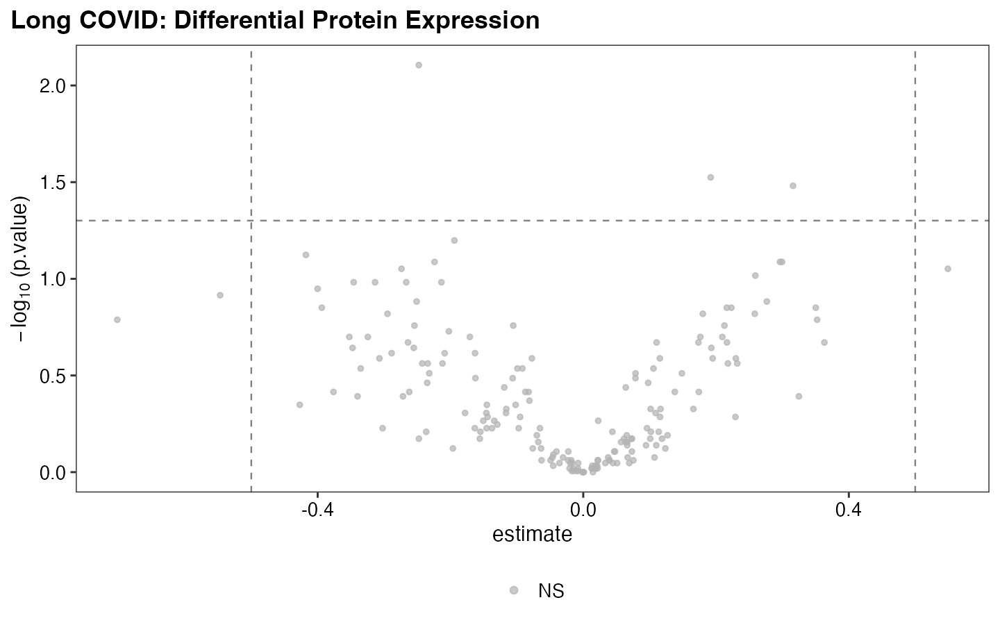
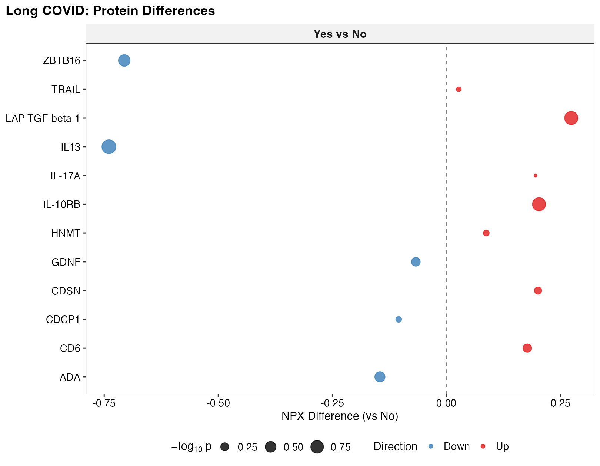
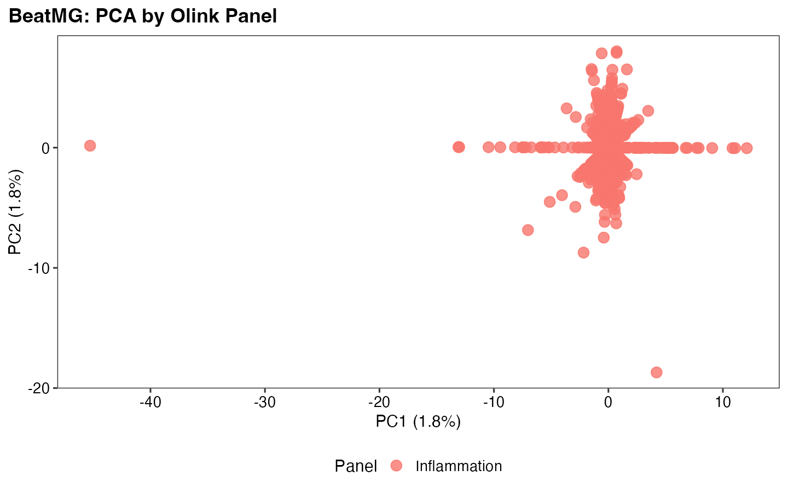
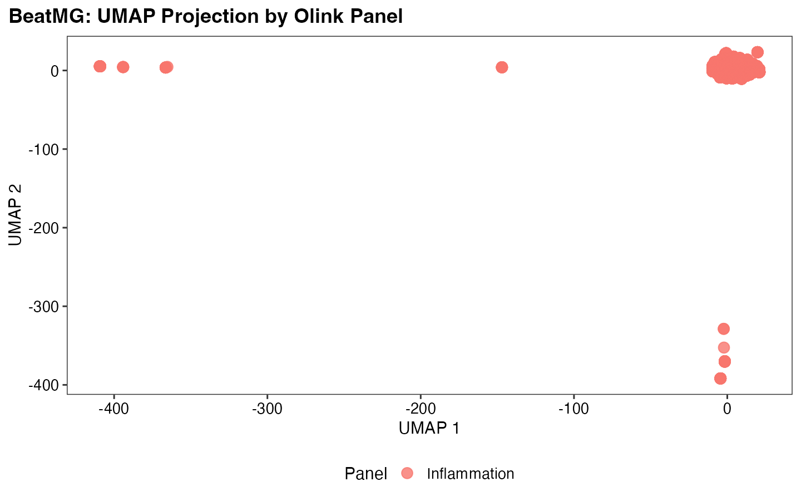
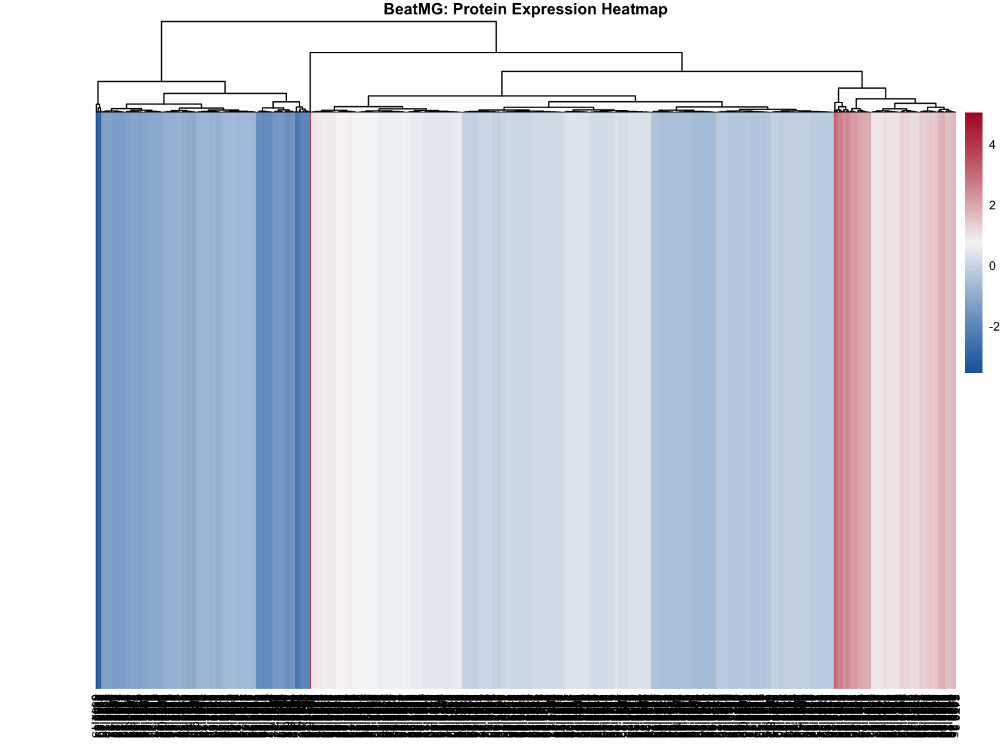
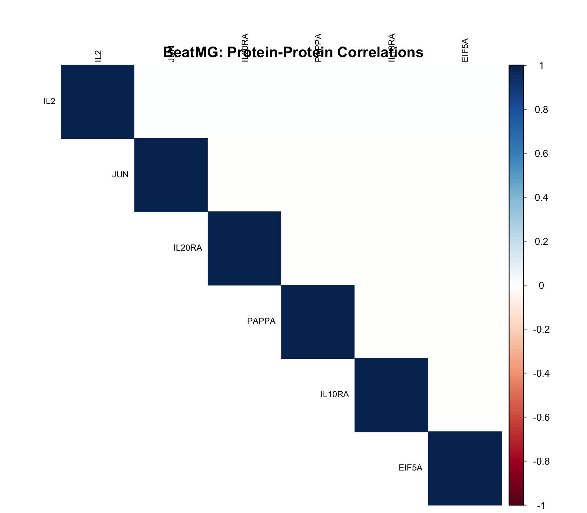
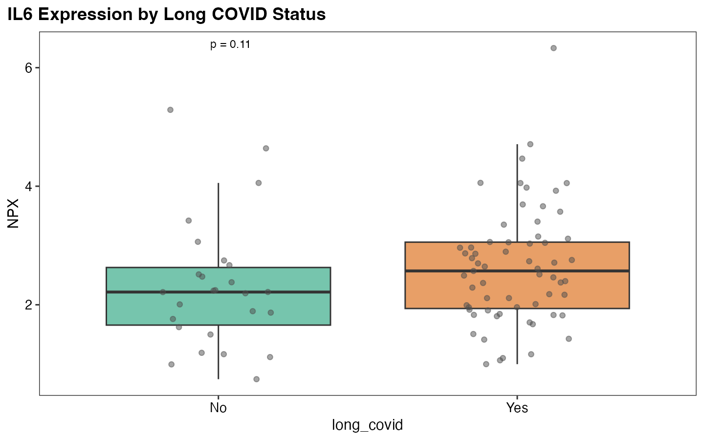
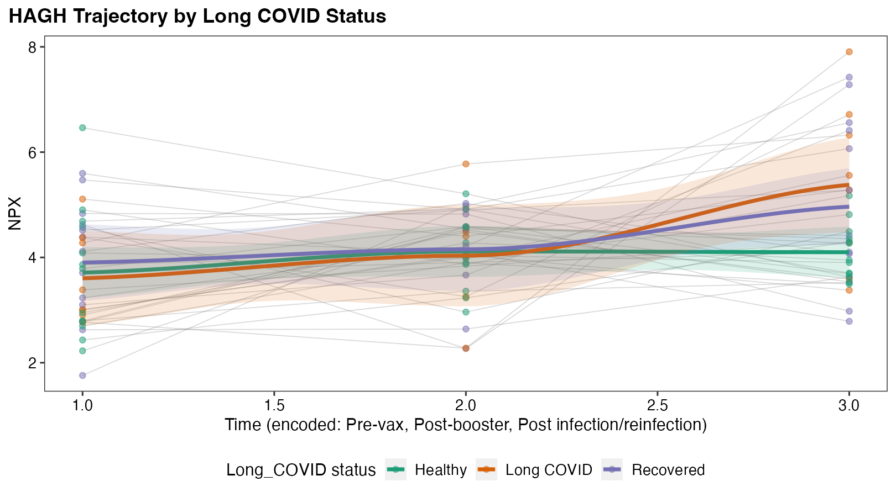
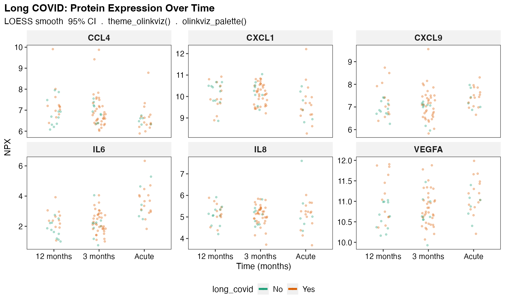

<div align="center">
  <h1>🧬 OlinkViz</h1>
  <h3><em>Visualization Toolkit for Olink Proteomics Data</em></h3>
  <br>

  [](https://lifecycle.r-lib.org/articles/stages.html)
  [](https://github.com/vanhungtran/OlinkViz/actions)
  [](https://opensource.org/licenses/MIT)
  [](https://doi.org/10.5281/zenodo.XXXXXXX)
</div>

<br>

> 🔬 **Ready-made, publication-quality visualizations for Olink NPX proteomics data — with 11 curated study datasets and an interactive Shiny dashboard.**
> Volcano plots · Heatmaps · PCA · UMAP · Boxplots · Dot plots · Correlation matrices · Longitudinal trajectories

---

## ✨ What is OlinkViz?

You've run your Olink assay and have a table of NPX values. Now you need to **explore, visualize, and communicate** your results — with plots that are ready for publication, not drafts you'll have to polish later.

**OlinkViz** gives you a complete visualization toolbox that understands Olink data structures out of the box:

```r
library(OlinkViz)

# One line to a publication-ready volcano plot
plot_volcano(bansal_univariate,
  pval_col  = "p.value",
  fc_col    = "estimate",
  assay_col = "Assay"
)

# Or explore everything interactively
run_shiny()
```

All plots use a clean, consistent theme and a colorblind-friendly palette. Every function handles the tedious preprocessing — **wide/long pivoting, replicate averaging, NA imputation with warnings, zero-variance filtering** — so you can focus on the biology.

---

## 🚀 Install

```r
remotes::install_github("vanhungtran/OlinkViz")
library(OlinkViz)
```

---

## 🎨 Gallery

### Differential Expression

<div align="center">

| Volcano Plot | Dot Plot |
|:---:|:---:|
| [](man/figures/readme-volcano.png) | [](man/figures/readme-dotplot.png) |
| *Fold change vs significance* | *Multi-protein effect sizes × significance* |

</div>

### Dimensionality Reduction

<div align="center">

| PCA | UMAP |
|:---:|:---:|
| [](man/figures/readme-pca.png) | [](man/figures/readme-umap.png) |
| *Linear projection with group ellipses* | *Non-linear manifold projection* |

</div>

### Expression Patterns

<div align="center">

| Heatmap | Correlation Matrix |
|:---:|:---:|
| [](man/figures/readme-heatmap.png) | [](man/figures/readme-corr.png) |
| *Clustered protein expression × samples* | *Protein-protein Spearman correlations* |

</div>

### Single-Protein & Longitudinal Views

<div align="center">

| Boxplot | Trajectory |
|:---:|:---:|
| [](man/figures/readme-boxplot.png) | [](man/figures/readme-trajectory.png) |
| *Group comparison with jittered points* | *Individual paths + group LOESS smooth* |

</div>

### Built-in Theme & Palette

<div align="center">

[](man/figures/readme-theme.png)

*Five proteins over time  ·  `theme_olinkviz()`  ·  `olinkviz_palette()`*

</div>

---

## 🧪 Quick Reference

<table>
<tr>
<td width="50%" valign="top">

**🔬 Differential Expression**
```r
plot_volcano(bansal_univariate,
  pval_col  = "p.value",
  fc_col    = "estimate",
  assay_col = "Assay")

plot_dotplot(data,
  group  = "Timepoint",
  assays = c("IL6","TNF","IFNG"),
  top_n  = 15)
```

</td>
<td width="50%" valign="top">

**📊 Dimensionality Reduction**
```r
plot_pca(data, color_by = "Panel",
         ellipse = TRUE)

plot_umap(data, color_by = "Panel",
          n_neighbors = 10, seed = 42)

plot_heatmap(data, scale = "row",
             show_rownames = FALSE)
```

</td>
</tr>
<tr>
<td width="50%" valign="top">

**🔍 Single-Protein & Longitudinal**
```r
plot_boxplot(data,
  assay = "IL6",
  group = "long_covid")

plot_trajectory(data,
  subject_id = "Patient",
  time       = "Time",
  assay      = "HAGH",
  group      = "Long_COVID status")
```

</td>
<td width="50%" valign="top">

**🗺️ Survey-Level**
```r
plot_corr(data, method = "spearman",
          top_n = 25,
          display_method = "color")
```

</td>
</tr>
</table>

---

## 📦 Bundled Datasets

11 curated Olink datasets from published studies are bundled with the package:

| Dataset | Study | Proteins | Samples | Description |
|---------|-------|:--------:|:-------:|-------------|
| `iris_longcovid` | IRIS | 180 | ~2,300 | Long COVID (7 time points) |
| `bansal_baseline57` | Bansal | 182 | 57 | Long COVID baseline |
| `bansal_longitudinal` | Bansal | 182 | 34 | Long COVID paired longitudinal |
| `bansal_univariate` | Bansal | 182 | — | Per-protein Wilcoxon results |
| `beatmg_npx` | BeatMG | 738 | ~2,000 | Myasthenia Gravis NPX |
| `beatmg_npx_merged` | BeatMG | 738 | ~2,000 | MG NPX + demographics |
| `beatmg_demo` | BeatMG | — | 52 | MG clinical variables |
| `pcnsl_olink` | Study 20815686 | 1,007 | 172 | Primary CNS lymphoma |
| `qinfeng_npx` | Qinfeng 2025 | 92 | 66 | Tuberculosis biomarkers |
| `tofa_data` | TOFA | Multiple | — | Down Syndrome NPX |
| `tofa_dictionary` | TOFA | — | — | TOFA variable dictionary |

```r
data(package = "OlinkViz")   # list all datasets
?iris_longcovid               # dataset documentation
```

---

## 🛠️ Data Utilities

| Function | What it does |
|----------|-------------|
| `validate_npx()` | Check data has required NPX columns (assay, value, sample) |
| `to_wide()` | Long → wide format with replicate averaging and metadata preservation |
| `to_long()` | Wide → long format with auto-detection of protein columns |
| `theme_olinkviz()` | Clean, publication-ready ggplot2 theme |
| `olinkviz_palette()` | Colorblind-friendly categorical palette (Dark2 + interpolation) |
| `run_shiny()` | Launch interactive Shiny dashboard |

```r
# Validate your data
validate_npx(my_data)

# Convert between formats
wide <- to_wide(long_data)
long <- to_long(wide, id_cols = "SampleID")
```

---

## 🖥️ Interactive Shiny App

```r
OlinkViz::run_shiny()
```

- Browse all 11 built-in datasets with variable descriptions
- Upload your own CSV or Excel NPX files
- Select from 8 plot types with adjustable parameters
- Filter by assay, timepoint, and group
- Download publication-ready plots as PNG or PDF

---

## 📖 Vignettes

| Vignette | What you'll learn |
|----------|-------------------|
| [Getting Started](https://vanhungtran.github.io/OlinkViz/articles/OlinkViz.html) | Installation, first plots, data utilities, complete workflow |

---

## 📖 Citation

If you use `OlinkViz` in your work, please cite:

```bibtex
@software{tran2026olinkviz,
  author    = {{Lucas VHH TRAN}},
  title     = {OlinkViz: Visualization Toolkit for Olink Proteomics Data},
  year      = {2026},
  publisher = {Zenodo},
  version   = {0.1.0},
  doi       = {10.5281/zenodo.XXXXXXX}
}
```

---

## 🤝 Contributing

Bug reports, feature requests, and pull requests are welcome.
See [CONTRIBUTING.md](CONTRIBUTING.md) and the [Code of Conduct](CODE_OF_CONDUCT.md).

---

## 📜 License

MIT © 2025 Lucas VHH TRAN. See [LICENSE.md](LICENSE.md).

---

<div align="center">
<br>
<em>Built with 🧬 and 📊 for the Olink proteomics community.</em>
<br><br>
</div>
