# Getting Started with OlinkViz

## Overview

**OlinkViz** provides ready-made, publication-quality visualization
functions tailored to [Olink](https://olink.com) NPX proteomics data. It
bundles 11 curated datasets from published studies and includes an
interactive Shiny application for data exploration.

### Installation

``` r
# From source:
install.packages("OlinkViz_0.1.0.tar.gz", repos = NULL, type = "source")

# Or with devtools:
# devtools::install("path/to/OlinkViz")
```

### Bundled Datasets

| Dataset | Study | Rows | Cols | Description |
|----|----|----|----|----|
| `iris_longcovid` | IRIS — [10.5281/zenodo.13363117](https://doi.org/10.5281/zenodo.13363117) | 16,020 | 7 | Long COVID NPX data (7 time points) |
| `pcnsl_olink` | PCNSL — [10.5281/zenodo.20815686](https://doi.org/10.5281/zenodo.20815686) | 172 | 1,010 | Primary CNS lymphoma (wide) |
| `beatmg_npx` | BeatMG — [10.1212/WNL.0000000000013121](https://doi.org/10.1212/WNL.0000000000013121) | 112,176 | 19 | Myasthenia Gravis NPX (long) |
| `beatmg_demo` | BeatMG — [10.1212/WNL.0000000000013121](https://doi.org/10.1212/WNL.0000000000013121) | 52 | 42 | MG demographics |
| `beatmg_npx_merged` | BeatMG — [10.1212/WNL.0000000000013121](https://doi.org/10.1212/WNL.0000000000013121) | 112,176 | 60 | MG NPX + demographics merged |
| `bansal_baseline57` | Bansal — [10.1038/s43856-026-01541-6](https://doi.org/10.1038/s43856-026-01541-6) | 10,374 | 24 | Long COVID baseline (182 proteins) |
| `bansal_univariate` | Bansal — [10.1038/s43856-026-01541-6](https://doi.org/10.1038/s43856-026-01541-6) | 182 | 14 | Per-protein Wilcoxon test results |
| `bansal_longitudinal` | Bansal — [10.1038/s43856-026-01541-6](https://doi.org/10.1038/s43856-026-01541-6) | 18,294 | 24 | Long COVID paired longitudinal |
| `qinfeng_npx` | Song 2025 — [10.1007/s00011-025-02020-9](https://doi.org/10.1007/s00011-025-02020-9) | 66 | 97 | Tuberculosis biomarkers (wide) |
| `tofa_data` | TOFA — [10.7554/elife.99323](https://doi.org/10.7554/elife.99323) | 453,684 | 16 | Down Syndrome NPX (long) |
| `tofa_dictionary` | TOFA — [10.7554/elife.99323](https://doi.org/10.7554/elife.99323) | 15 | 3 | TOFA variable descriptions |
| `probc` | NUMAB project B (simulated) | 35,328 | 22 | Simulated 2-group longitudinal NPX |

## Quick Start

``` r
library(OlinkViz)
library(ggplot2)
library(dplyr)  # for %>%
```

### Inspecting a Dataset

Each dataset can be examined directly. Let’s look at the IRIS Long COVID
data:

``` r
str(iris_longcovid)
#> Classes 'data.table' and 'data.frame':   16020 obs. of  7 variables:
#>  $ Assay       : chr  "IL8" "IL8" "IL8" "IL8" ...
#>  $ NPX         : num  5.22 5.82 5.14 5.17 5.18 ...
#>  $ Sex         : Factor w/ 2 levels "Female","Male": 2 1 1 2 2 1 1 2 2 2 ...
#>  $ IRIS_number : int  10 58 74 18 17 39 28 71 3 48 ...
#>  $ Panel       : chr  "Olink Inflammation" "Olink Inflammation" "Olink Inflammation" "Olink Inflammation" ...
#>  $ long_covid  : Factor w/ 2 levels "No","Yes": 1 1 2 2 2 2 2 1 2 2 ...
#>  $ timing_month: chr  "3 months" "3 months" "3 months" "3 months" ...
#>  - attr(*, ".internal.selfref")=<pointer: (nil)>
```

``` r
# Unique assays in the dataset
length(unique(iris_longcovid$Assay))
#> [1] 180
```

``` r
# Groups and time points available
table(iris_longcovid$long_covid, iris_longcovid$timing_month)
#>      
#>       12 months 3 months Acute
#>   No       1980     1620  1080
#>   Yes      2160     6480  2700
```

------------------------------------------------------------------------

## The OlinkExperiment Object

OlinkViz 0.1.2 introduces the `OlinkExperiment` S4 class, a container
for Olink proteomics data modeled on Bioconductor’s
[`SingleCellExperiment`](https://bioconductor.org/packages/SingleCellExperiment).
Rows are **proteins**, columns are **samples**; different
quantifications (NPX, LOD, protein counts) live in the `assays` slot,
protein annotation in `rowData`, sample annotation in `colData`, and
dimensionality reductions in `reducedDims`.

``` r
library(SummarizedExperiment)  # for colData(), rowData(), as()
```

### Build from raw long-format data

[`oe_from_long()`](https://vanhungtran.github.io/OlinkViz/reference/oe_from_long.md)
builds an `OlinkExperiment` from a long NPX table (one row per assay per
sample). Assay/value/sample columns are auto-detected; the remaining
columns are split into `rowData` (per-protein) and `colData`
(per-sample); an optional `LOD` column becomes a parallel assay.

``` r
oe <- oe_from_long(iris_longcovid)
oe
#> class: OlinkExperiment 
#> dim: 180 45 
#> metadata(0):
#> assays(1): NPX
#> rownames(180): IL8 VEGFA ... ITGB6 BTN3A2
#> rowData names(2): Assay Panel
#> colnames(45): 10 58 ... 6 7
#> colData names(4): IRIS_number Sex long_covid timing_month
#> reducedDimNames(0):
```

``` r
dim(npx(oe))
#> [1] 180  45
colnames(colData(oe))
#> [1] "IRIS_number"  "Sex"          "long_covid"   "timing_month"
colnames(rowData(oe))
#> [1] "Assay" "Panel"
```

### Build from a wide NPX matrix

Use the base
[`OlinkExperiment()`](https://vanhungtran.github.io/OlinkViz/reference/OlinkExperiment.md)
constructor directly:

``` r
# A long table that includes LOD values
oe <- oe_from_long(beatmg_npx[beatmg_npx$Timepoint == 1, ])

oe2 <- OlinkExperiment(
  assays  = list(NPX = npx(oe), LOD = lod(oe)),
  colData = colData(oe),
  rowData = rowData(oe)
)
oe2
#> class: OlinkExperiment 
#> dim: 730 49 
#> metadata(0):
#> assays(2): NPX LOD
#> rownames(730): IL2 IL10RA ... SERPINC1 CFH
#> rowData names(11): Assay Timepoint ... Normalization ExploreVersion
#> colnames(49): 5458 5484 ... 2757 6487
#> colData names(6): SampleID SubjectID ... PlateID Assay_Warning
#> reducedDimNames(0):
```

### Accessors

[`npx()`](https://vanhungtran.github.io/OlinkViz/reference/npx.md) and
[`lod()`](https://vanhungtran.github.io/OlinkViz/reference/npx.md)
mirror the named-assay accessors of `SingleCellExperiment` (like
`counts()`/`logcounts()`):

``` r
dim(npx(oe2))   # NPX assay, proteins x samples
#> [1] 730  49
dim(lod(oe2))   # LOD assay, parallel to NPX
#> [1] 730  49
head(colData(oe2))
#> DataFrame with 6 rows and 6 columns
#>       SampleID   SubjectID         PID     Index          PlateID Assay_Warning
#>      <integer> <character> <character> <integer>      <character>   <character>
#> 5458      5458      5458_1      1001_1         1 Q-05705_SS230103          PASS
#> 5484      5484      5484_1      1012_1         4 Q-05705_SS230103          PASS
#> 6711      6711      6711_1      1025_1         8 Q-05705_SS230103          PASS
#> 6592      6592      6592_1      1035_1        11 Q-05705_SS230103          PASS
#> 5827      5827      5827_1      1004_1        14 Q-05705_SS230103          PASS
#> 4148      4148      4148_1      1015_1        17 Q-05705_SS230103          PASS
head(rowData(oe2))
#> DataFrame with 6 rows and 11 columns
#>              Assay Timepoint Sample_Type     OlinkID     UniProt MissingFreq
#>        <character> <integer> <character> <character> <character>   <numeric>
#> IL2            IL2         1      SAMPLE    OID20419      P60568      0.2297
#> IL10RA      IL10RA         1      SAMPLE    OID20420      Q13651      0.0068
#> PAPPA        PAPPA         1      SAMPLE    OID20421      Q13219      0.0000
#> IL20RA      IL20RA         1      SAMPLE    OID20422      Q9UHF4      0.0203
#> EIF5A        EIF5A         1      SAMPLE    OID20423      P63241      0.2905
#> JUN            JUN         1      SAMPLE    OID20424      P05412      0.0068
#>               Panel Panel_Lot_Nr  QC_Warning Normalization ExploreVersion
#>         <character>  <character> <character>   <character>    <character>
#> IL2    Inflammation       E50005        PASS     Intensity          3.0.5
#> IL10RA Inflammation       E50005        PASS     Intensity          3.0.5
#> PAPPA  Inflammation       E50005        PASS     Intensity          3.0.5
#> IL20RA Inflammation       E50005        PASS     Intensity          3.0.5
#> EIF5A  Inflammation       E50005        PASS     Intensity          3.0.5
#> JUN    Inflammation       E50005        PASS     Intensity          3.0.5
```

### Storing dimensionality reductions

PCA/UMAP/t-SNE coordinates are stored via
[`reducedDims()`](https://vanhungtran.github.io/OlinkViz/reference/reducedDims.md),
one matrix per result with one row per sample:

``` r
pca <- matrix(rnorm(ncol(oe2) * 5), ncol = 5,
              dimnames = list(colnames(oe2), paste0("PC", 1:5)))
reducedDims(oe2) <- S4Vectors::SimpleList(PCA = pca)
reducedDim(oe2, "PCA")[1:3, 1:3]
#>             PC1        PC2        PC3
#> 5458 -1.4000435 -1.9117205  1.3168264
#> 5484  0.2553171  0.8620865 -0.2966400
#> 6711 -2.4372636 -0.2432367 -0.3872136
```

### Subsetting, combining and coercion

The object behaves like a `SummarizedExperiment`: subset with `[`,
combine with
[`cbind()`](https://rdrr.io/r/base/cbind.html)/[`rbind()`](https://rdrr.io/r/base/cbind.html),
and coerce with [`as()`](https://rdrr.io/r/methods/as.html):

``` r
oe2[1:10, 1:5]                       # first 10 proteins x 5 samples
#> class: OlinkExperiment 
#> dim: 10 5 
#> metadata(0):
#> assays(2): NPX LOD
#> rownames(10): IL2 IL10RA ... IL1B IL33
#> rowData names(11): Assay Timepoint ... Normalization ExploreVersion
#> colnames(5): 5458 5484 6711 6592 5827
#> colData names(6): SampleID SubjectID ... PlateID Assay_Warning
#> reducedDimNames(1): PCA
rbind(oe2, oe2)                      # combine row-wise (identical reducedDims)
#> class: OlinkExperiment 
#> dim: 1460 49 
#> metadata(0):
#> assays(2): NPX LOD
#> rownames(1460): IL2 IL10RA ... SERPINC1 CFH
#> rowData names(11): Assay Timepoint ... Normalization ExploreVersion
#> colnames(49): 5458 5484 ... 2757 6487
#> colData names(6): SampleID SubjectID ... PlateID Assay_Warning
#> reducedDimNames(1): PCA
as(oe2, "SummarizedExperiment")      # back to a plain SE
#> class: SummarizedExperiment 
#> dim: 730 49 
#> metadata(0):
#> assays(2): NPX LOD
#> rownames: NULL
#> rowData names(0):
#> colnames(49): 5458 5484 ... 2757 6487
#> colData names(6): SampleID SubjectID ... PlateID Assay_Warning
```

### Plotting directly from an `OlinkExperiment`

All `plot_*()` functions accept an `OlinkExperiment` directly: they
convert it to the long format internally, so `colData` columns
(e.g. `Group`, `long_covid`) and `rowData` columns (e.g. `Panel`) are
available for grouping without any extra steps:

``` r
oe_iris <- oe_from_long(iris_longcovid)
plot_boxplot(oe_iris, assay = "CD40", group = "long_covid")
```

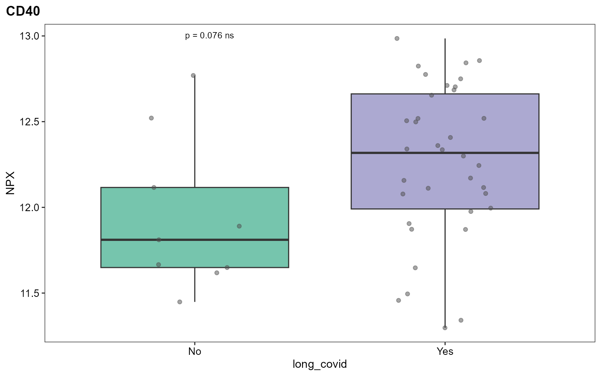

For a one-stop dimensionality-reduction plot, use
[`plot_dim_reduc()`](https://vanhungtran.github.io/OlinkViz/reference/plot_dim_reduc.md).
It computes PCA/UMAP/t-SNE on the fly (or re-uses a reduction already
stored in
[`reducedDims()`](https://vanhungtran.github.io/OlinkViz/reference/reducedDims.md))
and colors points by any sample covariate. Several reductions can be
plotted **jointly** in a single multi-panel figure:

``` r
plot_dim_reduc(oe_iris, type = "pca", color = "long_covid")
```

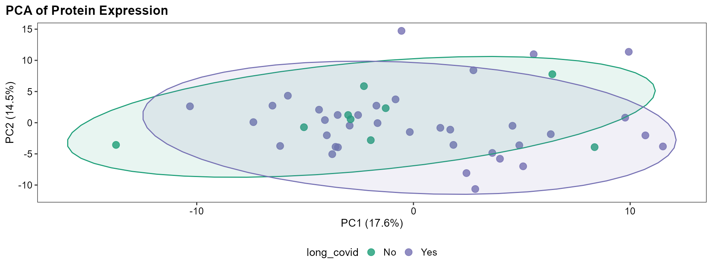

``` r
plot_dim_reduc(oe_iris, type = c("pca", "umap", "tsne"),
               color = "long_covid", perplexity = 10)
```

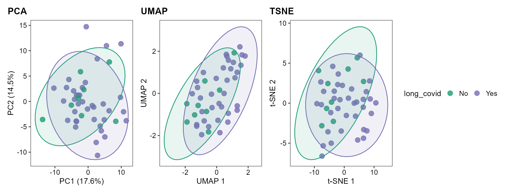

You can still extract the raw matrices with
[`npx()`](https://vanhungtran.github.io/OlinkViz/reference/npx.md) /
[`lod()`](https://vanhungtran.github.io/OlinkViz/reference/npx.md) /
[`colData()`](https://rdrr.io/pkg/SummarizedExperiment/man/SummarizedExperiment-class.html)
/
[`rowData()`](https://rdrr.io/pkg/SummarizedExperiment/man/SummarizedExperiment-class.html)
when you need them directly.

------------------------------------------------------------------------

## Plotting Functions

### 1. Boxplot — Single Protein by Group

Compare NPX values for a single protein across groups, with optional
statistical test annotations.

``` r
plot_boxplot(iris_longcovid, assay = "CD40", group = "long_covid")
```

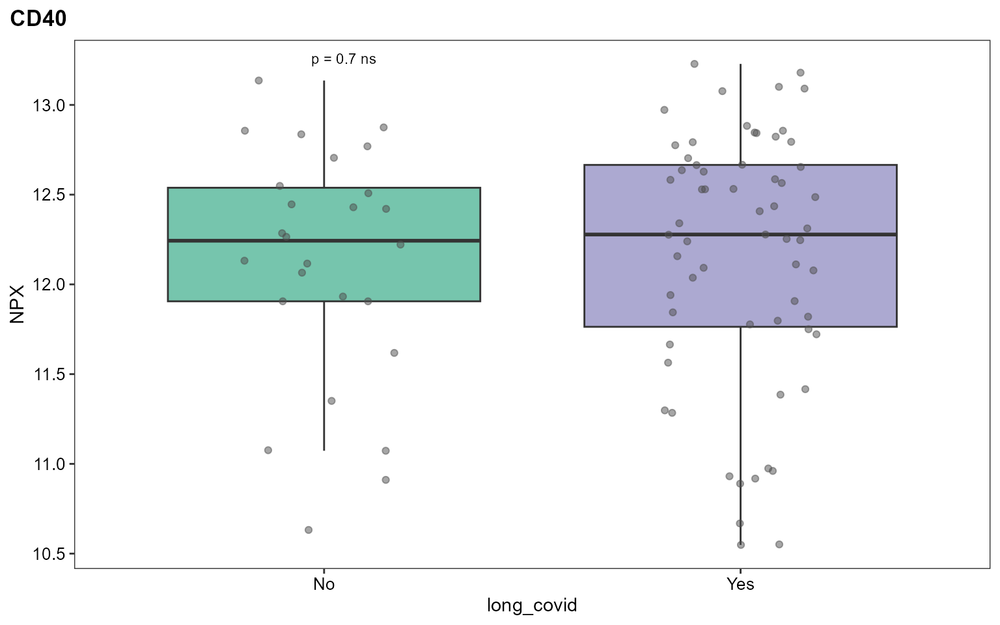

With custom comparisons (requires the `ggpubr` package):

``` r
plot_boxplot(
  iris_longcovid,
  assay       = "CD40",
  group       = "timing_month",
  test        = "wilcox.test",
  comparisons = list(c("Acute", "3 months"), c("3 months", "12 months")),
  title       = "CD40 Expression Over Time"
)
```

### 2. Volcano Plot — Differential Expression

Visualize fold change versus significance for each protein. The function
validates p-values and handles exact zeros gracefully.

``` r
# Using the Bansal univariate test results. bansal_univariate's `estimate`
# is on a much smaller natural scale than a typical log2 fold change, so
# fc_threshold needs to be set accordingly (the default of 1 would mark
# every point "NS" here) — see ?plot_volcano.
plot_volcano(
  bansal_univariate,
  pval_col       = "p.value",
  fc_col         = "estimate",
  assay_col      = "Assay",
  pval_threshold = 0.05,
  fc_threshold   = 0.1,
  max_labels     = 10,
  title          = "Long COVID: Protein Differential Expression"
)
```

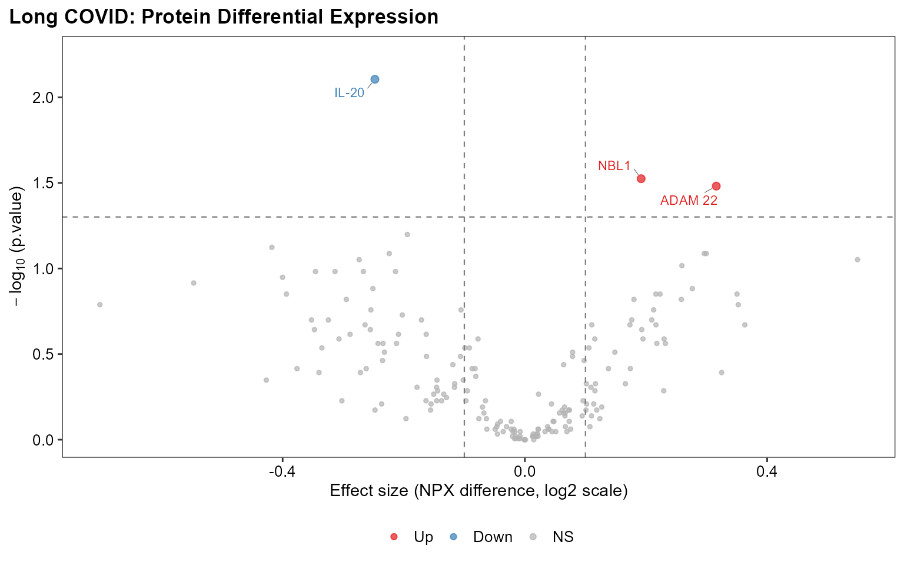

For raw fold-change ratios (not yet log2-transformed), set
`transform_fc = TRUE`:

``` r
plot_volcano(de_results, pval_col = "pval", fc_col = "FC",
             transform_fc = TRUE)
```

### 3. Dimensionality Reduction — PCA / UMAP / t-SNE

Project samples onto a low-dimensional representation, colored by a
grouping variable with optional confidence ellipses.
[`plot_dim_reduc()`](https://vanhungtran.github.io/OlinkViz/reference/plot_dim_reduc.md)
computes PCA, UMAP, or t-SNE on the fly and can combine several
reductions into one figure.

``` r
plot_dim_reduc(beatmg_npx_merged, type = "pca", color = "Timepoint",
               title = "BeatMG: PCA by Timepoint")
```


Without grouping, all points are shown in a single color:

``` r
plot_dim_reduc(beatmg_npx_merged[beatmg_npx_merged$Timepoint == 1, ],
               type = "pca", title = "BeatMG Baseline Samples")
```

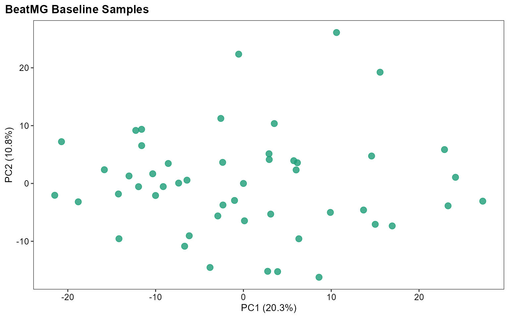

### 4. UMAP — Non-Linear Projection

UMAP captures non-linear structure that PCA may miss. The `seed`
parameter ensures reproducibility.

``` r
plot_umap(beatmg_npx_merged, color_by = "Timepoint",
          n_neighbors = 10, seed = 42,
          title = "BeatMG: UMAP by Timepoint")
```

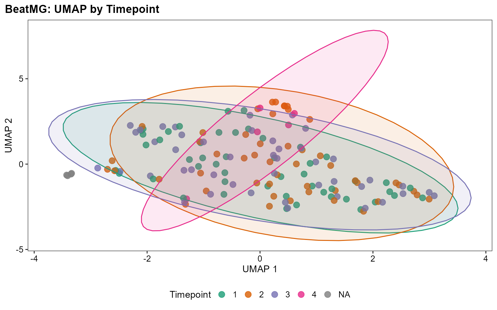

### 5. Heatmap — Clustered Expression Matrix

Proteins are clustered by expression pattern. NAs are imputed with
column means and a warning is issued. The function accepts both long and
wide formats.

``` r
# Long-format input (rows clustered, columns as samples)
plot_heatmap(
  beatmg_npx_merged[beatmg_npx_merged$Timepoint == 1, ],
  sample_col = "SampleID",
  scale      = "row",
  show_rownames = FALSE,
  main       = "BeatMG Baseline Protein Expression"
)
```

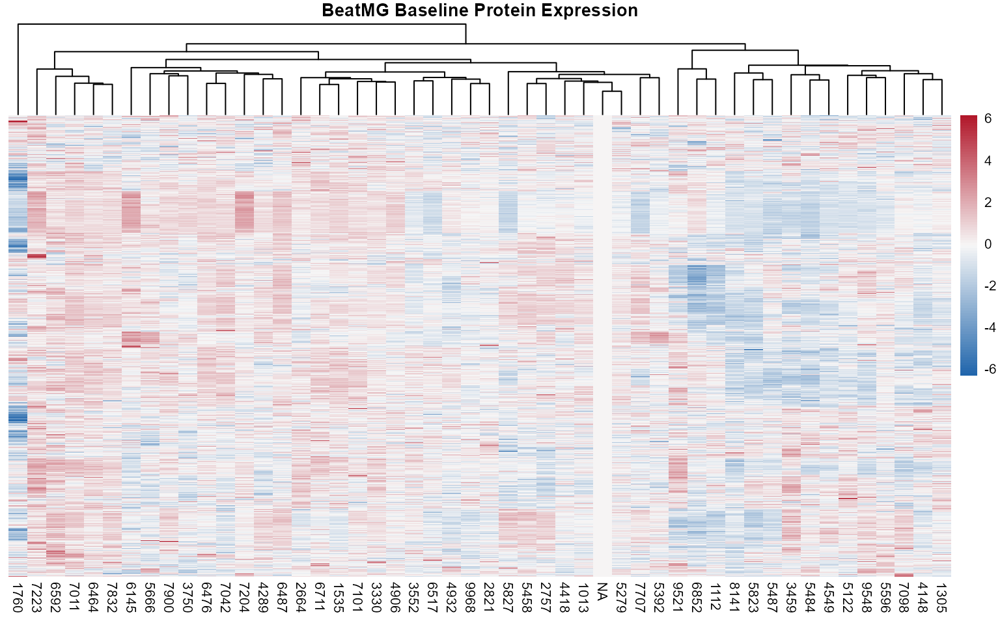

When given an `OlinkExperiment`, the sample covariates stored in
[`colData()`](https://rdrr.io/pkg/SummarizedExperiment/man/SummarizedExperiment-class.html)
(e.g. `Sex`, `long_covid`, `timing_month`) are shown automatically as
annotation tracks above the samples. Pass `annotation_cols` to select a
specific subset:

``` r
plot_heatmap(oe_iris, scale = "row", show_rownames = FALSE,
             main = "Long COVID: Protein Expression by Covariate")
```

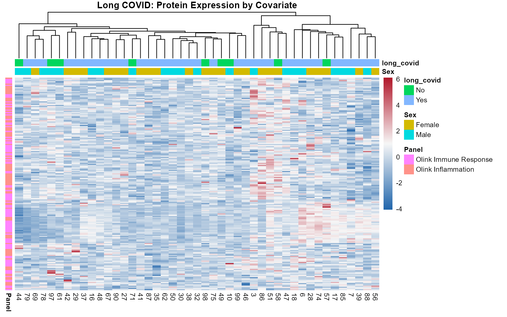

Biomarkers can also be grouped into **sets** (e.g. the Olink panel each
protein belongs to) with a row annotation track, via `annotation_rows`
(automatically filled from `rowData` for an `OlinkExperiment`):

``` r
plot_heatmap(oe_iris, scale = "row", show_rownames = FALSE,
             annotation_rows = "Panel",
             main = "Long COVID: Protein Expression by Biomarker Set")
```


To group the biomarkers by their **enriched pathways** instead of by
Olink panel, set `pathway_annotation = TRUE` (or pass a precomputed
protein → pathway mapping) — see [Pathway Enrichment & Protein
Networks](#pathway-enrichment-protein-networks) below for a full,
runnable example with
[`enrich_pathways()`](https://vanhungtran.github.io/OlinkViz/reference/enrich_pathways.md).

Wide-format input with `wide = TRUE`:

``` r
# qinfeng_npx is already wide: 66 samples x 92 proteins
plot_heatmap(qinfeng_npx, wide = TRUE, sample_col = "SampleID",
             scale = "column", show_colnames = FALSE,
             main = "Tuberculosis Biomarker Profiles")
```

### 6. Dot Plot — Multi-Protein Comparison

Dot size encodes significance (-log10 p-value); color encodes direction
of change. Useful for survey-level views across many proteins.

``` r
plot_dotplot(
  beatmg_npx_merged,
  group   = "Timepoint",
  assays  = c("CD83", "CXCL8", "CD40", "CD70", "CCL20",
              "TNFRSF4", "TNF", "IL6", "CXCL10", "IFNG",
              "CCL3", "CCL4", "IL10", "TGFB1", "VEGFA"),
  top_n   = 15,
  title   = "BeatMG: Protein Changes vs Baseline"
)
```

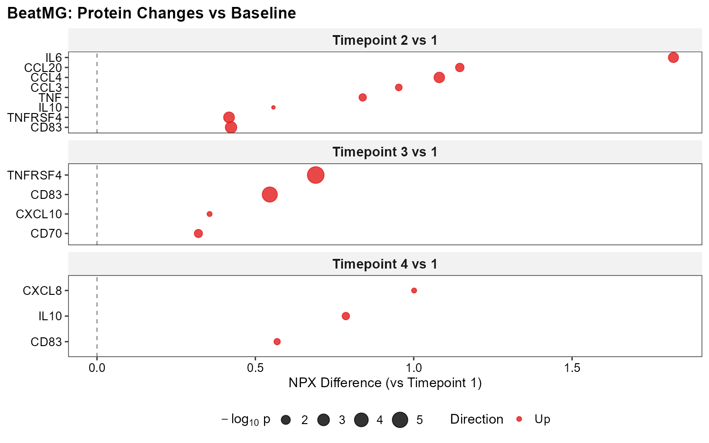

If an assay name is misspelled, a warning is now emitted instead of
silently omitting it.

### 7. Correlation Matrix

Compute pairwise correlations between the most variable proteins.

``` r
plot_corr(
  beatmg_npx_merged[beatmg_npx_merged$Timepoint == 1, ],
  method    = "spearman",
  top_n     = 25,
  corr_type = "upper"
)
```


The new `display_method` parameter allows alternative visual encodings:

``` r
plot_corr(beatmg_npx_merged, method = "spearman", top_n = 15,
          display_method = "ellipse")
plot_corr(beatmg_npx_merged, method = "pearson",  top_n = 10,
          display_method = "number")
```

Valid `display_method` options are: `"color"`, `"circle"`, `"ellipse"`,
`"number"`, `"shade"`, and `"pie"`.

### 8. Longitudinal Trajectories

Individual spaghetti plots with optional group-level smoothing lines.

``` r
# Subset to a manageable number of proteins for demonstration
plot_trajectory(
  bansal_longitudinal,
  subject_id    = "Assigned Participant  ID",
  time          = "Time",
  assay         = "HAGH",
  group         = "Long_COVID status",
  smooth_method = "loess",
  title         = "HAGH Trajectory by Long COVID Status"
)
```

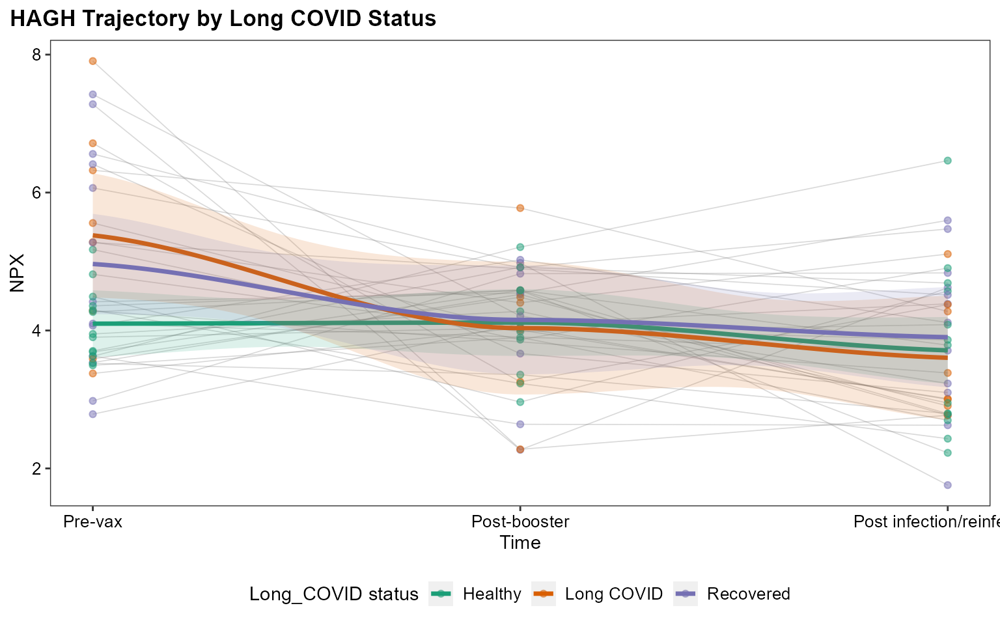

The new `facet` argument makes one panel per subject, and `lod_col` adds
a dashed “MaxLOD” reference line per panel (matching the report
figures):

``` r
plot_trajectory(
  beatmg_npx_merged,
  assay    = "IL4",
  time     = "Timepoint",
  facet    = "subject",
  lod_col  = "LOD"
)
```

### 9. Mean Profile — Mean ± CI over Time by Group

The classic “mean NPX trajectory” figure: mean ± 95% CI at each time
point, with one line per group.

``` r
plot_mean_profile(
  iris_longcovid,
  assay = "CD40",
  x     = "timing_month",
  group = "long_covid",
  title = "CD40 Mean NPX Trajectory by Long COVID Status"
)
```

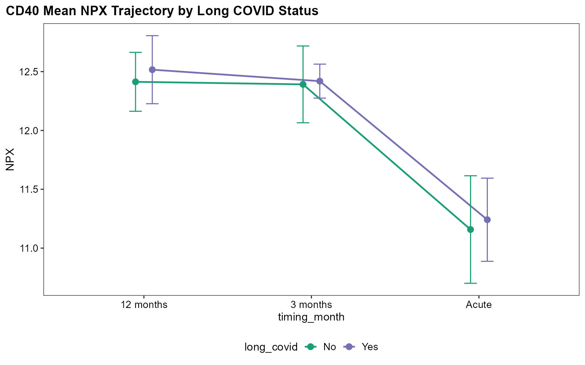

With `error_bar_type = "se"` the bars show the standard error instead of
the confidence interval. Set `add_signif = TRUE` (requires `ggpubr`) to
annotate between-group p-values at each time point.

### 10. Spaghetti Plot — Individual Trajectories Faceted by Group

One line per subject, with an overlaid trend curve, optionally faceted
by a grouping variable.

``` r
plot_spaghetti(
  bansal_longitudinal,
  assay      = "HAGH",
  subject_id = "Assigned Participant  ID",
  time       = "Time",
  facet_by   = "Long_COVID status"
)
```

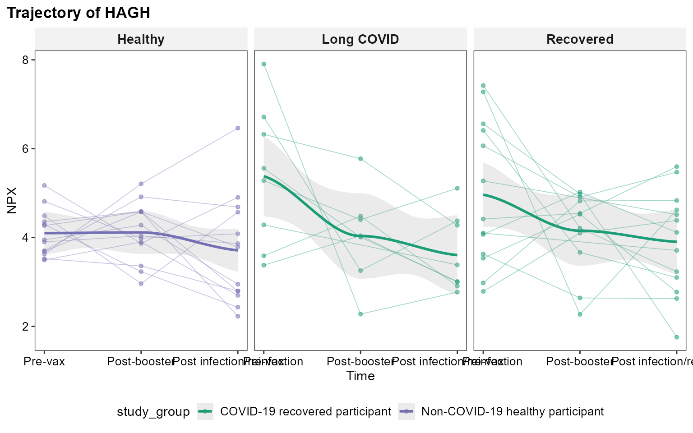

### 11. Violin + Boxplot

Distribution of a single protein across a categorical axis (e.g. time
point), with an overlaid boxplot. Optionally filled by group.

``` r
plot_violin(
  iris_longcovid,
  assay = "CD40",
  x     = "timing_month",
  group = "long_covid"
)
```


The single-assay comparison plots
([`plot_boxplot()`](https://vanhungtran.github.io/OlinkViz/reference/plot_boxplot.md),
[`plot_violin()`](https://vanhungtran.github.io/OlinkViz/reference/plot_violin.md),
[`plot_mean_profile()`](https://vanhungtran.github.io/OlinkViz/reference/plot_mean_profile.md))
can annotate p-values for **each pairwise comparison** between the
x-axis levels (here, each pair of time points) with `show_p_value`
(numeric p-values) and/or `show_significant` (significance stars). With
`show_significant = TRUE` only comparisons with p \< `p_cutoff` (default
0.05) are drawn, so the plot is not cluttered with non-significant bars;
set `p_cutoff = NULL` to show every comparison. Brackets are placed
above the data automatically (`bracket_nudge_y` adjusts the height,
`step_increase` the gap between stacked bars), so they never overlap the
points/violins. This requires the `ggpubr` package:

``` r
plot_violin(
  iris_longcovid,
  assay = "CD40",
  x     = "timing_month",
  group = "long_covid",
  show_significant = TRUE
)
```


### 12. PCA Scree Plot

Variance explained per principal component, with the cumulative line.

``` r
plot_scree(
  beatmg_npx_merged[beatmg_npx_merged$Timepoint == 1, ],
  n_pcs = 10,
  title = "BeatMG Baseline: Variance Explained"
)
```

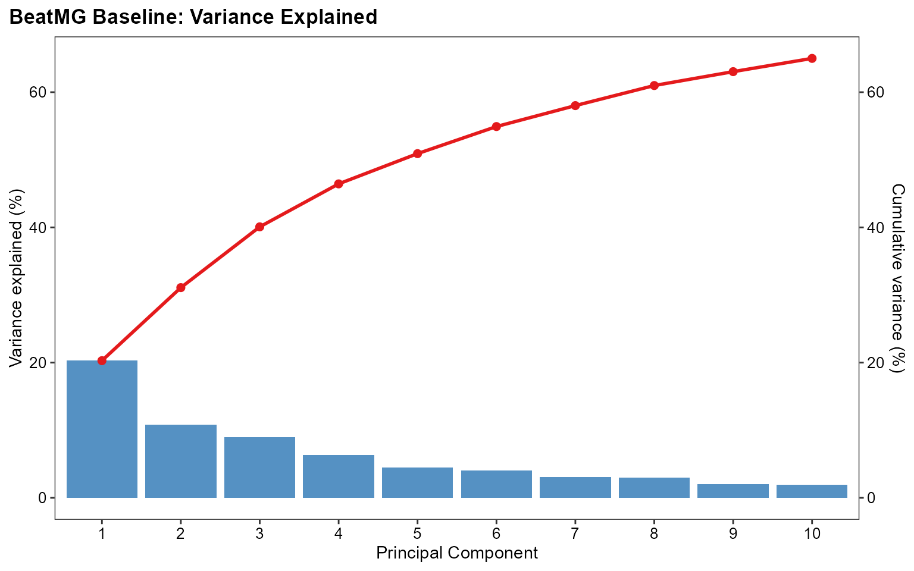

### 13. PCA Loadings Plot

The variables (proteins) with the largest loadings for each of the top
principal components.

``` r
plot_loadings(
  beatmg_npx_merged[beatmg_npx_merged$Timepoint == 1, ],
  components = 1:3,
  top_n      = 8
)
```

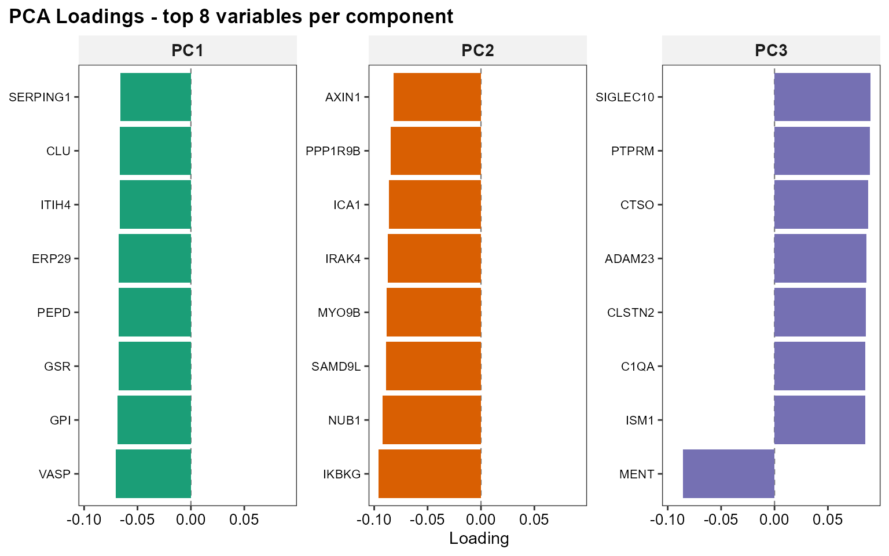

### 14. LMER Point-Range Plot

Point-range (mean ± CI) visualization of a linear mixed model, faceted
by protein. The `probc` dataset is a simulated two-group longitudinal
Olink panel (see
[`?probc`](https://vanhungtran.github.io/OlinkViz/reference/probc.md)).
Pass `add_pvalue = TRUE` to fit `value ~ x * group + (1 | random)` per
protein with `lme4` and annotate the group-effect p-value on each panel.

``` r
plot_lmer(
  probc,
  assay  = c("IL6", "TNF"),
  x      = "Timepoint",
  group  = "Project",
  random = "PPID"
)
```

### 15. Regression Scatter — Linear Smooth

Scatter of NPX against a continuous x-axis with an overlaid linear
smooth, optionally colored and/or faceted by a grouping variable.

``` r
plot_regression(
  probc,
  assay     = "IL6",
  x         = "Time",
  color_by  = "Project",
  title     = "IL6 NPX Trend (Simulated PROBC)"
)
```


### 16. Sample QC — Median NPX versus IQR

The standard sample-level quality check for Olink data. Each point is
one sample on one panel; samples whose median NPX or interquartile range
lies more than `sd_cutoff` standard deviations from the panel mean are
flagged and labelled, and samples that carry an Olink `QC_Warning` are
drawn as triangles. Colour the points by a sample-level column such as
the plate to look for batch structure.

``` r
plot_qc(probc)
```

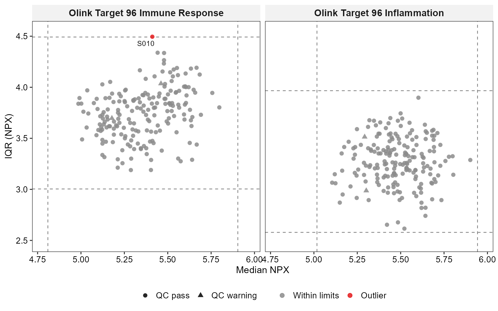

``` r
plot_qc(probc, color_by = "PlateID", sd_cutoff = 2.5, label_outliers = FALSE)
```

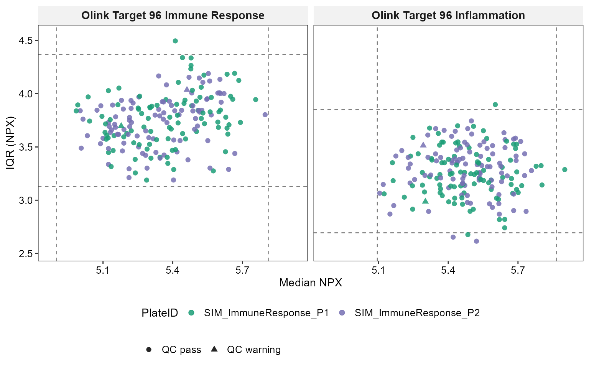

### 17. Assay Detectability — Percent of Samples Above LOD

Which proteins are worth analysing?
[`plot_lod()`](https://vanhungtran.github.io/OlinkViz/reference/plot_lod.md)
ranks every assay by the percentage of samples whose NPX is above the
limit of detection and labels the least detectable ones. The threshold
is a convention (here 75 percent), not a rule: choose it for your study.

``` r
plot_lod(probc, threshold = 75)
```

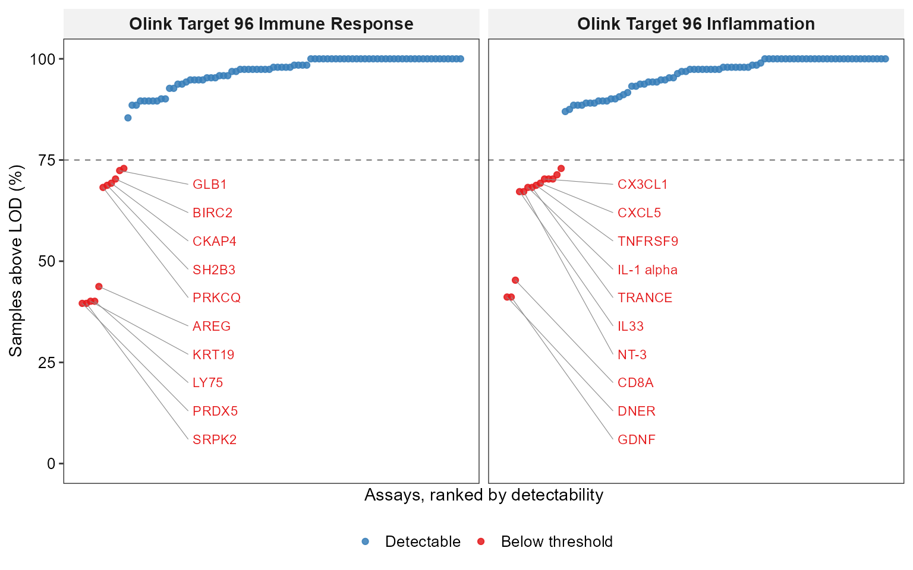

### 18. ROC Curves for Individual Proteins

ROC curves for a two-group comparison, with the AUC and its DeLong 95
percent confidence interval in the legend (requires `pROC`). Set
`show_direction = TRUE` to mark whether higher (`+`) or lower (`-`) NPX
values are associated with the positive group. Each curve is the
apparent performance of one protein on these samples; it is not
cross-validated. Subset the data to the two groups first, and to one
time point if there are repeated measures.

``` r
baseline <- probc[probc$Timepoint == 1, ]
plot_roc(baseline, assays = c("IL6", "TNF", "IL8"), group = "Project",
         show_direction = TRUE)
```

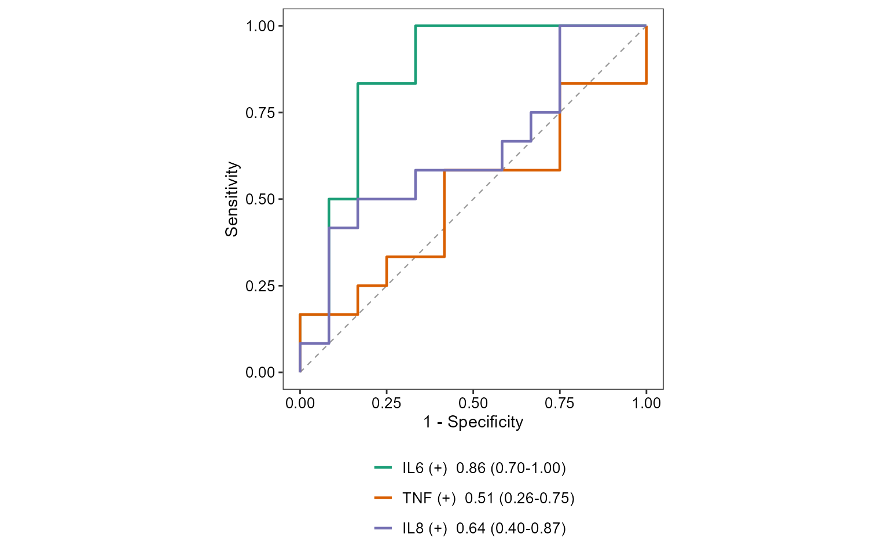

### 19. Bridge Sample & Plate QC (`plot_bridge()`, `plot_plate_qc()`)

When a study spans multiple plates or batches,
[`plot_plate_qc()`](https://vanhungtran.github.io/OlinkViz/reference/plot_plate_qc.md)
summarizes sample median NPX distributions per plate, and
[`plot_bridge()`](https://vanhungtran.github.io/OlinkViz/reference/plot_bridge.md)
draws a Bland-Altman (or scatter) comparison of overlapping bridge
reference samples:

``` r
plot_plate_qc(probc)
```

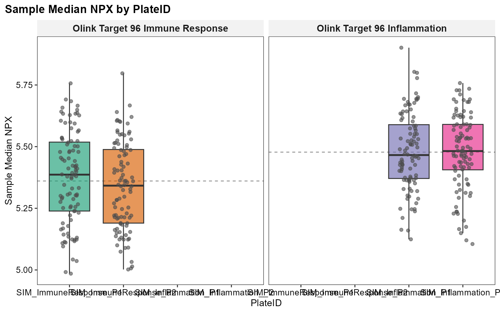

``` r
b1 <- probc[probc$Timepoint == 1, ]
b2 <- b1
b2$NPX <- b1$NPX + rnorm(nrow(b1), mean = 0.12, sd = 0.18)
plot_bridge(b1, b2, type = "bland_altman")
```


------------------------------------------------------------------------

## Journal-Size Figures

By default text and marks are sized for the screen (11 pt). A figure
that is drawn on a large canvas and shrunk to a journal column ends up
with text that is too small, or with labels that collide. Draw it at its
final size instead, with one option, and every `plot_*()` function sizes
its text and marks from it:

``` r
old <- olinkviz_options(base_size = 7, axes = "l")   # 7 pt text, left and bottom axes
p <- plot_boxplot(probc, assay = "IL6", group = "Project")
p
```

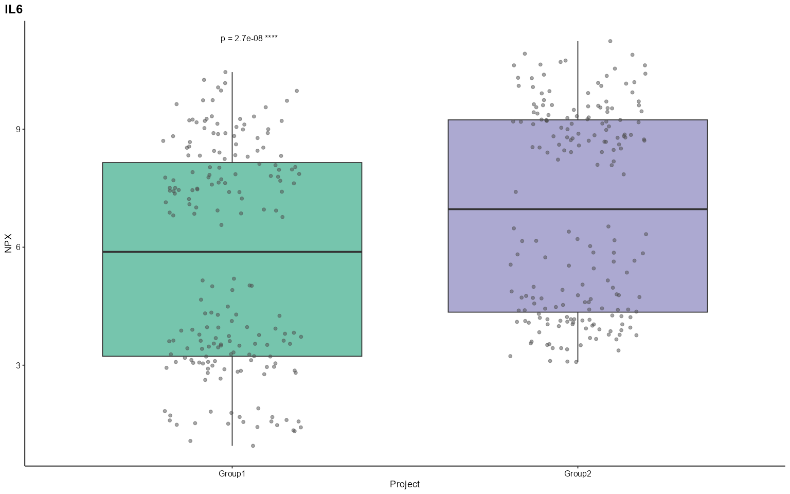

[`save_olinkviz()`](https://vanhungtran.github.io/OlinkViz/reference/save_olinkviz.md)
then writes the file at the exact physical size (89 mm is a typical
single column; check the author guidelines of your journal), with
embedded fonts in the PDF:

``` r
files <- save_olinkviz(p, file.path(tempdir(), "il6_boxplot"),
                       width = 89, height = 70, formats = c("pdf", "png"))
basename(files)
#> [1] "il6_boxplot.pdf" "il6_boxplot.png"
options(old)   # restore the previous sizing options
```

The smallest text in a plot is `base_size - 1` (the tick labels), so
choose a base size one point above the smallest text your journal
allows: 7 for most journals, 9 where the minimum is 8 pt.

Any base size below the 11 pt default is “journal-size mode”, where a
few things that depend on the canvas also adapt: long titles wrap,
[`plot_corr_triangle()`](https://vanhungtran.github.io/OlinkViz/reference/plot_corr_triangle.md)
fits its circles to the grid, a heatmap with more than 30 samples (at 7
pt) leaves out the sample names, and `-log10` axis labels are plain text
(a typeset subscript is drawn at 70 percent size, so at 7 pt it would be
below the 5 to 6 pt minimum most journals ask for). At the default size
nothing changes, apart from the fixes listed in `NEWS.md`.

[`plot_heatmap()`](https://vanhungtran.github.io/OlinkViz/reference/plot_heatmap.md)
and
[`plot_corr()`](https://vanhungtran.github.io/OlinkViz/reference/plot_corr.md)
draw with base graphics: open the device yourself, for example
`grDevices::cairo_pdf("fig.pdf", width = 89 / 25.4, height = 70 / 25.4)`,
call the function, and close the device with
[`grDevices::dev.off()`](https://rdrr.io/r/grDevices/dev.html).

------------------------------------------------------------------------

## Pathway Enrichment & Protein Networks

Two related questions come up constantly in Olink analysis: *what
biology do my hits belong to* (pathway enrichment), and *how are my hits
connected* (protein/pathway networks). OlinkViz has one function for
each.

### Enrichment: `enrich_pathways()`

Runs GO/KEGG enrichment via `gprofiler2` and returns a tidy protein →
pathway mapping (needs an internet connection). Restricting `sources` to
`GO:BP`/`KEGG` avoids GO Cellular Component terms like “extracellular
region” — true of nearly every secreted Olink protein, so uninformative
as a grouping. Here we enrich the 15 most up-regulated Bansal proteins —
the same set the network figure below visualizes:

``` r
top_de <- head(bansal_univariate[order(-bansal_univariate$estimate), ], 15)
pathways <- enrich_pathways(top_de$UniProt, sources = c("GO:BP", "KEGG"))
if (!is.null(pathways)) {
  head(pathways[, c("Protein", "Pathway", "p_value")])
}
#>   Protein       Pathway     p_value
#> 1  Q99731 cell adhesion 0.001910817
#> 2  Q8NFP4 cell adhesion 0.001910817
#> 3  O75077 cell adhesion 0.001910817
#> 4  Q9P0K1 cell adhesion 0.001910817
#> 5  Q9HCK4 cell adhesion 0.001910817
#> 6  O15444 cell adhesion 0.001910817
```

Feed a protein → pathway mapping into
`plot_heatmap(..., pathway_annotation = <mapping>)` (see the Heatmap
section above) to group biomarkers by enriched pathway instead of by
Olink panel.

### Networks: `plot_pathway_network()` and `plot_network()`

[`enrich_pathways()`](https://vanhungtran.github.io/OlinkViz/reference/enrich_pathways.md)
returns `Protein` in the same identifier space you queried with (UniProt
here), so map it back to `Assay` names and keep only pathways shared by
several proteins — a handful of real, multi-gene hubs instead of dozens
of one-gene terms (or, worse, a “network” of exactly two Olink panels
with no edges between proteins at all):

``` r
if (!is.null(pathways) && nrow(pathways) > 0) {
  pw_map <- merge(pathways, top_de[, c("UniProt", "Assay")], by.x = "Protein", by.y = "UniProt")
  pw_map <- unique(pw_map[, c("Assay", "Pathway")])
  coverage <- table(pw_map$Pathway)
  pw_map <- pw_map[pw_map$Pathway %in% names(coverage)[coverage >= 3], ]
} else {
  pw_map <- NULL
}

plot_pathway_network(bansal_univariate, assay_col = "Assay", value_col = "estimate",
                     pathway_map = pw_map, top_n = 15, palette = "jewel",
                     title = "Top Dysregulated Proteins and Their Functional Modules")
```

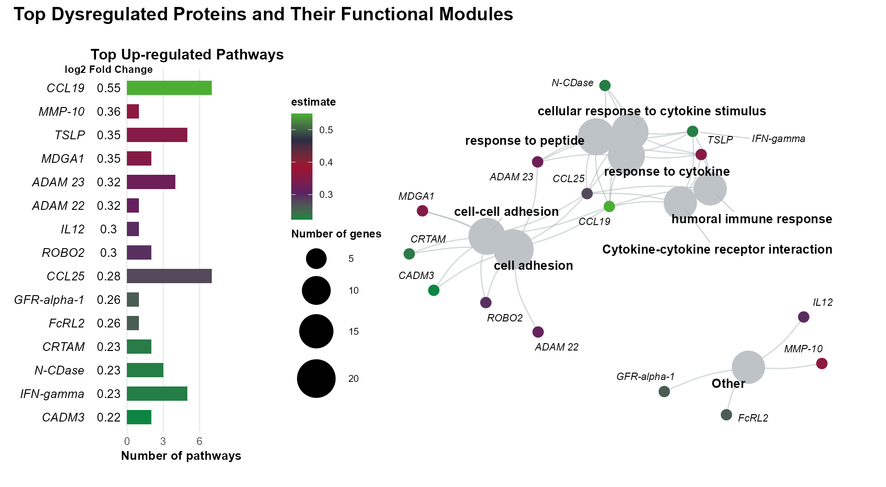

For a real protein-protein interaction network instead of a pathway
grouping,
[`plot_network()`](https://vanhungtran.github.io/OlinkViz/reference/plot_network.md)
queries the STRING database directly (requires the `rbioapi` package and
an internet connection):

``` r
plot_network(c("IL6", "TNF", "CXCL10", "CD40", "IL10"))
```

------------------------------------------------------------------------

## Data Utilities

### Validating NPX Data

[`validate_npx()`](https://vanhungtran.github.io/OlinkViz/reference/validate_npx.md)
checks that your data has the minimum required columns:

``` r
validate_npx(iris_longcovid)
```

``` r
# With a missing column — warns rather than stops
validate_npx(mtcars, fail_on_missing = FALSE)
```

### Converting Between Long and Wide Formats

**Long to wide:**

``` r
# Pivot a subset for demonstration
iris_sub <- iris_longcovid[iris_longcovid$timing_month == "Acute", ]
wide <- to_wide(iris_sub, sample_col = "IRIS_number")
wide[1:5, 1:6]
#>   IRIS_number    Sex long_covid timing_month     IL8    VEGFA
#> 1          99 Female        Yes        Acute 5.24166 10.20731
#> 2          61   Male         No        Acute 4.67765 10.40073
#> 3          86 Female        Yes        Acute 5.65692 11.42994
#> 4          98 Female         No        Acute 5.62729 11.39714
#> 5          75 Female        Yes        Acute 4.70624 11.03180
```

Duplicate sample-assay combinations are automatically averaged with a
message:

``` r
# Create artificial duplicate to demonstrate replicate averaging
dup_row <- iris_sub[1, ]
iris_dup <- rbind(iris_sub, dup_row)
wide_dedup <- to_wide(iris_dup, sample_col = "IRIS_number")
```

**Wide to long:**

``` r
# With automatic assay column detection
long <- to_long(wide, id_cols = "IRIS_number")
if (requireNamespace("DT", quietly = TRUE)) {
  DT::datatable(head(long))
} else {
  head(long)
}
```

The new `exclude_cols` parameter lets you control which columns are
excluded from auto-detection when pivoting:

``` r
to_long(wide, id_cols = "IRIS_number",
        exclude_cols = "Sex") %>% head(20)  # explicit: only exclude "Sex"
#>    IRIS_number    Sex long_covid timing_month          Assay      NPX
#> 1           99 Female        Yes        Acute            IL8  5.24166
#> 2           99 Female        Yes        Acute          VEGFA 10.20731
#> 3           99 Female        Yes        Acute           CD8A 10.58543
#> 4           99 Female        Yes        Acute          MCP-3  2.45599
#> 5           99 Female        Yes        Acute           GDNF  0.89861
#> 6           99 Female        Yes        Acute          CDCP1  1.79942
#> 7           99 Female        Yes        Acute          CD244  6.09629
#> 8           99 Female        Yes        Acute            IL7  0.96627
#> 9           99 Female        Yes        Acute            OPG  9.38285
#> 10          99 Female        Yes        Acute LAP TGF-beta-1  7.17724
#> 11          99 Female        Yes        Acute            uPA 10.66074
#> 12          99 Female        Yes        Acute         IL-17C  2.31181
#> 13          99 Female        Yes        Acute          MCP-1 12.29401
#> 14          99 Female        Yes        Acute         IL-17A  2.24297
#> 15          99 Female        Yes        Acute         CXCL11 13.05433
#> 16          99 Female        Yes        Acute          AXIN1  2.71468
#> 17          99 Female        Yes        Acute          TRAIL  7.59333
#> 18          99 Female        Yes        Acute        IL-20RA  0.52761
#> 19          99 Female        Yes        Acute          CXCL9  6.65477
#> 20          99 Female        Yes        Acute           CST5  4.65951
```

### Custom Themes and Palettes

[`theme_olinkviz()`](https://vanhungtran.github.io/OlinkViz/reference/theme_olinkviz.md)
provides a clean, publication-ready ggplot2 theme:

``` r
ggplot(mtcars, aes(wt, mpg, color = factor(cyl))) +
  geom_point(size = 3) +
  labs(title = "Custom OlinkViz Theme",
       subtitle = "Using theme_olinkviz()") +
  theme_olinkviz()
```

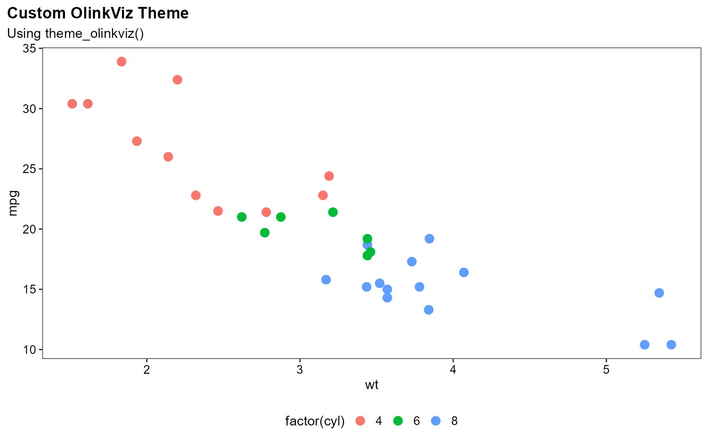

[`olinkviz_palette()`](https://vanhungtran.github.io/OlinkViz/reference/olinkviz_palette.md)
returns colorblind-friendly categorical colors using RColorBrewer’s
Dark2 palette, extended via interpolation when more colors are needed:

``` r
# Standard 8-color palette
scales::show_col(olinkviz_palette(8))
```


``` r

# Interpolated 12-color extension
scales::show_col(olinkviz_palette(12))
```

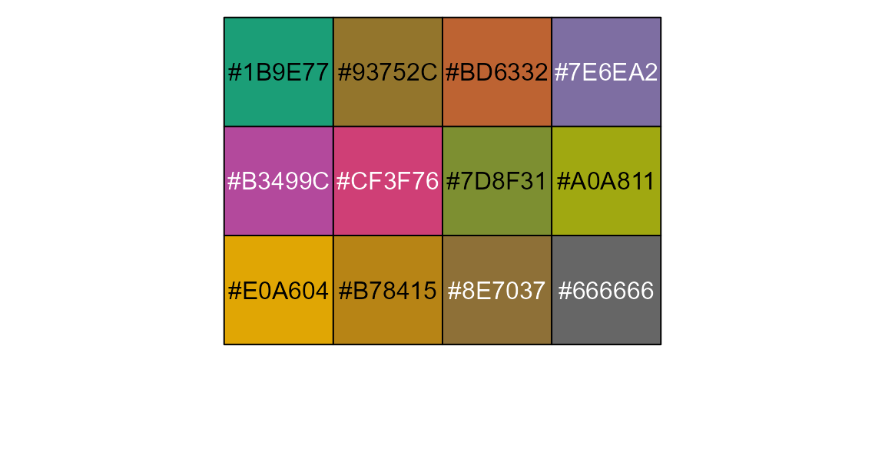

------------------------------------------------------------------------

## Interactive Exploration

Launch the Shiny app for interactive data exploration:

``` r
OlinkViz::run_shiny()
```

The Shiny app allows you to:

- Browse all 11 built-in datasets with variable descriptions
- Upload your own CSV or Excel NPX files
- Select from 8 plot types with adjustable parameters
- Filter by assay, timepoint, and group
- Download publication-ready plots as PNG or PDF

------------------------------------------------------------------------

## Typical Workflow

A common analysis workflow using OlinkViz:

1.  **Inspect** your data with
    [`str()`](https://rdrr.io/r/utils/str.html) and
    [`validate_npx()`](https://vanhungtran.github.io/OlinkViz/reference/validate_npx.md)
2.  **Explore global structure** with
    [`plot_dim_reduc()`](https://vanhungtran.github.io/OlinkViz/reference/plot_dim_reduc.md)
    or
    [`plot_umap()`](https://vanhungtran.github.io/OlinkViz/reference/plot_umap.md)
3.  **Survey many proteins** with
    [`plot_dotplot()`](https://vanhungtran.github.io/OlinkViz/reference/plot_dotplot.md)
    or
    [`plot_heatmap()`](https://vanhungtran.github.io/OlinkViz/reference/plot_heatmap.md)
4.  **Identify hits** with
    [`plot_volcano()`](https://vanhungtran.github.io/OlinkViz/reference/plot_volcano.md)
    on statistical test results
5.  **Investigate candidates** with
    [`plot_boxplot()`](https://vanhungtran.github.io/OlinkViz/reference/plot_boxplot.md)
    for single proteins
6.  **Track over time** with
    [`plot_trajectory()`](https://vanhungtran.github.io/OlinkViz/reference/plot_trajectory.md)
    for longitudinal data
7.  **Check relationships** with
    [`plot_corr()`](https://vanhungtran.github.io/OlinkViz/reference/plot_corr.md)
    between top proteins

------------------------------------------------------------------------

## ALS Phenoconversion Biomarker Analyses

This worked example recreates the visualization strategy of [Ran X, Wuu
J, Qin ZS, McDermott MP, Cooper-Knock J, et al., Benatar M. (2026),
“Longitudinal plasma proteomics predict phenoconversion to clinically
manifest ALS”, *Nature Medicine* 32,
3417-3429](https://doi.org/10.1038/s41591-026-04528-x). The paper used
longitudinal Olink Explore HT proteomics from asymptomatic carriers of
ALS-associated gene variants to find a 19-protein panel predicting
“phenoconversion” (transition to clinically manifest disease) up to 5
years ahead of symptom onset.

OlinkViz has no genetic-carrier ALS cohort, so the figures below map the
same ideas onto the one bundled dataset with a **real** observed state
transition over time: `iris_longcovid` participants who are
Long-COVID-positive at the 3-month visit sometimes resolve (become
negative) by 12 months — 11 of 23 with month-12 follow-up, confirmed
directly from the raw data below, not assumed. That resolution event
stands in for “phenoconversion”: same underlying question (do early
biomarkers anticipate a later change in clinical state?), opposite
direction (recovery, not onset). Where no dataset supports a real
longitudinal outcome, the cross-sectional Bansal Long COVID vs Healthy
contrast is used instead.

``` r
library(data.table)
library(patchwork)
library(pROC)
library(survival)
```

### Building the resolution cohort

``` r
univ <- as.data.table(bansal_univariate)[order(p.value)]

iris <- as.data.table(iris_longcovid)
iris[, month_num := fcase(
  timing_month == "Acute",      0,
  timing_month == "3 months",   3,
  timing_month == "12 months", 12,
  default = NA_real_
)]

# Status at each visit, wide, defines who is "at risk" of resolution
stat_wide <- dcast(unique(iris[, .(IRIS_number, month_num, long_covid)]),
                    IRIS_number ~ month_num, value.var = "long_covid")
setnames(stat_wide, c("IRIS_number", "m0", "m3", "m12"))
at_risk <- stat_wide[m3 == "Yes" & !is.na(m12)]
at_risk[, resolved    := as.integer(m12 == "No")]
at_risk[, time_months := 9]   # fixed 3 -> 12 month follow-up window
nrow(at_risk); sum(at_risk$resolved)
#> [1] 23
#> [1] 11
```

``` r
# Baseline (month-3) protein z-scores for the resolution cohort
m3_npx <- iris[month_num == 3 & IRIS_number %in% at_risk$IRIS_number,
               .(IRIS_number, Assay, NPX)]
m3_npx[, z := as.numeric(scale(NPX)), by = Assay]
m3_wide_z <- dcast(m3_npx, IRIS_number ~ Assay, value.var = "z")
```

### 1. Disease-state volcano (paper Fig 1a)

The paper’s manifest-disease-vs-healthy volcano is exactly the [Volcano
Plot](#volcano-plot-differential-expression) example from Plotting
Functions above, run on the same Bansal Long COVID vs Healthy cohort —
no need to re-run it here.

### 2. Pathway enrichment by direction (paper Fig 1b/1c)

Same
[`enrich_pathways()`](https://vanhungtran.github.io/OlinkViz/reference/enrich_pathways.md)/`gprofiler2`
mechanics as [Pathway Enrichment & Protein
Networks](#pathway-enrichment-protein-networks) above, split by
direction of change to match the paper’s separate up/down panels (not
evaluated here — needs internet access):

``` r
up_list   <- unique(univ[p.value < 0.15 & estimate > 0]$UniProt)
down_list <- unique(univ[p.value < 0.15 & estimate < 0]$UniProt)

gost_up   <- gprofiler2::gost(up_list[!is.na(up_list)],
                              organism = "hsapiens", sources = c("GO:BP", "KEGG"))
gost_down <- gprofiler2::gost(down_list[!is.na(down_list)],
                              organism = "hsapiens", sources = c("GO:BP", "KEGG"))
```

See `man/figures/fig_pathway_direction.png` for the output
(chemotaxis/cell migration enriched among up-regulated proteins; viral
protein interaction and inflammatory response among down-regulated
ones), or run `scripts/generate_figures_natmed.R`, which builds the two
bar charts from `gost_up`/`gost_down` and combines them with
`patchwork`.

### 3. Functional module network (paper Fig 1d)

Same 15 up-regulated Bansal proteins, same
[`enrich_pathways()`](https://vanhungtran.github.io/OlinkViz/reference/enrich_pathways.md) +
[`plot_pathway_network()`](https://vanhungtran.github.io/OlinkViz/reference/plot_pathway_network.md)
recipe as [Pathway Enrichment & Protein
Networks](#pathway-enrichment-protein-networks) above — see that section
for the figure and the code that builds it.

### 4. Protein levels before vs after resolution (paper Fig 1e/2a)

``` r
resolvers <- at_risk[resolved == 1]$IRIS_number
res_npx <- iris[IRIS_number %in% resolvers & month_num %in% c(3, 12),
                .(IRIS_number, Assay, NPX, month_num)]
top_var_res <- res_npx[, .(v = var(NPX, na.rm = TRUE)), by = Assay][order(-v)][1:40]$Assay
res_npx <- res_npx[Assay %in% top_var_res]
res_npx[, z := as.numeric(scale(NPX)), by = Assay]
res_mean <- res_npx[, .(z = mean(z, na.rm = TRUE)), by = .(Assay, month_num)]
res_mean[, TimeBin := ifelse(month_num == 3, "Active (Month 3)", "Resolved (Month 12)")]
res_wide <- as.data.frame(dcast(res_mean, TimeBin ~ Assay, value.var = "z"))

plot_heatmap(
  res_wide, wide = TRUE, sample_col = "TimeBin",
  scale = "none", cluster_rows = TRUE, cluster_cols = FALSE,
  show_rownames = TRUE, show_colnames = TRUE, fontsize = 7,
  main = sprintf("Protein Levels Before/After Long COVID Resolution (n=%d)", length(resolvers))
)
```

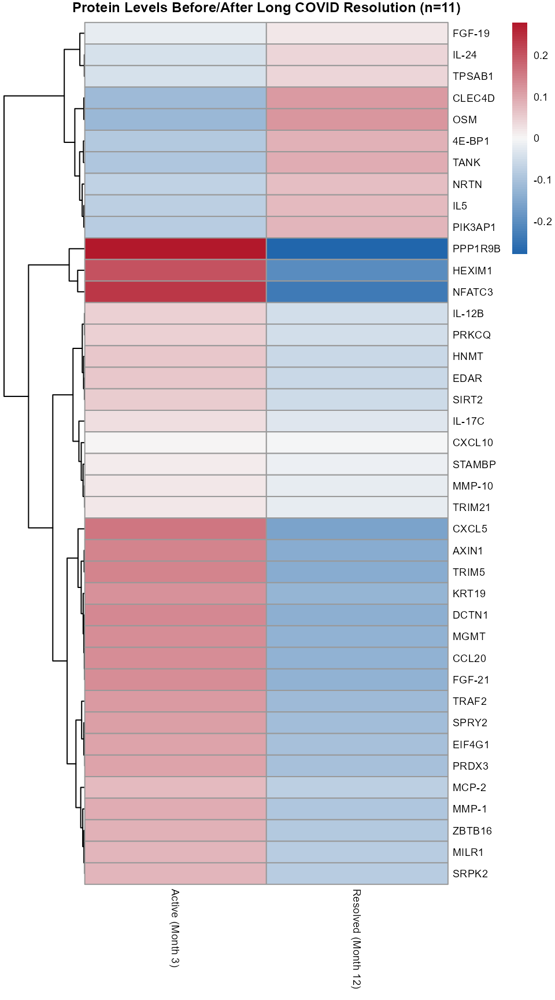

### 5. Protein trajectories by status (paper Fig 2b)

``` r
m3_all <- iris[month_num == 3, .(IRIS_number, Assay, NPX, long_covid)]
wilcox_m3 <- m3_all[, {
  yy <- NPX[long_covid == "Yes"]; nn <- NPX[long_covid == "No"]
  if (length(yy) < 3 || length(nn) < 3) list(p = NA_real_)
  else list(p = tryCatch(suppressWarnings(wilcox.test(yy, nn)$p.value), error = function(e) NA_real_))
}, by = Assay]
top4 <- wilcox_m3[!is.na(p)][order(p)][1:4]$Assay

traj_plots <- lapply(top4, function(a) {
  plot_trajectory(as.data.frame(iris), subject_id = "IRIS_number", time = "month_num",
                  assay = a, group = "long_covid", smooth_method = "loess", title = a) +
    labs(x = "Months", color = "Long COVID")
})
wrap_plots(traj_plots, ncol = 2) + plot_layout(guides = "collect")
```


### 6. Kaplan-Meier: time to resolution (paper Fig 3b/3c)

A baseline (month-3) 8-protein signature, median-split into two risk
groups, against time to resolution. With only two real follow-up visits,
every subject shares the same 9-month assessment window, so each curve
takes one step rather than a smooth decline — an honest consequence of
the coarser visit schedule, not a continuous-surveillance KM curve like
the paper’s:

``` r
km_dt <- merge(at_risk[, .(IRIS_number, time_months, resolved)], m3_wide_z, by = "IRIS_number")
assay_cols <- setdiff(names(km_dt), c("IRIS_number", "time_months", "resolved"))

assoc <- data.table(Assay = assay_cols)
assoc[, p := vapply(Assay, function(a) {
  tryCatch(suppressWarnings(wilcox.test(km_dt[[a]] ~ km_dt$resolved)$p.value),
           error = function(e) NA_real_)
}, numeric(1))]
top_risk <- assoc[!is.na(p)][order(p)][1:min(8, .N)]$Assay

km_dt[, risk_score := rowMeans(.SD, na.rm = TRUE), .SDcols = top_risk]
km_dt[, risk_group := ifelse(risk_score > median(risk_score),
                             "High baseline signature", "Low baseline signature")]

fit <- survfit(Surv(time_months, resolved) ~ risk_group, data = km_dt)
sd_  <- survdiff(Surv(time_months, resolved) ~ risk_group, data = km_dt)
p_logrank <- 1 - pchisq(sd_$chisq, length(sd_$n) - 1)

km_df <- data.table(time = fit$time, surv = fit$surv, lower = fit$lower, upper = fit$upper,
                    strata = rep(names(fit$strata), fit$strata))
km_df[, strata := sub(".*risk_group=", "", strata)]
km0 <- data.table(time = 0, surv = 1, lower = 1, upper = 1, strata = unique(km_df$strata))
km_df <- rbind(km0, km_df)[order(strata, time)]

ggplot(km_df, aes(x = time, y = surv, color = strata)) +
  geom_step(linewidth = 1.1) +
  geom_ribbon(aes(ymin = lower, ymax = upper, fill = strata), alpha = 0.12, colour = NA) +
  coord_cartesian(ylim = c(0, 1)) +
  labs(x = "Months from active Long COVID (month-3 visit)",
       y = "Probability of remaining symptomatic",
       title = "Baseline Protein Signature Predicts Time to Resolution",
       subtitle = sprintf("n=%d Long COVID-positive at month 3 (%d resolved by month 12); log-rank p=%.3f",
                          nrow(km_dt), sum(km_dt$resolved), p_logrank))
```

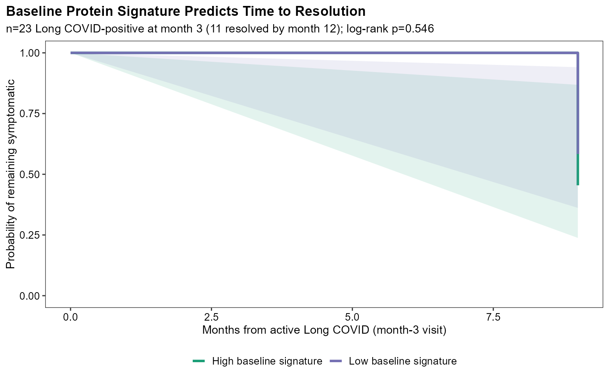

### 7. Resolution ROC + cross-analysis protein overlap (paper Fig 4b/4c)

The left panel is a standard ROC (individual proteins in grey, the
8-protein signature in colour). The right panel is a small hand-rolled
UpSet plot — OlinkViz has no UpSet dependency, so this helper builds one
from a bar chart of intersection sizes plus a dot matrix, both in
`ggplot2`:

``` r
roc_score    <- roc(km_dt$resolved, km_dt$risk_score, quiet = TRUE)
roc_score_ci <- as.numeric(ci.auc(roc_score))
sc_co <- coords(roc_score, seq(0, 1, length.out = 150), ret = c("specificity", "sensitivity"))

ind_rocs <- rbindlist(lapply(top_risk, function(a) {
  ro <- roc(km_dt$resolved, km_dt[[a]], quiet = TRUE)
  co <- coords(ro, seq(0, 1, length.out = 60), ret = c("specificity", "sensitivity"))
  data.table(Assay = a, spec = co$specificity, sens = co$sensitivity)
}))

p_roc <- ggplot() +
  geom_abline(linetype = "dashed", colour = "grey65") +
  geom_path(data = ind_rocs, aes(1 - spec, sens, group = Assay), colour = "grey55",
            linewidth = 0.35, alpha = 0.4) +
  geom_path(data = sc_co, aes(1 - specificity, sensitivity), colour = "darkorange", linewidth = 1.4) +
  coord_equal() +
  labs(x = "1 - Specificity", y = "Sensitivity",
       title = "Predicting Resolution from Month-3 Proteins",
       subtitle = sprintf("8-protein signature AUC = %.2f (95%% CI %.2f-%.2f)",
                          as.numeric(auc(roc_score)), roc_score_ci[1], roc_score_ci[3]))
```

``` r
# Minimal UpSet-style plot: intersection-size bars + a set-membership dot matrix
simple_upset <- function(sets, min_size = 1, subtitle = NULL) {
  sets <- Filter(function(s) length(s) > 0, sets)
  all_items <- unique(unlist(sets))
  mem <- sapply(sets, function(s) all_items %in% s)
  combo_key <- apply(mem, 1, function(r) paste(as.integer(r), collapse = ""))
  combo_dt <- data.table(item = all_items, ckey = combo_key)
  combo_sizes <- combo_dt[, .N, by = "ckey"][N >= min_size][order(-N)]
  combo_sizes <- combo_sizes[ckey != paste(rep(0, length(sets)), collapse = "")]

  set_names <- names(sets)
  combo_sizes[, combo_id := factor(ckey, levels = ckey)]
  dot_dt <- combo_sizes[, {
    bits <- as.integer(strsplit(ckey, "")[[1]])
    data.table(set = set_names, on = as.logical(bits))
  }, by = combo_id]
  dot_dt[, set := factor(set, levels = rev(set_names))]

  p_bar <- ggplot(combo_sizes, aes(x = combo_id, y = N)) +
    geom_col(fill = "grey30", width = 0.6) +
    geom_text(aes(label = N), vjust = -0.4, size = 3.2) +
    labs(x = NULL, y = "Intersection size", subtitle = subtitle) +
    theme(axis.text.x = element_blank(), axis.ticks.x = element_blank())

  p_dot <- ggplot(dot_dt, aes(x = combo_id, y = set)) +
    geom_line(data = dot_dt[on == TRUE], aes(group = combo_id), colour = "grey20") +
    geom_point(aes(colour = on), size = 3) +
    scale_colour_manual(values = c(`TRUE` = "grey15", `FALSE` = "grey85"), guide = "none") +
    labs(x = NULL, y = NULL) +
    theme(axis.text.x = element_blank(), axis.ticks.x = element_blank())

  p_bar / p_dot + plot_layout(heights = c(2.2, 1))
}

sig_bansal       <- unique(univ[p.value < 0.1]$Assay)
sig_iris_cross   <- unique(wilcox_m3[!is.na(p) & p < 0.1]$Assay)
sig_iris_resolve <- unique(assoc[!is.na(p) & p < 0.1]$Assay)
sets <- list("Bansal: LC vs Healthy"  = sig_bansal,
            "IRIS: LC vs Not (3mo)"  = sig_iris_cross,
            "IRIS: Resolvers vs Not" = sig_iris_resolve)

p_roc | simple_upset(sets, subtitle = "Overlap of nominally significant proteins (p<0.1)")
```

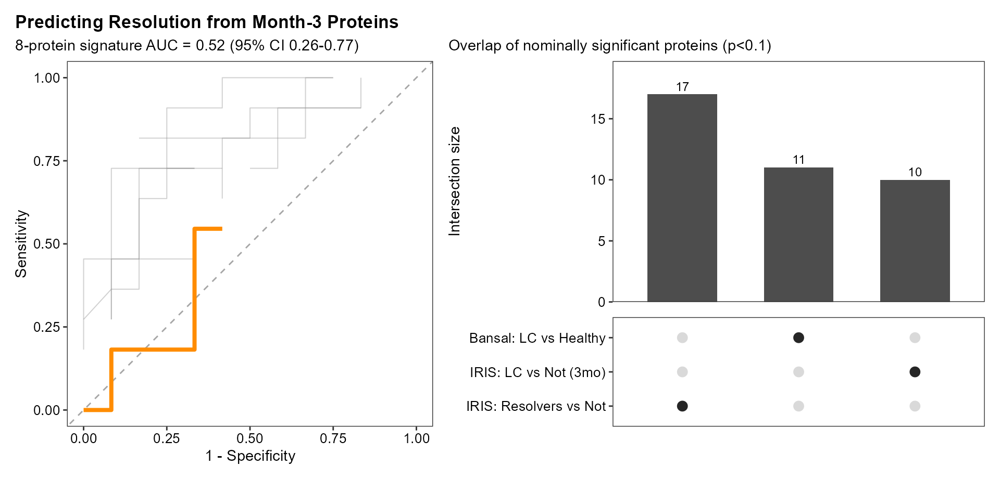

### 8. Cross-cohort replication scatter (paper Fig 5a)

Per-protein effect sizes computed independently in two cohorts — IRIS
(Long COVID vs not, at month 3) and Bansal (Long COVID vs Healthy) — for
the proteins the two panels have in common:

``` r
m3_eff <- iris[month_num == 3, .(IRIS_number, Assay, NPX, long_covid)]
m3_eff[, z := as.numeric(scale(NPX)), by = Assay]
iris_eff <- m3_eff[, .(iris_effect = mean(z[long_covid == "Yes"], na.rm = TRUE) -
                                     mean(z[long_covid == "No"],  na.rm = TRUE)),
                    by = Assay]
rep_dt <- merge(iris_eff, univ[, .(Assay, estimate)], by = "Assay")
ct <- suppressWarnings(cor.test(rep_dt$iris_effect, rep_dt$estimate, method = "pearson"))

ggplot(rep_dt, aes(x = estimate, y = iris_effect)) +
  geom_point(alpha = 0.7, size = 2, colour = "darkorange") +
  geom_smooth(method = "lm", colour = "grey20", fill = "grey70", alpha = 0.3, linewidth = 0.8) +
  geom_hline(yintercept = 0, linetype = "dashed", colour = "grey70") +
  geom_vline(xintercept = 0, linetype = "dashed", colour = "grey70") +
  labs(x = "Bansal cohort effect size (Long COVID - Healthy)",
       y = "IRIS cohort effect size (Long COVID - Not, z-score)",
       title = "Cross-Cohort Replication of Protein Effect Directions",
       subtitle = sprintf("%d overlapping proteins; Pearson r = %.2f (p = %.2g)",
                          nrow(rep_dt), ct$estimate, ct$p.value))
```

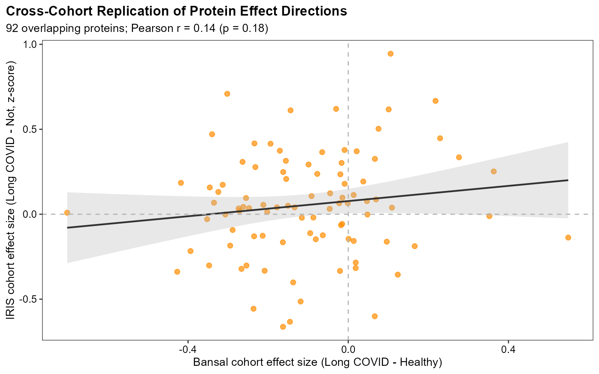

The full script behind this section — with file output and a QA pass
that checks every figure actually rendered — is
[`scripts/generate_figures_natmed.R`](https://github.com/vanhungtran/OlinkViz/blob/main/scripts/generate_figures_natmed.R)
in the repo root; the rendered PNGs also appear in the [README
gallery](https://github.com/vanhungtran/OlinkViz#-als-phenoconversion-biomarker-analyses).

------------------------------------------------------------------------

## Next Steps

- See the function reference:
  [`?plot_volcano`](https://vanhungtran.github.io/OlinkViz/reference/plot_volcano.md),
  [`?plot_heatmap`](https://vanhungtran.github.io/OlinkViz/reference/plot_heatmap.md),
  etc.
- See the `OlinkExperiment` container:
  [`?OlinkExperiment`](https://vanhungtran.github.io/OlinkViz/reference/OlinkExperiment.md),
  [`?oe_from_long`](https://vanhungtran.github.io/OlinkViz/reference/oe_from_long.md),
  [`?npx`](https://vanhungtran.github.io/OlinkViz/reference/npx.md),
  [`?lod`](https://vanhungtran.github.io/OlinkViz/reference/npx.md),
  [`?pcount`](https://vanhungtran.github.io/OlinkViz/reference/npx.md),
  [`?reducedDims`](https://vanhungtran.github.io/OlinkViz/reference/reducedDims.md)
- See dataset documentation:
  [`?iris_longcovid`](https://vanhungtran.github.io/OlinkViz/reference/iris_longcovid.md),
  [`?beatmg_npx`](https://vanhungtran.github.io/OlinkViz/reference/beatmg_npx.md),
  etc.
- Run
  [`OlinkViz::run_shiny()`](https://vanhungtran.github.io/OlinkViz/reference/run_shiny.md)
  for interactive exploration
- Visit the [OlinkViz GitHub](https://github.com/example/OlinkViz) for
  updates
