# All OlinkViz Plots on One Dataset (probc)

This gallery runs every `OlinkViz` visualization on a **single cohort**
(`probc`: 26 subjects, 2 groups, 9 timepoints `1..85`, 184 assays across
2 Olink Target 96 panels, with `PlateID`, `MaxLOD`, `PlateLOD`, and
`QC_Warning`).

``` r

library(OlinkViz)
library(ggplot2)
library(data.table)
```

## 1. Preparing the single-cohort views

``` r

oe <- oe_from_long(probc)
base <- probc[probc$Timepoint == 1, ]
early_late <- probc[probc$Timepoint %in% c(1, 29, 85), ]

# Compute per-protein baseline differential expression (Group2 vs Group1)
dt_base <- as.data.table(base)
de_t1 <- dt_base[, {
  g1 <- NPX[Project == "Group1"]
  g2 <- NPX[Project == "Group2"]
  tt <- tryCatch(stats::t.test(g2, g1), error = function(e) NULL)
  list(
    MeanNPX  = mean(NPX, na.rm = TRUE),
    estimate = mean(g2, na.rm = TRUE) - mean(g1, na.rm = TRUE),
    conf.low  = if (is.null(tt)) NA_real_ else tt$conf.int[1],
    conf.high = if (is.null(tt)) NA_real_ else tt$conf.int[2],
    p.value   = if (is.null(tt)) NA_real_ else tt$p.value
  )
}, by = .(Assay, Panel, UniProt)]
de_t1[, Adjusted_pval := stats::p.adjust(p.value, method = "BH")]
de_t1 <- de_t1[order(p.value)]

# Day 85 differential expression for cross-timepoint concordance & UpSet
dt_all <- as.data.table(probc)
de_by_tp <- function(tp) {
  dt_all[Timepoint == tp, {
    g1 <- NPX[Project == "Group1"]
    g2 <- NPX[Project == "Group2"]
    tt <- tryCatch(stats::t.test(g2, g1), error = function(e) NULL)
    list(
      est = mean(g2, na.rm = TRUE) - mean(g1, na.rm = TRUE),
      p   = if (is.null(tt)) NA_real_ else tt$p.value
    )
  }, by = Assay]
}
de_t29 <- de_by_tp(29)
de_t85 <- de_by_tp(85)

top_assays <- head(de_t1$Assay, 4)
top_assays
#> [1] "PTH1R"   "GDNF"    "IL-20RA" "CD244"
```

------------------------------------------------------------------------

## 2. Quality Control & Bridge Diagnostics

### 2.1 Sample QC (`plot_qc()`)

``` r

plot_qc(probc, color_by = "PlateID", sd_cutoff = 2.5)
```

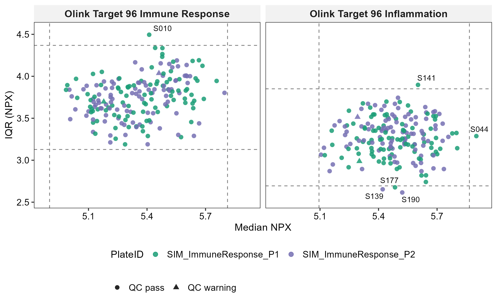

### 2.2 Assay Detectability (`plot_lod()`)

``` r

plot_lod(probc, threshold = 75)
```

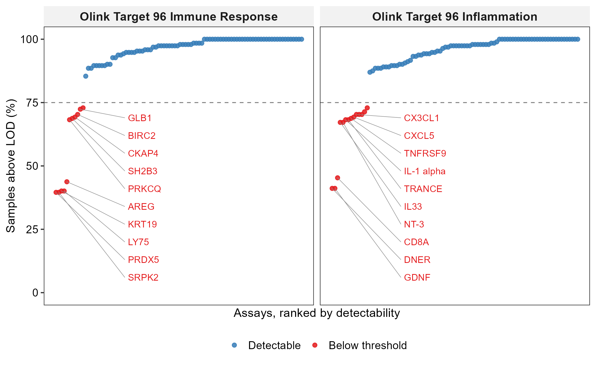

### 2.3 Plate Median Distributions (`plot_plate_qc()`)

``` r

plot_plate_qc(probc)
```

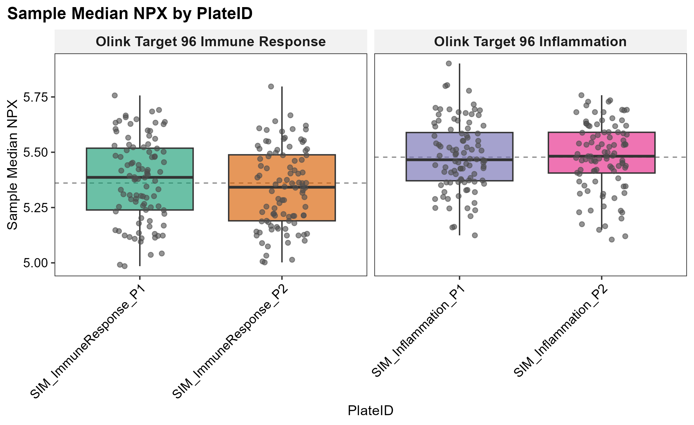

### 2.4 Bridge Sample Concordance (`plot_bridge()`)

``` r

set.seed(42)
b_ref <- base
b_new <- base
b_new$NPX <- b_new$NPX + rnorm(nrow(b_new), mean = 0.08, sd = 0.15)
plot_bridge(b_ref, b_new, type = "bland_altman")
```

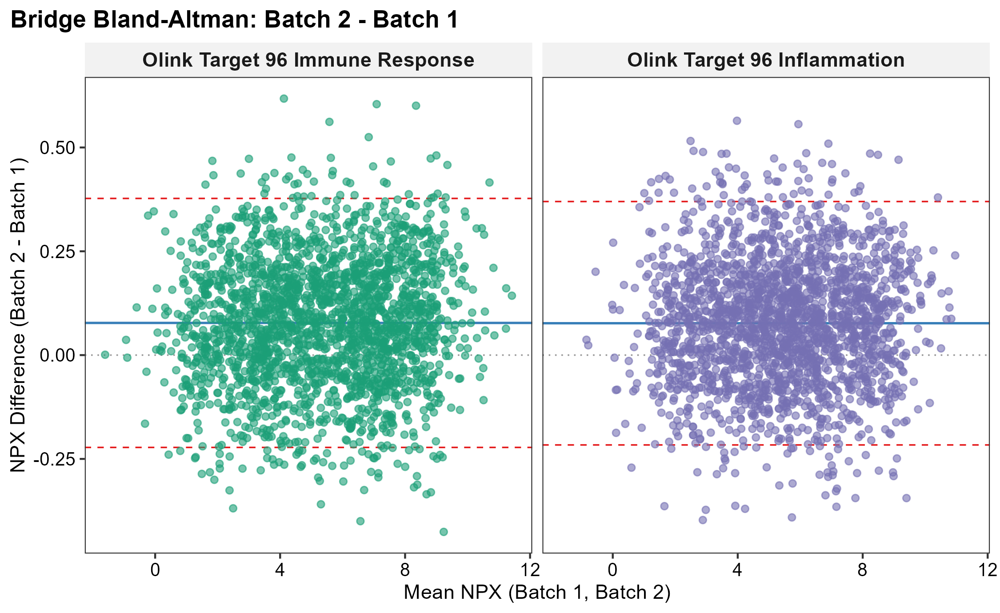

------------------------------------------------------------------------

## 3. Dimensionality Reduction & Clustering

### 3.1 Joint PCA, UMAP, and t-SNE (`plot_dim_reduc()`)

``` r

plot_dim_reduc(base, type = c("pca", "umap", "tsne"),
               color = "Project", perplexity = 7, seed = 42)
```

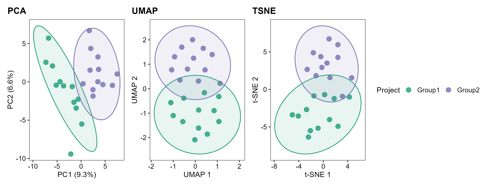

### 3.2 Standalone PCA & UMAP via `plot_dim_reduc()`

``` r

p1 <- plot_dim_reduc(base, type = "pca", color = "Project", title = "Baseline PCA")
p2 <- plot_dim_reduc(base, type = "umap", color = "Project", n_neighbors = 8,
                     seed = 42, title = "Baseline UMAP")
if (requireNamespace("patchwork", quietly = TRUE)) {
  olinkviz_combine(p1, p2, journal = "nature")
} else {
  p1
}
```

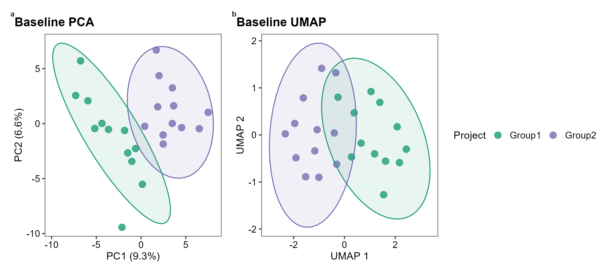

### 3.3 PCA Scree (`plot_scree()`) & Loadings (`plot_loadings()`)

``` r

ps <- plot_scree(base, n_pcs = 10, title = "Baseline Variance Explained")
pl <- plot_loadings(base, components = 1:2, top_n = 8)
if (requireNamespace("patchwork", quietly = TRUE)) {
  olinkviz_combine(ps, pl, journal = "nature")
} else {
  pl
}
```

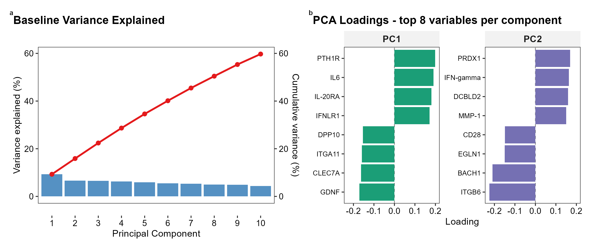

### 3.4 Clustered Heatmap (`plot_heatmap()`)

``` r

oe_base <- oe[, colData(oe)$Timepoint == 1]
plot_heatmap(oe_base, scale = "row", show_rownames = FALSE,
             annotation_rows = "Panel",
             main = "Baseline NPX Heatmap (OlinkExperiment)")
```

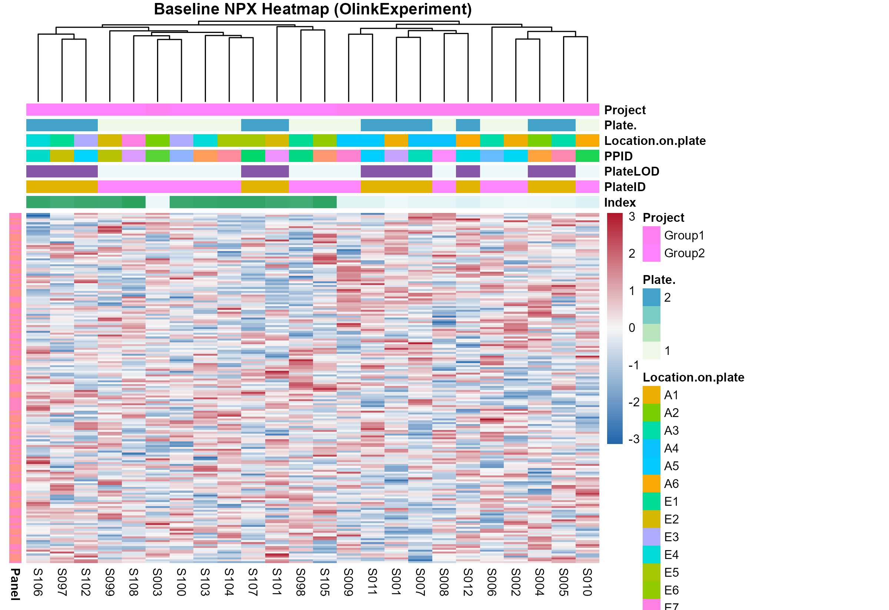

------------------------------------------------------------------------

## 4. Differential Expression, Intervals, Concordance & Set Overlap

### 4.1 Volcano Plot (`plot_volcano()`)

``` r

plot_volcano(de_t1, pval_col = "p.value", fc_col = "estimate",
             fc_threshold = 0.3, max_labels = 10,
             title = "Baseline Group2 vs Group1")
```

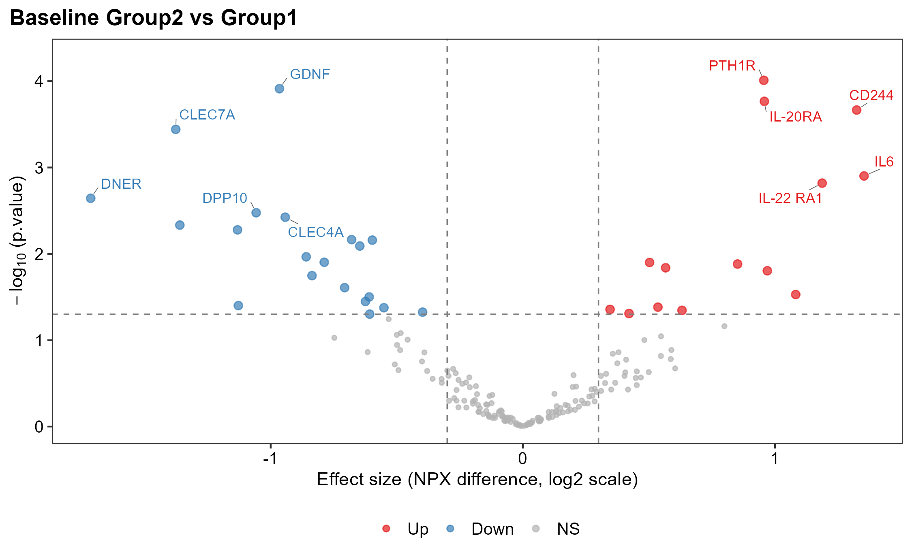

### 4.2 MA Plot (`plot_ma()`)

``` r

plot_ma(de_t1, mean_col = "MeanNPX", fc_col = "estimate",
        pval_col = "p.value", fc_threshold = 0.3, max_labels = 8,
        title = "Baseline MA Plot (NPX Difference vs Mean NPX)")
```

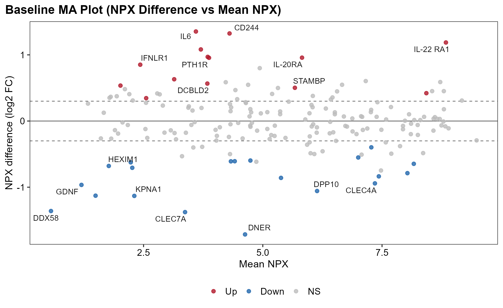

### 4.3 Multi-Protein Dot Plot (`plot_dotplot()`)

``` r

plot_dotplot(base, group = "Project",
             assays = head(de_t1$Assay, 15),
             title = "Top 15 Baseline Assays (Group2 vs Group1)")
```

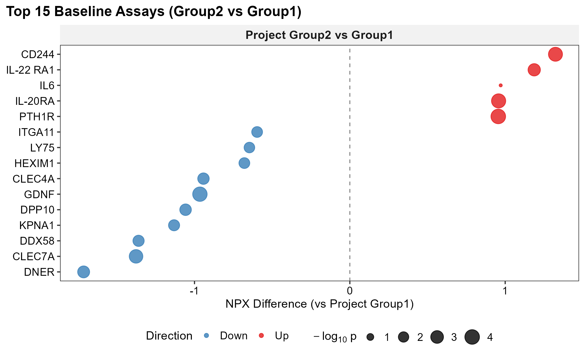

### 4.4 Effect-Size Forest Plot (`plot_forest()`)

``` r

de_top <- head(de_t1, 14)
de_top[, sig := p.value < 0.05]
plot_forest(de_top, assay_col = "Assay", estimate_col = "estimate",
            lower_col = "conf.low", upper_col = "conf.high",
            sig_col = "sig", title = "Top 14 Baseline Proteins (95% CI)")
```

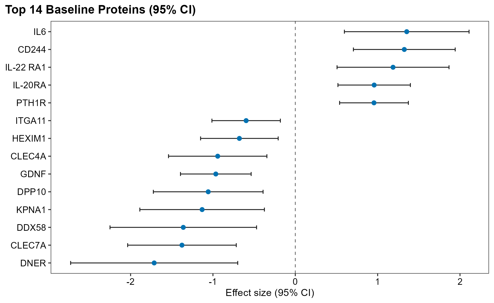

### 4.5 Cross-Timepoint Effect Concordance (`plot_concordance()`)

``` r

conc_dt <- merge(
  de_t1[, .(Assay, Day1 = estimate)],
  de_t85[, .(Assay, Day85 = est)],
  by = "Assay"
)
plot_concordance(conc_dt, x_col = "Day1", y_col = "Day85",
                 xlab = "Day 1 effect (Group2 - Group1)",
                 ylab = "Day 85 effect (Group2 - Group1)",
                 title = "Concordance of Treatment Effects (Day 1 vs Day 85)")
```

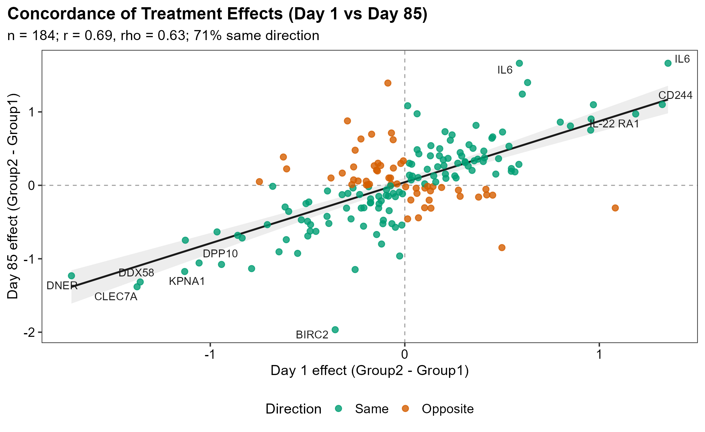

### 4.6 Overlapping Protein Sets (`plot_upset()`)

``` r

sets <- list(
  "Day 1 (p < 0.1)"  = de_t1[p.value < 0.1]$Assay,
  "Day 29 (p < 0.1)" = de_t29[p < 0.1]$Assay,
  "Day 85 (p < 0.1)" = de_t85[p < 0.1]$Assay
)
plot_upset(sets, title = "Overlap of Differentially Abundant Proteins Across Visits")
```

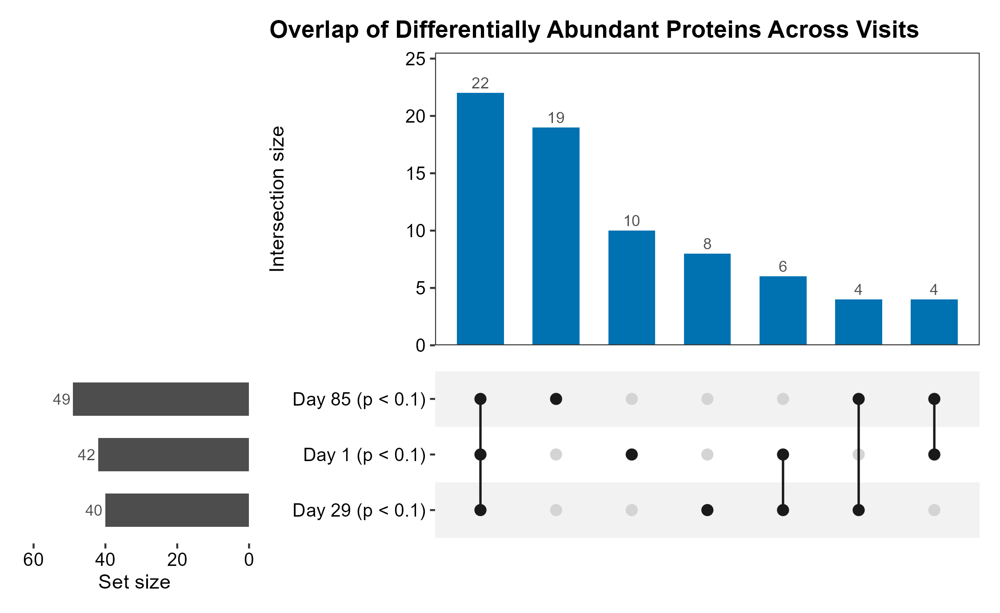

------------------------------------------------------------------------

## 5. Single-Protein & Longitudinal Views

### 5.1 Boxplot (`plot_boxplot()`)

``` r

plot_boxplot(base, assay = top_assays[1:2], group = "Project",
             show_lod = TRUE, show_significant = TRUE)
```

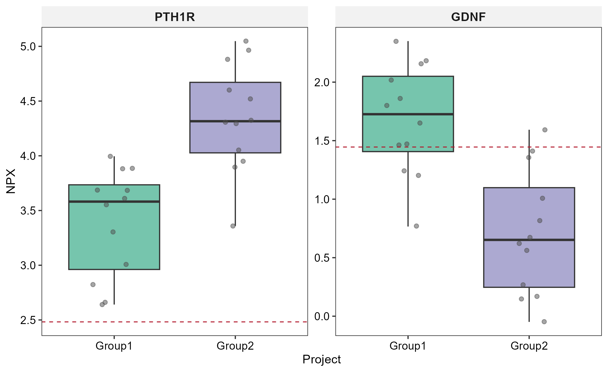

### 5.2 Violin + Boxplot (`plot_violin()`)

``` r

plot_violin(early_late, assay = top_assays[1], x = "Timepoint",
            group = "Project", show_lod = TRUE, show_significant = TRUE)
```

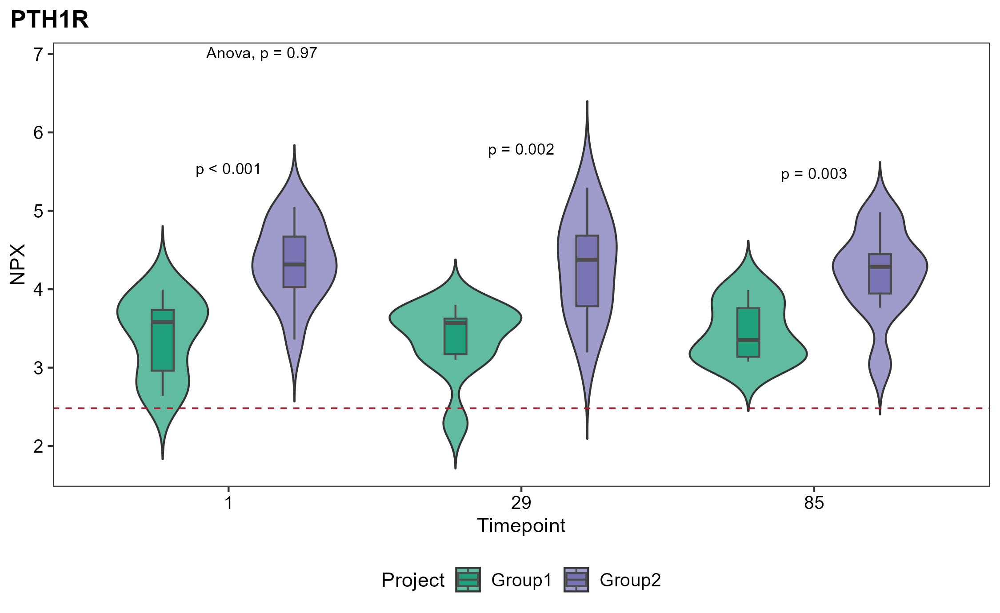

### 5.3 Mean Profile (`plot_mean_profile()`)

``` r

plot_mean_profile(probc, assay = top_assays[1:2], x = "Timepoint",
                  group = "Project", show_lod = TRUE)
```

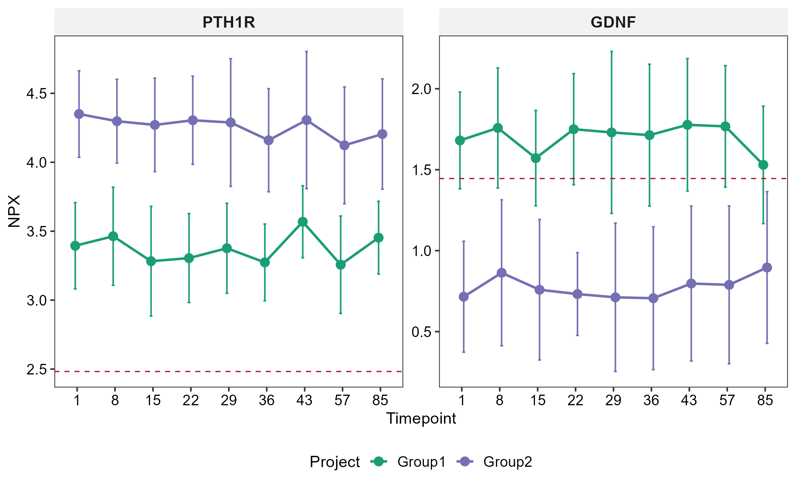

### 5.4 Individual Trajectories (`plot_trajectory()`)

``` r

plot_trajectory(probc, assay = top_assays[1], subject_id = "PPID",
                time = "Time", group = "Project", smooth_method = "loess",
                lod_col = "MaxLOD")
```

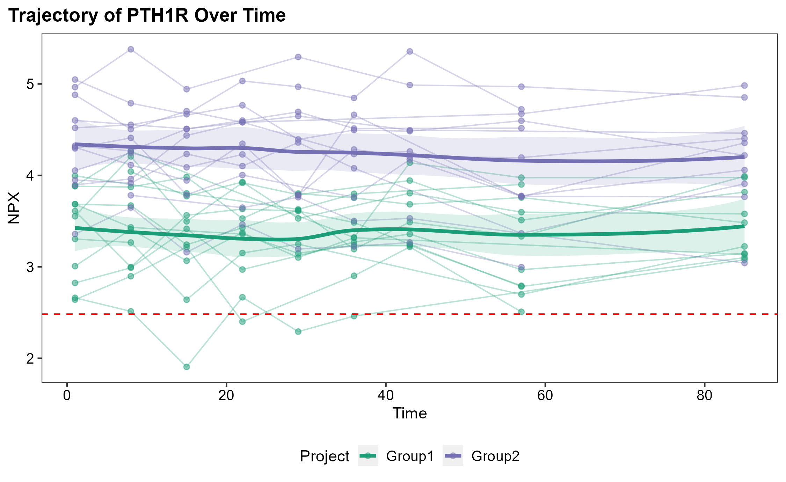

### 5.5 Faceted Spaghetti Plot (`plot_spaghetti()`)

``` r

plot_spaghetti(probc, assay = top_assays[1], subject_id = "PPID",
               time = "Time", facet_by = "Project")
```

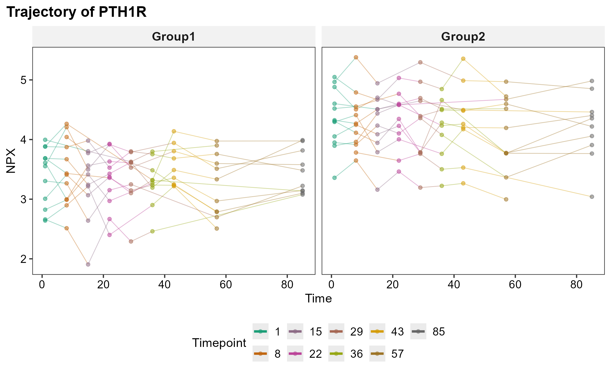

### 5.6 Linear Mixed-Model Point-Range (`plot_lmer()`)

``` r

plot_lmer(early_late, assay = top_assays[1:2], x = "Timepoint",
          group = "Project", random = "PPID",
          add_pvalue = requireNamespace("lmerTest", quietly = TRUE))
```

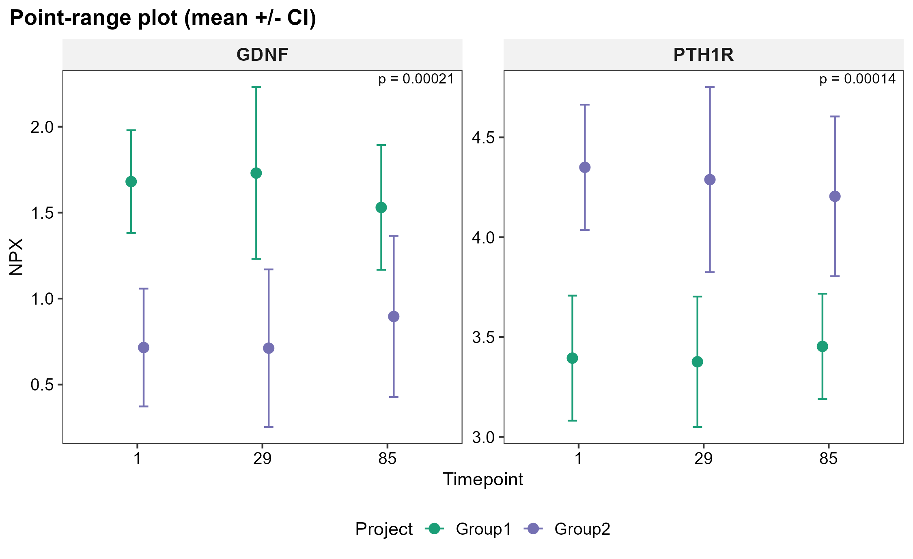

### 5.7 Continuous Regression Smooth (`plot_regression()`)

``` r

plot_regression(probc, assay = top_assays[1], x = "Time",
                color_by = "Project", title = paste(top_assays[1], "Trend"))
```

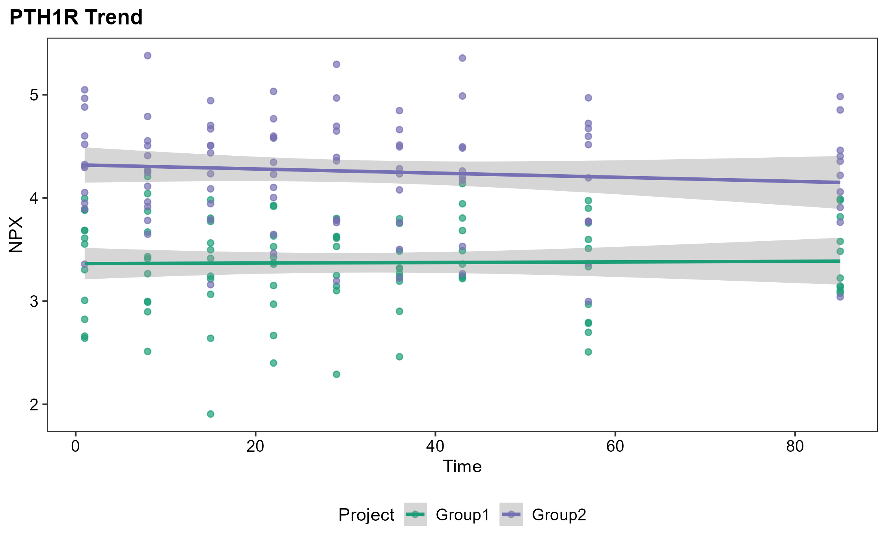

------------------------------------------------------------------------

## 6. Correlation, Biomarker ROC, and Pathway Network

### 6.1 Correlation Matrix (`plot_corr()` & `plot_corr_triangle()`)

``` r

plot_corr(base, method = "spearman", top_n = 18, corr_type = "upper")
```

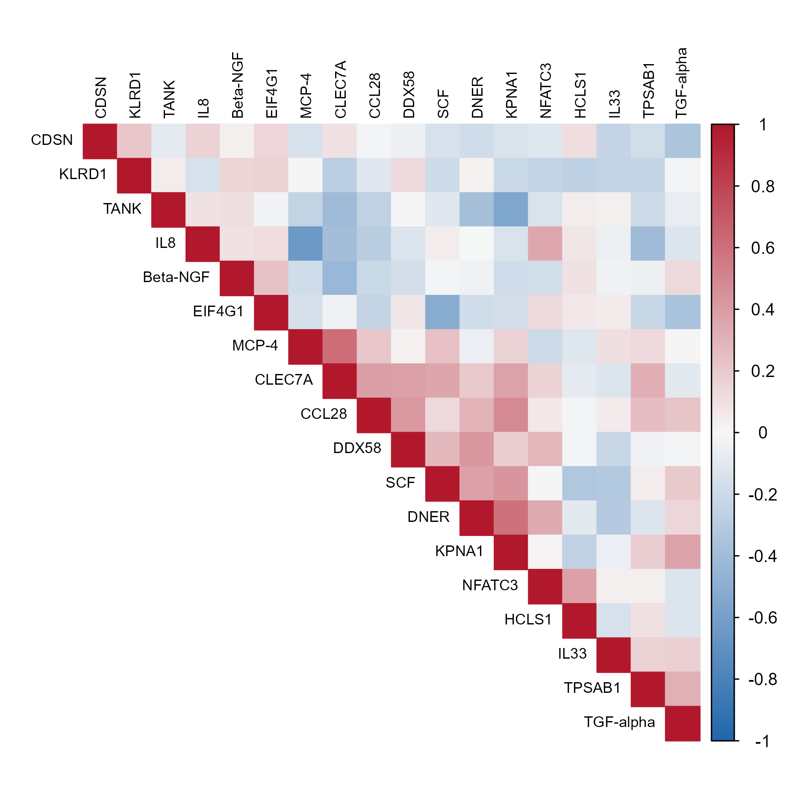

``` r

plot_corr_triangle(base, method = "spearman", top_n = 15,
                   title = "Baseline Correlation Triangle")
```

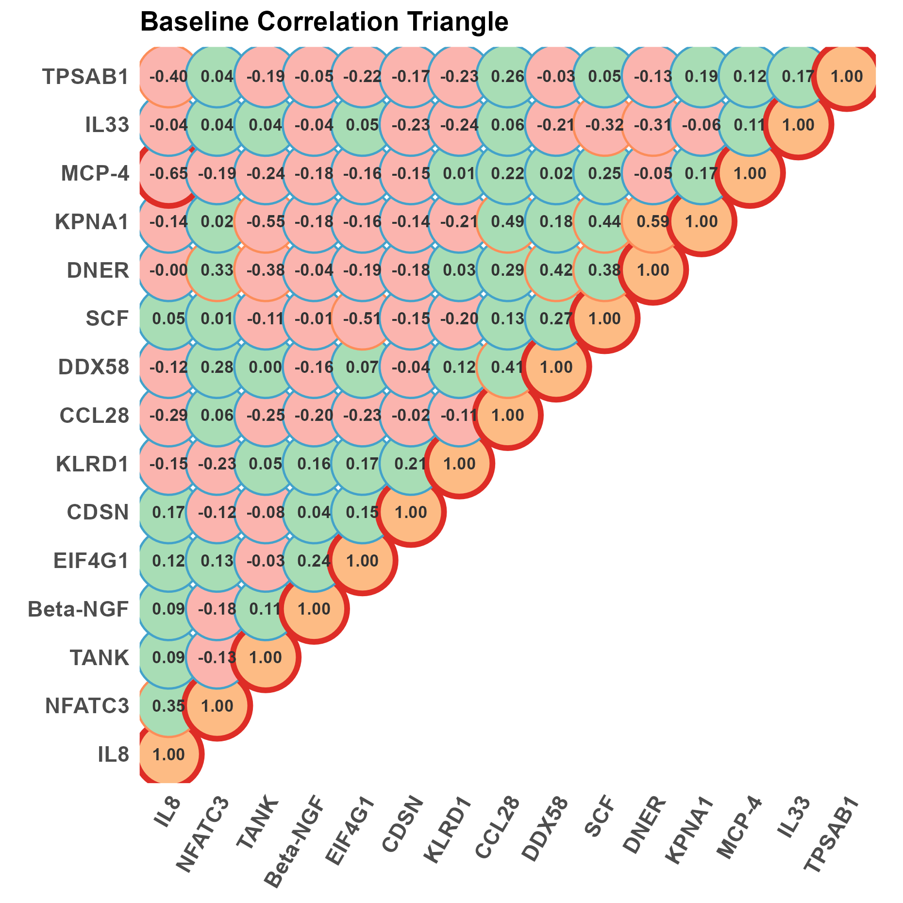

### 6.2 ROC Curves with 95% CI Shade & DeLong Comparison (`plot_roc()`)

``` r

plot_roc(base, assays = top_assays[1:3], group = "Project",
         add_ci = TRUE, boot_n = 100, show_direction = TRUE,
         compare = TRUE, compare_method = "delong",
         palette = "okabe_ito",
         title = "Baseline Classification (95% CI & DeLong Test)")
```

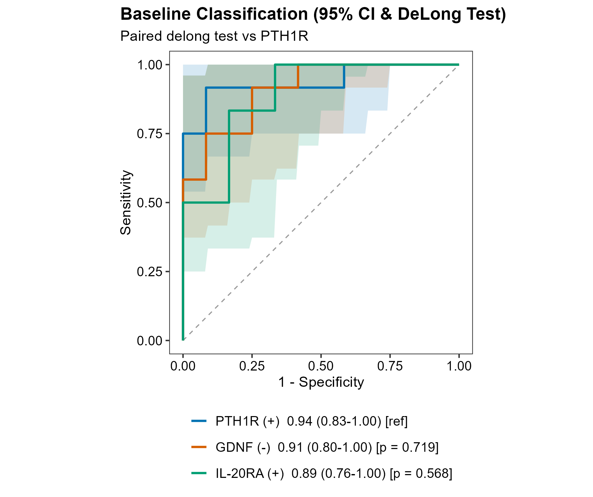

### 6.3 Pathway / Panel Network (`plot_pathway_network()`)

``` r

pw_panel <- unique(de_t1[, .(Assay, Pathway = gsub("Olink ", "", Panel))])
plot_pathway_network(de_t1, assay_col = "Assay", value_col = "estimate",
                     pathway_map = as.data.frame(pw_panel), top_n = 16,
                     palette = "jewel",
                     title = "Top Baseline Proteins Grouped by Olink Panel")
```

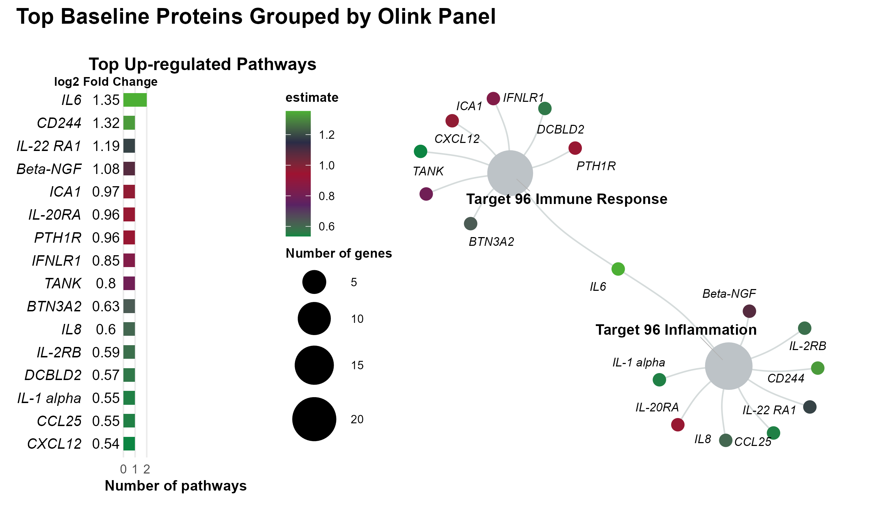
