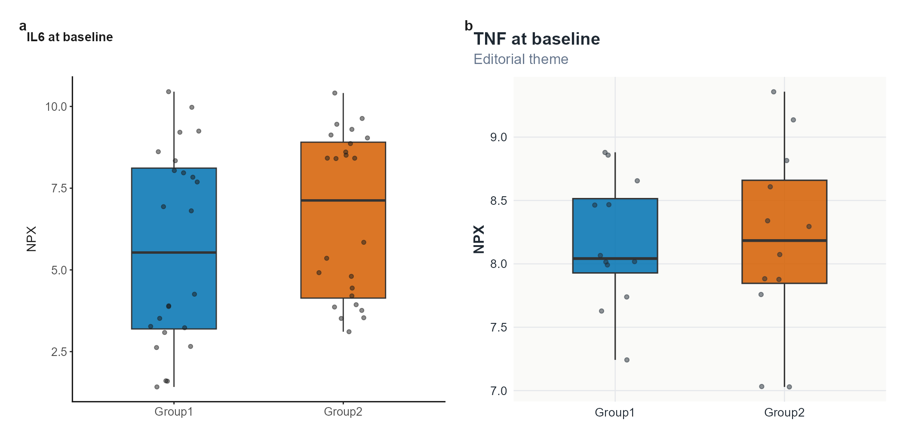
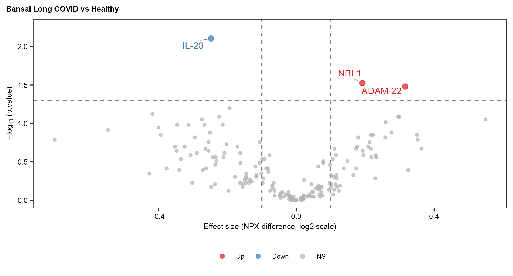
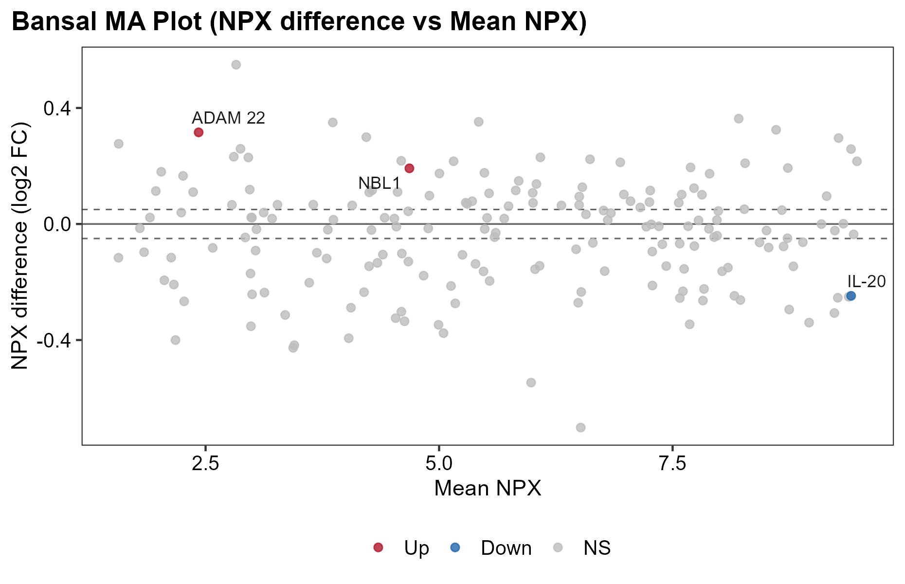
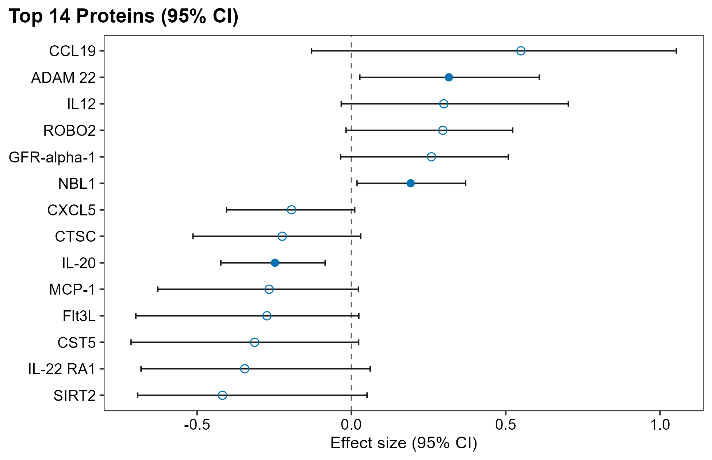
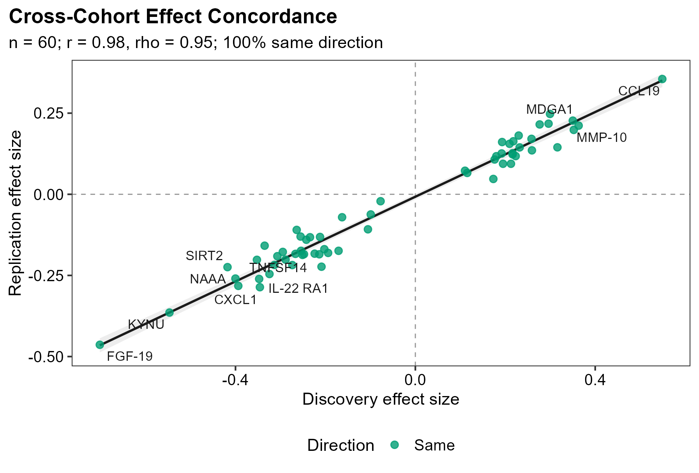
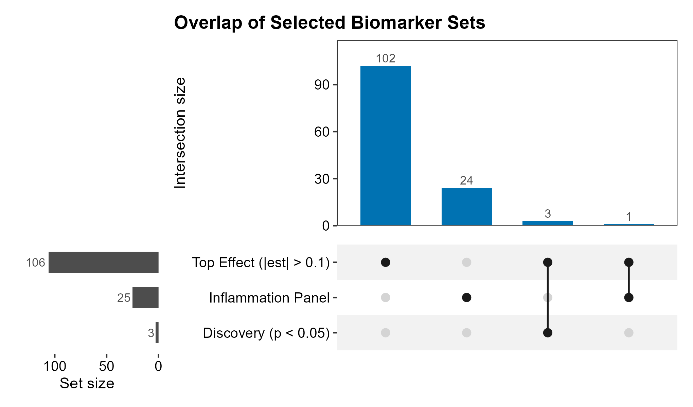
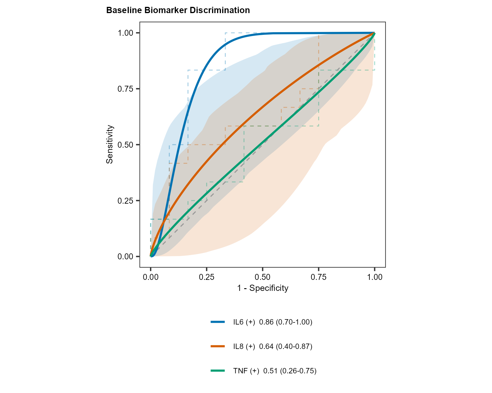

# Journal Specifications, Pre-Flight QA, and Publication Figures

``` r

library(OlinkViz)
library(ggplot2)
set.seed(1)
```

A figure is judged at the size, and by the rules, of the journal it is
headed for. **OlinkViz** keeps those rules in **one registry**
([`journal_spec()`](https://vanhungtran.github.io/OlinkViz/reference/journal_spec.md),
[`journal_specs()`](https://vanhungtran.github.io/OlinkViz/reference/journal_specs.md),
[`journal_spec_add()`](https://vanhungtran.github.io/OlinkViz/reference/journal_spec_add.md))
and connects them to
[`olinkviz_options()`](https://vanhungtran.github.io/OlinkViz/reference/olinkviz_options.md),
[`journal_width()`](https://vanhungtran.github.io/OlinkViz/reference/journal_width.md),
[`theme_journal()`](https://vanhungtran.github.io/OlinkViz/reference/theme_journal.md),
[`olinkviz_combine()`](https://vanhungtran.github.io/OlinkViz/reference/olinkviz_combine.md),
[`olinkviz_preflight()`](https://vanhungtran.github.io/OlinkViz/reference/olinkviz_preflight.md),
and
[`save_olinkviz()`](https://vanhungtran.github.io/OlinkViz/reference/save_olinkviz.md).

## The journal specification registry

[`journal_spec()`](https://vanhungtran.github.io/OlinkViz/reference/journal_spec.md)
returns the column widths, maximum figure height, text-size floor and
ceiling, minimum stroke weight, panel-tag style, and raster DPI
requirements for a target journal or output purpose:

``` r

journal_spec("nature")
#> <journal spec> nature: Nature (Springer Nature) [journal]
#>   widths      single 90 | 1.5 120 | double 180 mm  (also quoted: 89 / 183 mm)
#>   max height  170 mm
#>   text        5-7 pt (body 7 pt)
#>   lines       not stated *
#>   panel tags  lower-case, 8 pt bold
#>   raster dpi  halftone >= 300
#>   fonts       Arial, Helvetica
#>   formats     PDF, EPS, AI
#>   colour      RGB
#>   provenance  publisher page, checked 2026-10
#>               https://research-figure-guide.nature.com/figures/building-and-exporting-figure-panels/
#>               https://research-figure-guide.nature.com/figures/preparing-figures-our-specifications/
#>   * not stated by the guide:
#>       line_min_pt: none stated; checks use 0.25 pt
#>   notes:
#>     Text must be 5-7 pt at final size (guide: 'Minimum text size: 5 pt', 'Maximum
#>     text size: 7 pt'); panel labels are 8-pt bold, upright, lower-case; the
#>     maximum figure height is 170 mm. Nature's figure guide quotes 89 / 183 mm
#>     columns while its author formatting guide quotes 90 / 180 mm: 90 / 180 is
#>     used here and 89 / 183 is accepted as an alternative. The 120 mm
#>     one-and-a-half column is the Nature Portfolio convention, not a
#>     flagship-Nature number. A 7 pt 'minimum' sometimes quoted for Nature is its
#>     maximum text size.
```

Fields not stated by the publisher’s author guide are filled from the
publisher’s generic artwork guide or a package default and marked with
`*` when printed. Browse all registered specifications with
[`journal_specs()`](https://vanhungtran.github.io/OlinkViz/reference/journal_specs.md):

``` r

ids <- c("nature", "natcomms", "science", "cell", "pnas", "plos", "jid",
         "allergy", "jaci", "bjd", "default")
width_table <- do.call(rbind, lapply(ids, function(id) {
  s <- journal_spec(id)
  w <- function(k) if (k %in% names(s$widths_mm)) unname(s$widths_mm[[k]]) else NA_real_
  data.frame(
    journal    = id,
    single_mm  = w("single"),
    onehalf_mm = w("onehalf"),
    double_mm  = w("double"),
    max_h_mm   = s$max_height_mm,
    min_pt     = s$font_min_pt,
    max_pt     = s$font_max_pt,
    tag_case   = s$tag_case
  )
}))
knitr::kable(width_table, caption = "Selected journal column widths and text limits")
```

| journal  | single_mm | onehalf_mm | double_mm | max_h_mm | min_pt | max_pt | tag_case |
|:---------|----------:|-----------:|----------:|---------:|-------:|-------:|:---------|
| nature   |        90 |        120 |     180.0 |    170.0 |      5 |      7 | lower    |
| natcomms |        88 |         NA |     180.0 |    225.0 |      5 |      8 | lower    |
| science  |        57 |        121 |     184.0 |    230.0 |      5 |     NA | upper    |
| cell     |        85 |        114 |     174.0 |    200.0 |      6 |      8 | upper    |
| pnas     |        87 |        114 |     178.0 |    225.0 |      6 |     12 | upper    |
| plos     |       132 |         NA |     190.5 |    222.3 |      8 |     12 | upper    |
| jid      |        90 |        140 |     190.0 |    240.0 |      6 |     NA | upper    |
| allergy  |        80 |         NA |     180.0 |       NA |      6 |     NA | upper    |
| jaci     |        90 |        140 |     190.0 |       NA |      6 |     NA | upper    |
| bjd      |        85 |         NA |     175.0 |       NA |      7 |     NA | upper    |
| default  |        90 |         NA |     180.0 |    240.0 |      7 |     NA | lower    |

Selected journal column widths and text limits {.table}

Look up column widths in millimetres or inches with
[`journal_width()`](https://vanhungtran.github.io/OlinkViz/reference/journal_width.md),
and register custom or lab-specific presets with
[`journal_spec_add()`](https://vanhungtran.github.io/OlinkViz/reference/journal_spec_add.md):

``` r

journal_width("double", "nature")
#> [1] 180
journal_width("2col", "science")
#> [1] 121

journal_spec_add("cell3", widths_mm = c(single = 55, onehalf = 114, double = 174),
                 base = "cell", overwrite = TRUE)
journal_width("single", "cell3")
#> [1] 55
```

## Themes and journal-inspired palettes

[`theme_journal()`](https://vanhungtran.github.io/OlinkViz/reference/theme_journal.md)
reads body size, font family, text floors, title ceiling, panel-tag
size, and minimum stroke weight directly from the registry.
[`theme_editorial()`](https://vanhungtran.github.io/OlinkViz/reference/theme_editorial.md)
provides a warm off-white panel (`#FAFAF8`) with subtle gridlines for
reports, preprints, and web articles.

``` r

p_nat <- ggplot(probc[probc$Timepoint == 1 & probc$Assay == "IL6", ],
                aes(x = Project, y = NPX, fill = Project)) +
  geom_boxplot(width = 0.5, outlier.shape = NA, alpha = 0.85) +
  geom_jitter(width = 0.15, size = 0.9, alpha = 0.5, colour = "#1a1a1a") +
  scale_fill_olinkviz("okabe_ito", guide = "none") +
  labs(title = "IL6 at baseline", x = NULL, y = "NPX") +
  theme_journal("nature")

p_ed <- ggplot(probc[probc$Timepoint == 1 & probc$Assay == "TNF", ],
               aes(x = Project, y = NPX, fill = Project)) +
  geom_boxplot(width = 0.5, outlier.shape = NA, alpha = 0.85) +
  geom_jitter(width = 0.15, size = 0.9, alpha = 0.5, colour = "#1F2933") +
  scale_fill_olinkviz("editorial", guide = "none") +
  labs(title = "TNF at baseline", subtitle = "Editorial theme", x = NULL, y = "NPX") +
  theme_editorial("preprint")

if (requireNamespace("patchwork", quietly = TRUE)) {
  olinkviz_combine(p_nat, p_ed, journal = "nature")
} else {
  p_nat
}
```



When you already have an `OlinkViz` plot from
[`plot_volcano()`](https://vanhungtran.github.io/OlinkViz/reference/plot_volcano.md),
[`plot_qc()`](https://vanhungtran.github.io/OlinkViz/reference/plot_qc.md),
or
[`plot_boxplot()`](https://vanhungtran.github.io/OlinkViz/reference/plot_boxplot.md)
and want to enforce a journal’s text limits without overwriting hidden
axes or legend placement, add
[`theme_journal_text()`](https://vanhungtran.github.io/OlinkViz/reference/theme_journal_text.md):

``` r

plot_volcano(bansal_univariate, pval_col = "p.value", fc_col = "estimate",
             fc_threshold = 0.1, max_labels = 8,
             title = "Bansal Long COVID vs Healthy") +
  theme_journal_text("nature")
```



All built-in and journal palettes (`"okabe_ito"`, `"nature"`, `"npg"`,
`"aaas"`, `"nejm"`, `"lancet"`, `"jama"`, `"bmj"`, `"jco"`,
`"editorial"`, `"sunbird"`, `"redcap"`, `"jewel"`, `"scarlet"`) are
available through
[`olinkviz_palettes()`](https://vanhungtran.github.io/OlinkViz/reference/olinkviz_palettes.md),
[`olinkviz_palette()`](https://vanhungtran.github.io/OlinkViz/reference/olinkviz_palette.md),
[`scale_colour_olinkviz()`](https://vanhungtran.github.io/OlinkViz/reference/scale_colour_olinkviz.md),
and
[`scale_fill_olinkviz()`](https://vanhungtran.github.io/OlinkViz/reference/scale_colour_olinkviz.md).

## Pre-flight QA checks

[`olinkviz_preflight()`](https://vanhungtran.github.io/OlinkViz/reference/olinkviz_preflight.md)
audits the built grob tree against a target journal at the intended
export dimensions:

- `size`: width, height, and raster DPI against the journal’s limits
- `fit`: checks whether title, subtitle, or caption overflow the save
  width
- `text`: checks every drawn text element (including `ggrepel` labels)
  against `font_min_pt` and `font_max_pt`
- `lines`: checks every drawn stroke against `line_min_pt`
- `colour`: checks discrete palettes under deuteranopia, protanopia, and
  tritanopia via CIEDE2000 (`farver`)

``` r

olinkviz_preflight(p_nat, journal = "nature", width = "single", height = 65)
#> Pre-flight: Nature [nature] - 90 x 65 mm (3.54 x 2.56 in)
#>   size    OK    single column width; height within 170 mm
#>   fit     OK    title, subtitle and caption fit
#>   text    OK    6.5-7 pt across 8 text item(s)
#>   lines   OK    thinnest stroke 0.64 pt (minimum 0.25 pt)
#>   colour  OK    min CIEDE2000 49.6 (normal vision, 2 colours)
#>   all clear
```

A figure with tiny text, hairline strokes, overflowing title, or
red-green colour pairing is flagged immediately:

``` r

bad <- ggplot(mtcars, aes(wt, mpg, colour = factor(am))) +
  geom_point(size = 1.2) +
  geom_smooth(method = "lm", formula = y ~ x, linewidth = 0.05, se = FALSE) +
  annotate("text", x = 4.5, y = 30, label = "tiny note", size = 1.0) +
  scale_colour_manual(values = c(`0` = "#FF0000", `1` = "#00A000")) +
  labs(title = "A very long title that will overflow a single-column Cell figure") +
  theme_journal("cell")

olinkviz_preflight(bad, journal = "cell", width = "single", height = 60)
#> Pre-flight: Cell Press [cell] - 85 x 60 mm (3.35 x 2.36 in)
#>   size    OK    single column width; height within 200 mm
#>   fit     WARN  title overflows the page width
#>   text    WARN  2.85-8 pt across 17 text item(s); below the 6 pt minimum: in-plot text 2.85 pt (x1)
#>   lines   WARN  thinnest 0.11 pt < 0.5 pt minimum: data stroke 0.11 pt (x2); legend key 0.11 pt (x2)
#>   colour  NOTE  min CIEDE2000 5.1 (deutan vision, 2 colours); hard to tell apart - add shape or labels
#>   3 warning(s), 1 note(s)
```

## Exporting at journal dimensions

Set session-wide defaults once with
`olinkviz_options(journal = "nature")` (which sets `olinkviz.journal`,
`olinkviz.base_size`, and `olinkviz.axes = "l"`), or pass `journal` and
`width = "single" | "1.5" | "double"` directly to
[`save_olinkviz()`](https://vanhungtran.github.io/OlinkViz/reference/save_olinkviz.md).
Setting `check = TRUE` runs the pre-flight audit before writing `"pdf"`,
`"png"`, `"tiff"` (LZW), `"eps"`, `"svg"`, or `"jpeg"`:

``` r

old <- olinkviz_options(journal = "nature")
p1 <- plot_boxplot(probc[probc$Timepoint == 1, ], assay = "IL6",
                   group = "Project", test = "none")
p2 <- plot_mean_profile(probc, assay = "IL6", x = "Timepoint", group = "Project")
fig <- olinkviz_combine(p1, p2, journal = "nature")

save_olinkviz(fig, file.path(tempdir(), "fig_nature"),
              width = "double", height = 75,
              journal = "nature", formats = c("pdf", "tiff"), dpi = 300,
              check = TRUE)
options(old)
```

## Omics comparison and evidence synthesis plots

OlinkViz also provides four dedicated plot builders for
differential-abundance diagnostics, effect-size intervals, cross-cohort
replication, and overlapping protein sets:

### MA plot (`plot_ma()`)

``` r

set.seed(7)
de_ma <- bansal_univariate
de_ma$MeanNPX <- runif(nrow(de_ma), 1.5, 9.5)
plot_ma(de_ma, mean_col = "MeanNPX", fc_col = "estimate",
        pval_col = "p.value", fc_threshold = 0.05, max_labels = 8,
        title = "Bansal MA Plot (NPX difference vs Mean NPX)")
```



### Forest plot (`plot_forest()`)

``` r

top_hits <- bansal_univariate[order(bansal_univariate$p.value), ][1:14, ]
top_hits$sig <- top_hits$p.value < 0.05
plot_forest(top_hits, assay_col = "Assay", estimate_col = "estimate",
            lower_col = "conf.low", upper_col = "conf.high",
            sig_col = "sig", title = "Top 14 Proteins (95% CI)")
```



### Cross-cohort concordance (`plot_concordance()`)

``` r

set.seed(11)
conc_df <- data.frame(
  Assay   = bansal_univariate$Assay[1:60],
  CohortA = bansal_univariate$estimate[1:60],
  CohortB = 0.65 * bansal_univariate$estimate[1:60] + rnorm(60, 0, 0.04)
)
plot_concordance(conc_df, x_col = "CohortA", y_col = "CohortB",
                 xlab = "Discovery effect size", ylab = "Replication effect size",
                 title = "Cross-Cohort Effect Concordance")
```



### UpSet plot (`plot_upset()`)

``` r

sets <- list(
  "Discovery (p < 0.05)"   = bansal_univariate$Assay[bansal_univariate$p.value < 0.05],
  "Top Effect (|est| > 0.1)" = bansal_univariate$Assay[abs(bansal_univariate$estimate) > 0.1],
  "Inflammation Panel"     = unique(probc$Assay[1:25])
)
plot_upset(sets, title = "Overlap of Selected Biomarker Sets")
```



### Smoothed ROC curves with CI ribbons (`plot_roc()`)

``` r

baseline <- probc[probc$Timepoint == 1, ]
plot_roc(baseline, assays = c("IL6", "TNF", "IL8"), group = "Project",
         smooth_method = "binormal", add_ci = TRUE, boot_n = 100,
         show_direction = TRUE, palette = "okabe_ito",
         title = "Baseline Biomarker Discrimination") +
  theme_journal_text("nature")
```


