# Plots Generated from the Simulated Dataset (PROBC)

## About this document

This vignette demonstrates longitudinal and cross-sectional Olink NPX
visualizations generated directly from the bundled simulated dataset
[`probc`](https://vanhungtran.github.io/OlinkViz/reference/probc.md)
(`26` subjects, `2` treatment groups `"Group1"` and `"Group2"`, `9`
visits `1..85`, `184` assays across `2` Olink Target 96 panels).

``` r
library(OlinkViz)
library(ggplot2)
library(data.table)

PROBC <- as.data.frame(probc)
PROBC$Group <- factor(PROBC$Project)
PROBC$Timepoint_f <- factor(PROBC$Timepoint)

base <- PROBC[PROBC$Timepoint == 1, ]
early_late <- PROBC[PROBC$Timepoint %in% c(1, 29, 85), ]
```

------------------------------------------------------------------------

## 1. Sample & Assay Quality Control

``` r
p_qc <- plot_qc(PROBC, color_by = "PlateID", sd_cutoff = 2.5)
p_lod <- plot_lod(PROBC, threshold = 75)
if (requireNamespace("patchwork", quietly = TRUE)) {
  olinkviz_combine(p_qc, p_lod, journal = "nature")
} else {
  p_qc
}
```

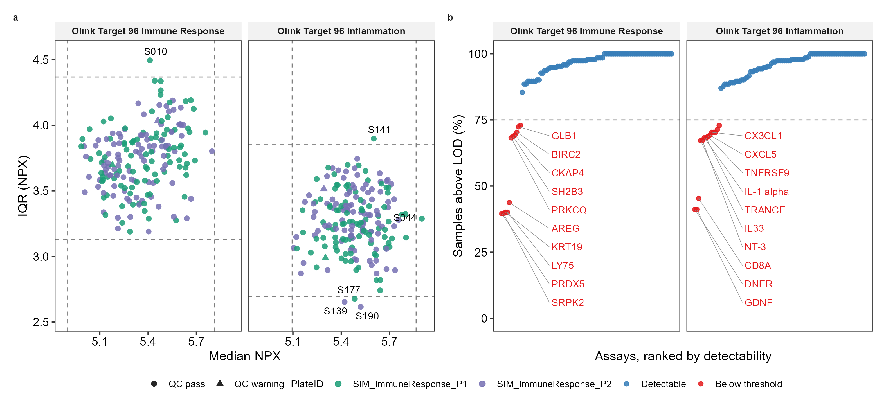

``` r
plot_plate_qc(PROBC)
```

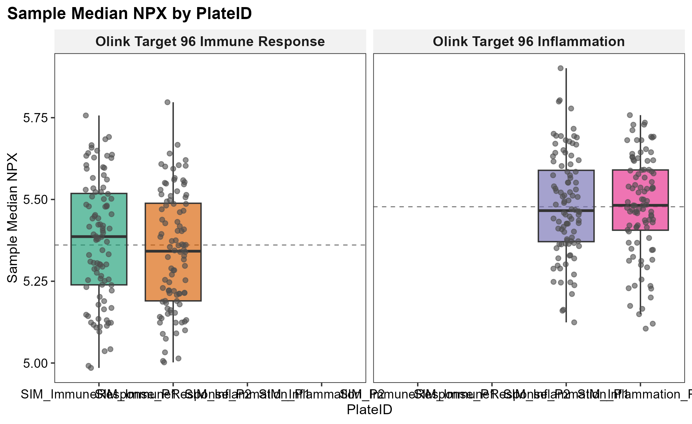

------------------------------------------------------------------------

## 2. Ordination & Clustered Expression

``` r
plot_dim_reduc(base, type = c("pca", "umap"), color = "Project",
               perplexity = 7, seed = 42)
```

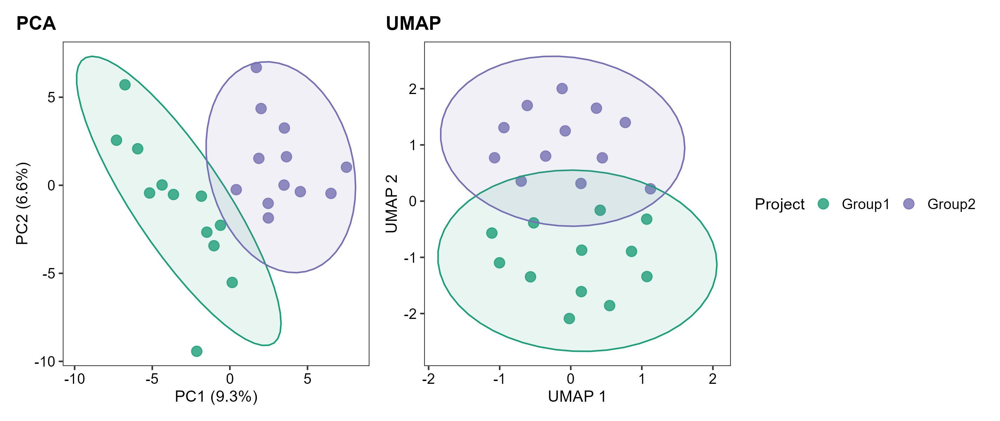

``` r
ps <- plot_scree(base, n_pcs = 10, title = "PROBC Baseline Variance Explained")
pl <- plot_loadings(base, components = 1:2, top_n = 8)
if (requireNamespace("patchwork", quietly = TRUE)) {
  olinkviz_combine(ps, pl, journal = "nature")
} else {
  pl
}
```

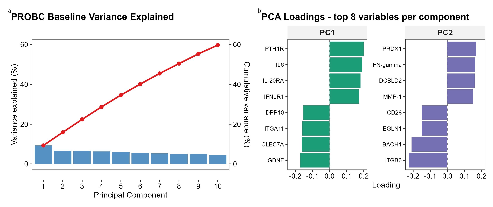

``` r
oe_base <- oe_from_long(base)
plot_heatmap(oe_base, scale = "row", show_rownames = FALSE,
             annotation_rows = "Panel",
             main = "PROBC Baseline Expression Heatmap")
```

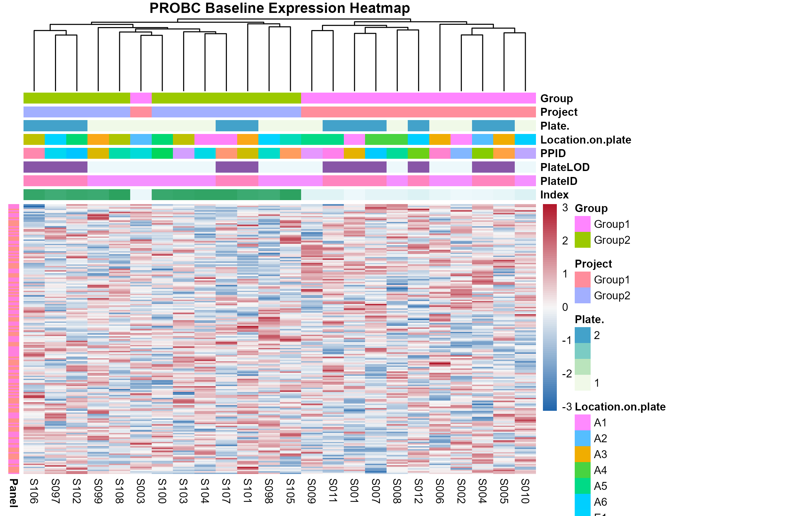

------------------------------------------------------------------------

## 3. Single-Protein Longitudinal Profiles

### 3.1 Mean ± 95% CI Profile Over Time (`plot_mean_profile()`)

``` r
plot_mean_profile(PROBC, assay = c("IL6", "IL4", "CXCL12", "TNF"),
                  x = "Timepoint", group = "Project", show_lod = TRUE)
```

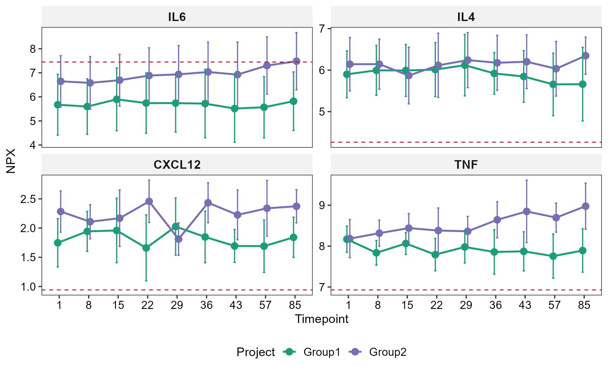

### 3.2 Individual Subject Trajectories (`plot_trajectory()`)

``` r
plot_trajectory(PROBC, assay = "IL6", subject_id = "PPID",
                time = "Time", group = "Project",
                smooth_method = "loess", lod_col = "MaxLOD",
                title = "IL6 Individual Trajectories")
```

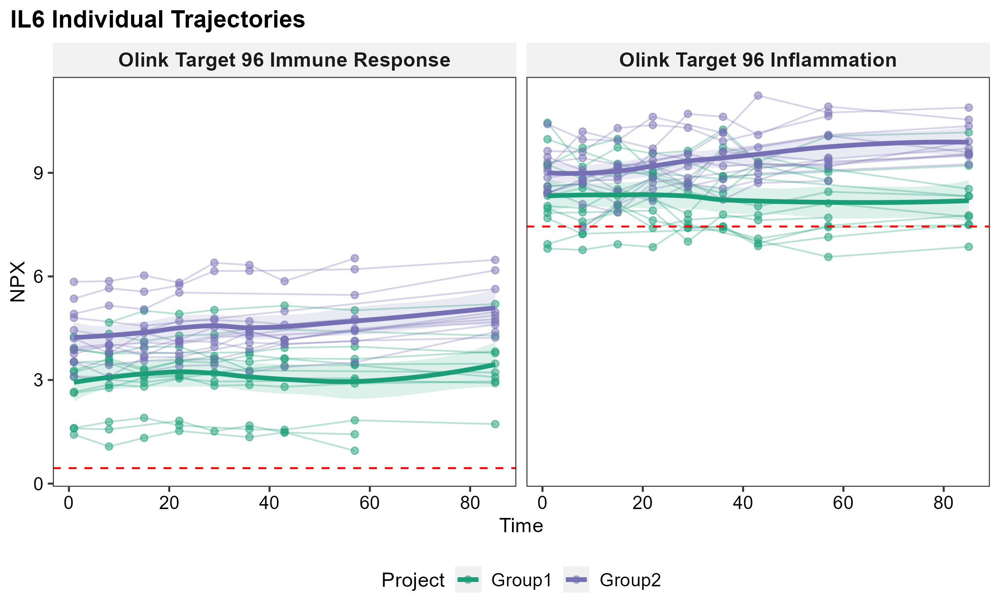

### 3.3 Spaghetti Plot Faceted by Group (`plot_spaghetti()`)

``` r
plot_spaghetti(PROBC, assay = "IL4", subject_id = "PPID",
               time = "Time", facet_by = "Project")
```

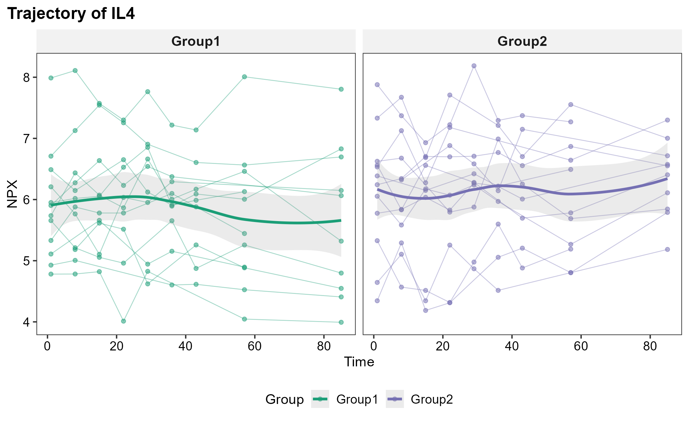

### 3.4 Violin + Boxplot Across Timepoints (`plot_violin()`)

``` r
plot_violin(early_late, assay = "IL6", x = "Timepoint_f",
            group = "Project", show_lod = TRUE, show_significant = TRUE)
```

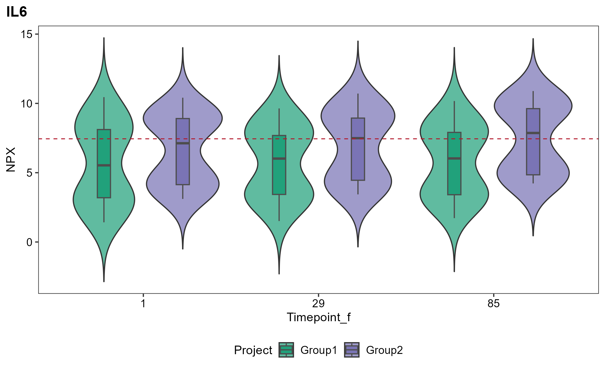

### 3.5 Group Boxplots at Baseline (`plot_boxplot()`)

``` r
plot_boxplot(base, assay = c("IL6", "TNF", "IL4", "CCL11"),
             group = "Project", show_lod = TRUE, show_significant = TRUE)
```

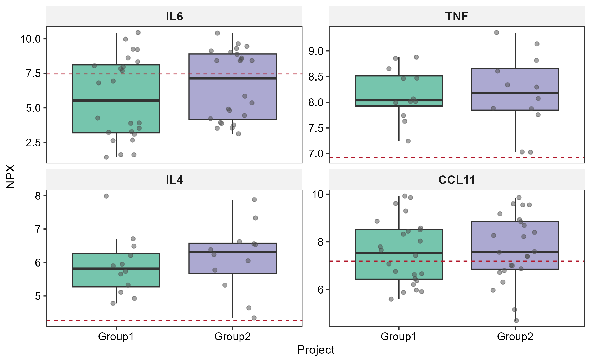

### 3.6 Linear Mixed-Model Point-Range (`plot_lmer()`)

``` r
plot_lmer(early_late, assay = c("IL6", "TNF"),
          x = "Timepoint_f", group = "Project", random = "PPID",
          add_pvalue = requireNamespace("lmerTest", quietly = TRUE))
```

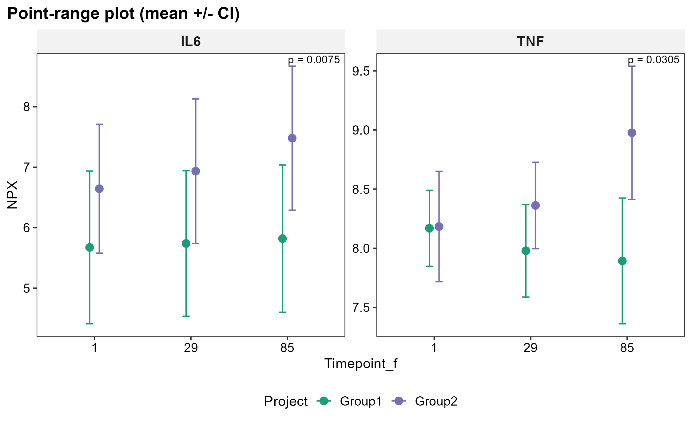

### 3.7 Continuous Regression Smooth (`plot_regression()`)

``` r
plot_regression(PROBC, assay = "IL6", x = "Time",
                color_by = "Project", title = "IL6 Linear Trend Over Time")
```

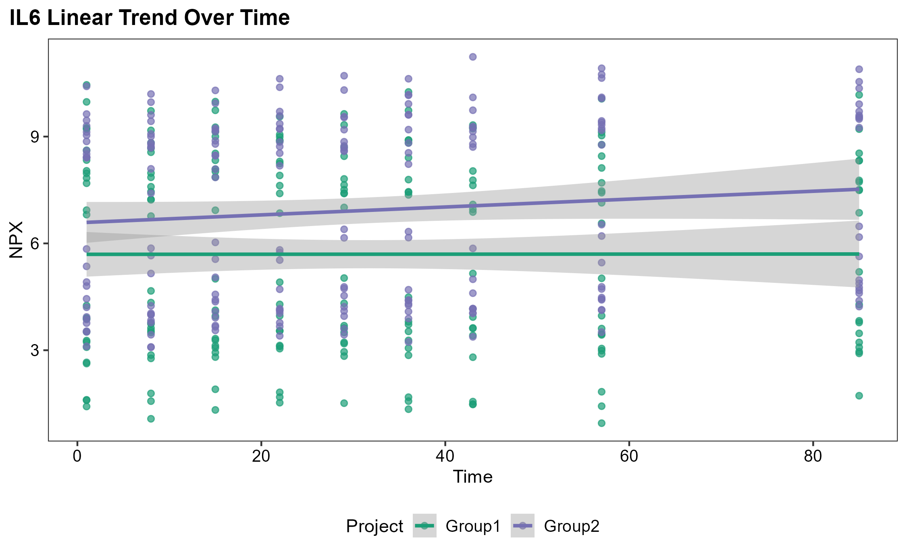

------------------------------------------------------------------------

## 4. Multi-Protein Differential Expression & ROC Analysis

``` r
dt_base <- as.data.table(base)
de_probc <- dt_base[, {
  g1 <- NPX[Project == "Group1"]
  g2 <- NPX[Project == "Group2"]
  tt <- tryCatch(stats::t.test(g2, g1), error = function(e) NULL)
  list(
    MeanNPX   = mean(NPX, na.rm = TRUE),
    estimate  = mean(g2, na.rm = TRUE) - mean(g1, na.rm = TRUE),
    conf.low  = if (is.null(tt)) NA_real_ else tt$conf.int[1],
    conf.high = if (is.null(tt)) NA_real_ else tt$conf.int[2],
    p.value   = if (is.null(tt)) NA_real_ else tt$p.value
  )
}, by = .(Assay, Panel)]
de_probc[, Adjusted_pval := stats::p.adjust(p.value, method = "BH")]
de_probc <- de_probc[order(p.value)]
top_hits <- head(de_probc$Assay, 4)
```

``` r
pv <- plot_volcano(de_probc, pval_col = "p.value", fc_col = "estimate",
                   fc_threshold = 0.3, max_labels = 8,
                   title = "Baseline Volcano (Group2 vs Group1)")
pm <- plot_ma(de_probc, mean_col = "MeanNPX", fc_col = "estimate",
              pval_col = "p.value", fc_threshold = 0.3, max_labels = 8,
              title = "Baseline MA Plot")
if (requireNamespace("patchwork", quietly = TRUE)) {
  olinkviz_combine(pv, pm, journal = "nature")
} else {
  pv
}
```

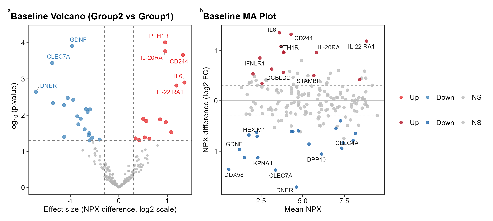

``` r
pd <- plot_dotplot(base, group = "Project", assays = head(de_probc$Assay, 12),
                   title = "Top 12 Baseline Assays")
de_f <- head(de_probc, 12)
de_f[, sig := p.value < 0.05]
pf <- plot_forest(de_f, assay_col = "Assay", estimate_col = "estimate",
                  lower_col = "conf.low", upper_col = "conf.high",
                  sig_col = "sig", title = "Top 12 Effect Sizes (95% CI)")
if (requireNamespace("patchwork", quietly = TRUE)) {
  olinkviz_combine(pd, pf, journal = "nature")
} else {
  pf
}
```

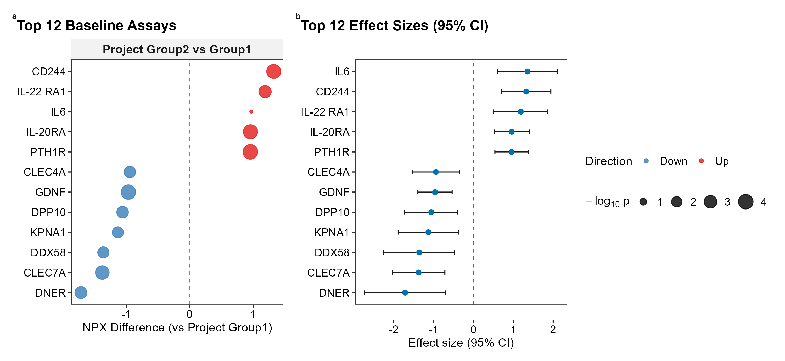

### 4.1 Correlation Matrix (`plot_corr_triangle()`)

``` r
plot_corr_triangle(base, method = "spearman", top_n = 15,
                   title = "PROBC Baseline Correlation Triangle")
```

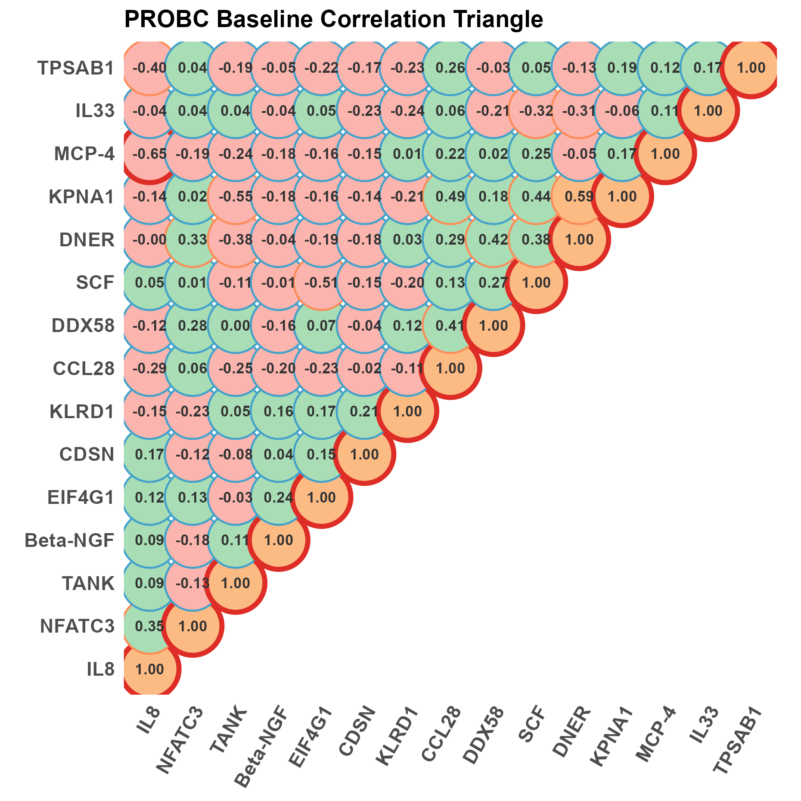

### 4.2 ROC Curves with 95% CI Shade & Paired DeLong Test (`plot_roc()`)

``` r
plot_roc(base, assays = top_hits[1:3], group = "Project",
         add_ci = TRUE, boot_n = 100, show_direction = TRUE,
         compare = TRUE, compare_method = "delong",
         palette = "okabe_ito",
         title = "PROBC Top Baseline Markers (95% CI & DeLong Test)")
```

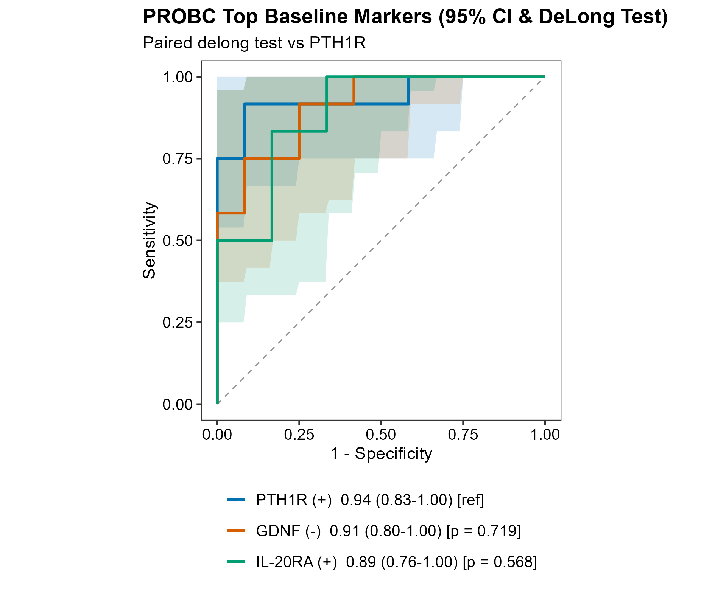
