# 🧬 OlinkViz

### *Visualization Toolkit for Olink Proteomics Data*

  

[](https://lifecycle.r-lib.org/articles/stages.html)
[](https://github.com/vanhungtran/OlinkViz/actions)
[](https://opensource.org/licenses/MIT)
[](https://doi.org/10.5281/zenodo.XXXXXXX)

  

> 🔬 **Ready-made, publication-quality visualizations for Olink NPX
> proteomics data — with 11 curated study datasets and an interactive
> Shiny dashboard.** Volcano plots · Heatmaps · PCA · UMAP · Boxplots ·
> Dot plots · Correlation matrices · Longitudinal trajectories · Sample
> QC · LOD detectability · ROC curves

------------------------------------------------------------------------

## ✨ What is OlinkViz?

You’ve run your Olink assay and have a table of NPX values. Now you need
to **explore, visualize, and communicate** your results — with plots
that are ready for publication, not drafts you’ll have to polish later.

**OlinkViz** gives you a complete visualization toolbox that understands
Olink data structures out of the box:

``` r
library(OlinkViz)

# One line to a publication-ready volcano plot — columns are auto-detected
plot_volcano(bansal_univariate)

# Or explore everything interactively
run_shiny()
```

All plots use a clean, consistent theme and a colorblind-friendly
palette. Every function handles the tedious preprocessing — **wide/long
pivoting, replicate averaging, NA imputation with warnings,
zero-variance filtering** — so you can focus on the biology.

No column arguments needed: `plot_boxplot(npx, assay = "IL6")`,
`plot_heatmap(npx)`, `plot_corr(npx)` and friends detect the standard
Olink columns (assay, NPX, sample ID, group, time, …) automatically. For
non-standard data, override with explicit arguments such as
`group = "condition"` or `pval_col = "pval"`.

Need a figure for a journal? Draw it at its final size instead of
shrinking it: `olinkviz_options(base_size = 7)` sets the text size of
every plot, and `save_olinkviz(p, "fig2a", width = 89)` exports at the
exact column width (see [Journal-Size
Figures](#id_-journal-size-figures)).

------------------------------------------------------------------------

## 🚀 Install

``` r
remotes::install_github("vanhungtran/OlinkViz")
library(OlinkViz)
```

------------------------------------------------------------------------

## 🎨 Gallery

[](https://vanhungtran.github.io/OlinkViz/man/figures/fig_montage.png)

*Six of the nine plot types at a glance*

### Differential Expression

| Volcano Plot | Dot Plot |
|:--:|:--:|
| [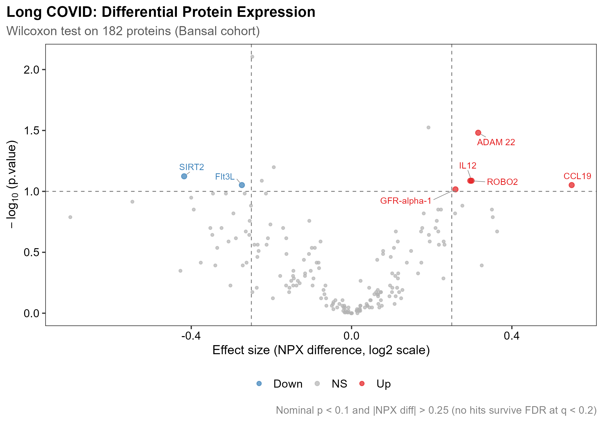](https://vanhungtran.github.io/OlinkViz/man/figures/fig_volcano.png) | [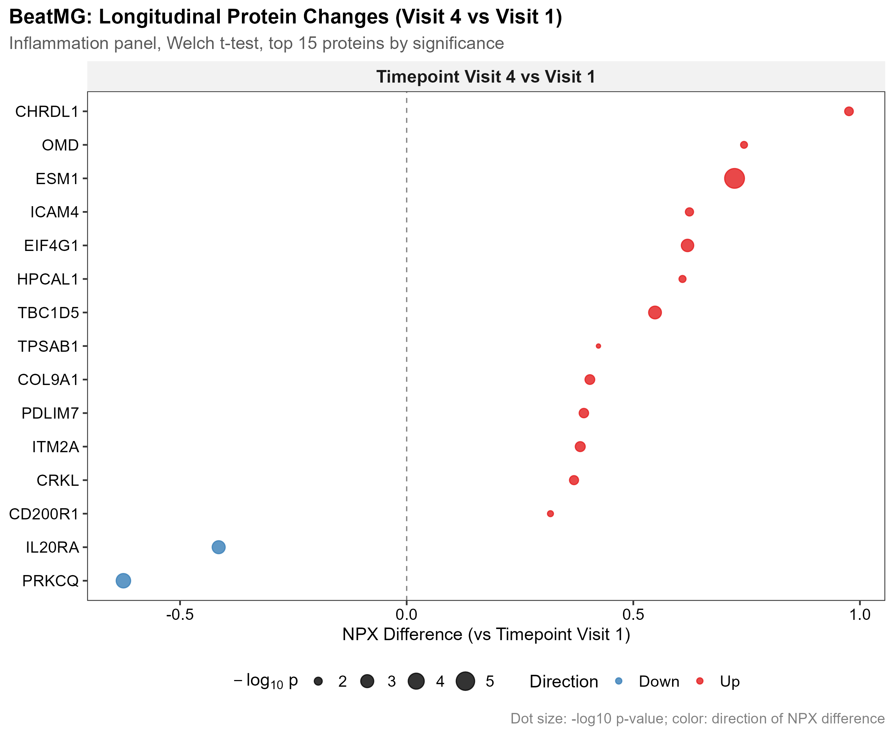](https://vanhungtran.github.io/OlinkViz/man/figures/fig_dotplot.png) |
| *Fold change vs significance — Bansal Long COVID* | *Longitudinal effect sizes × significance (Visit 4 vs 1)* |

### Dimensionality Reduction

| PCA | UMAP |
|:--:|:--:|
| [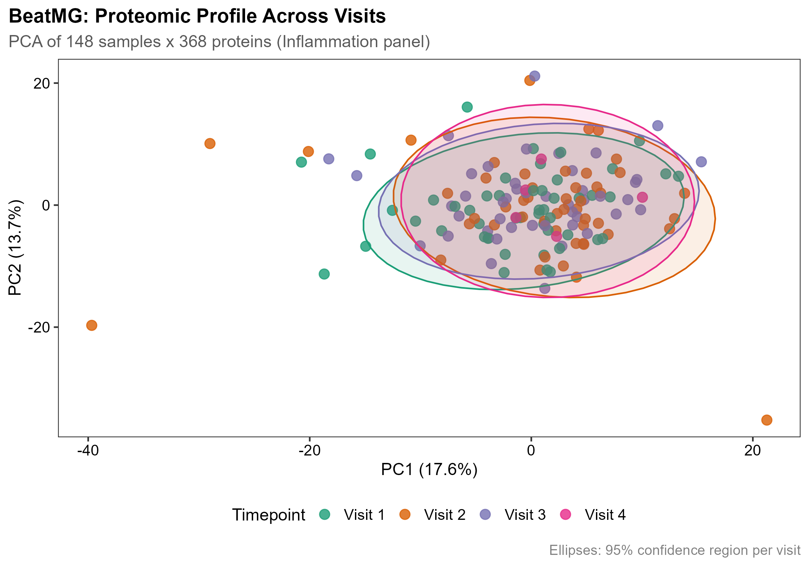](https://vanhungtran.github.io/OlinkViz/man/figures/fig_pca.png) | [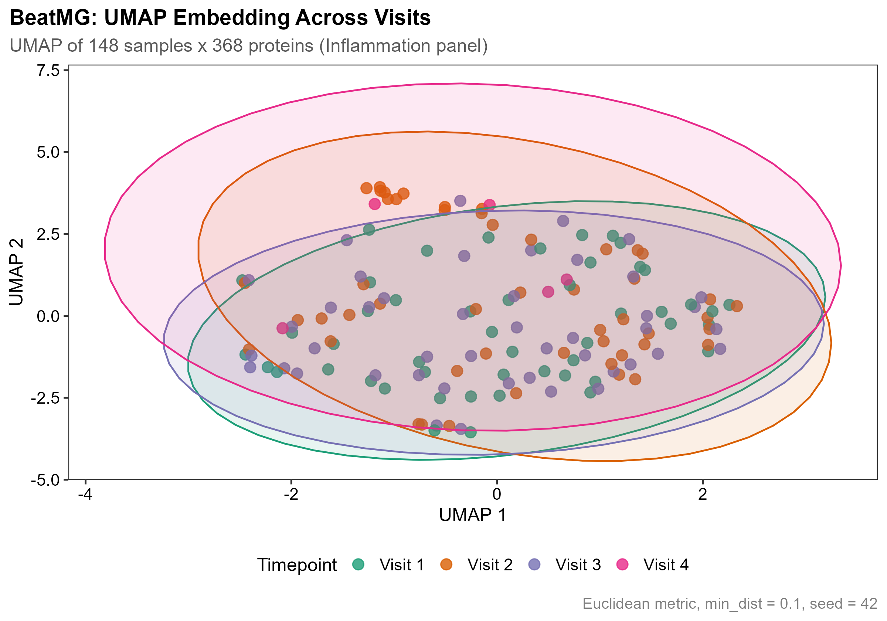](https://vanhungtran.github.io/OlinkViz/man/figures/fig_umap.png) |
| *Linear projection with visit ellipses — BeatMG* | *Non-linear manifold projection — BeatMG* |

### Expression Patterns

| Heatmap | Correlation Matrix |
|:--:|:--:|
| [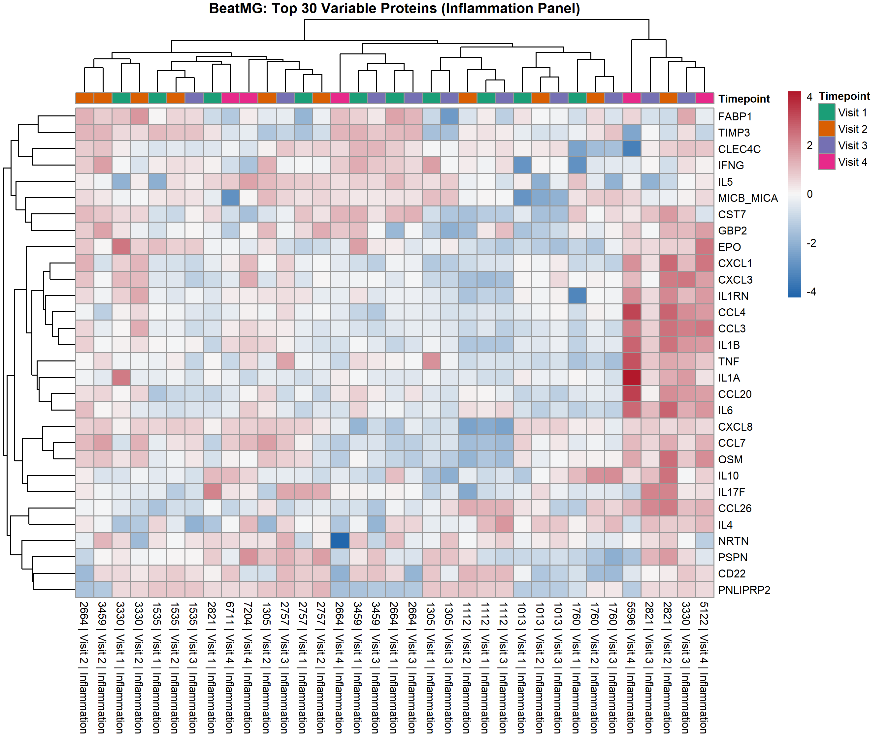](https://vanhungtran.github.io/OlinkViz/man/figures/fig_heatmap.png) | [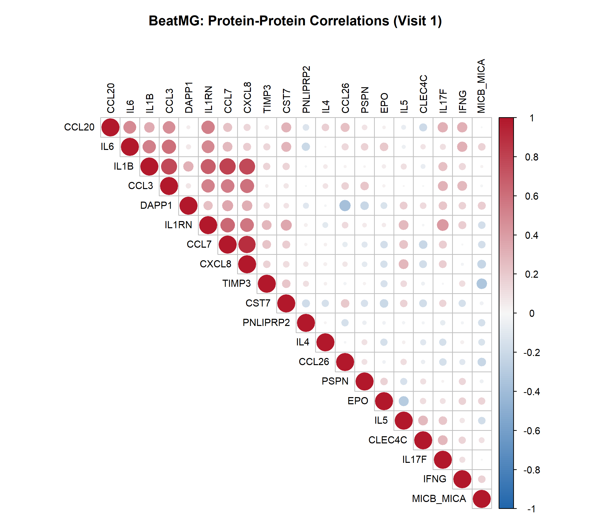](https://vanhungtran.github.io/OlinkViz/man/figures/fig_corr.png) |
| *Top 30 variable proteins, visit annotation* | *Spearman correlations — BeatMG Visit 1* |

### Single-Protein & Longitudinal Views

| Boxplot | Trajectory |
|:--:|:--:|
| [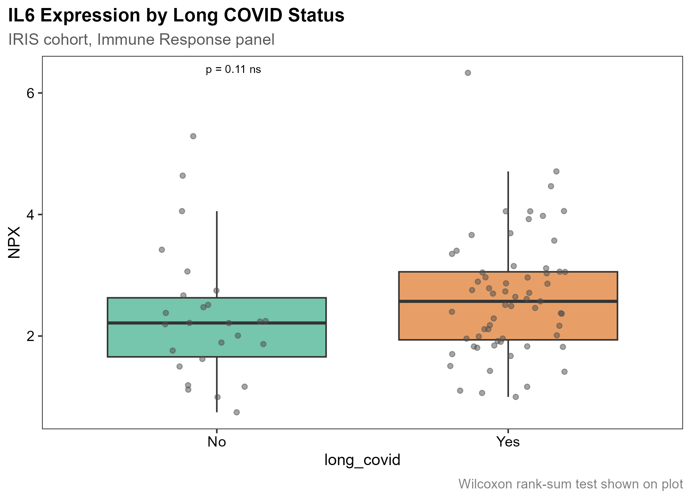](https://vanhungtran.github.io/OlinkViz/man/figures/fig_boxplot.png) | [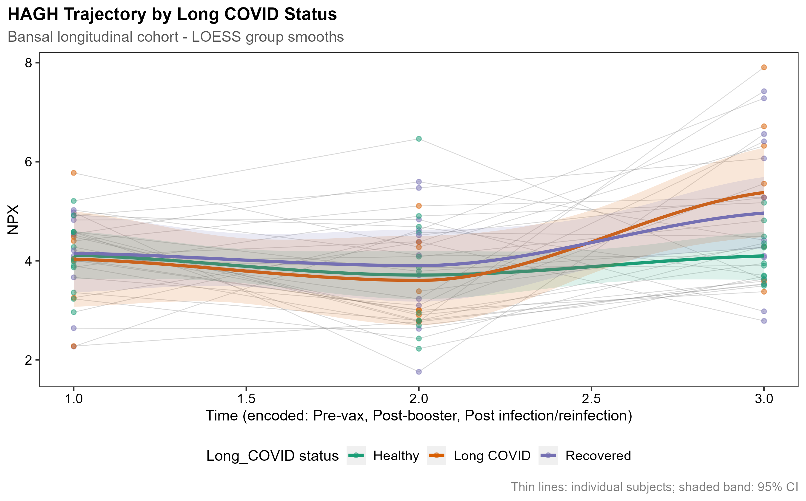](https://vanhungtran.github.io/OlinkViz/man/figures/fig_trajectory.png) |
| *IL6 by Long COVID status with Wilcoxon test* | *HAGH paths + group LOESS smooth — Bansal* |

### Built-in Theme & Palette

[](https://vanhungtran.github.io/OlinkViz/man/figures/fig_timeseries.png)

*Four proteins over time ·
[`theme_olinkviz()`](https://vanhungtran.github.io/OlinkViz/reference/theme_olinkviz.md)
·
[`olinkviz_palette()`](https://vanhungtran.github.io/OlinkViz/reference/olinkviz_palette.md)
— IRIS Long COVID*

------------------------------------------------------------------------

## ✅ Quality Control & Biomarker Performance

Three checks that belong in every Olink analysis, shown here on the
simulated `probc` dataset: sample QC (median NPX versus IQR, outliers
flagged, optional colouring by plate), assay detectability (percent of
samples above the limit of detection) and single-protein ROC curves with
DeLong confidence intervals.

| Sample QC | Assay Detectability |
|:--:|:--:|
| [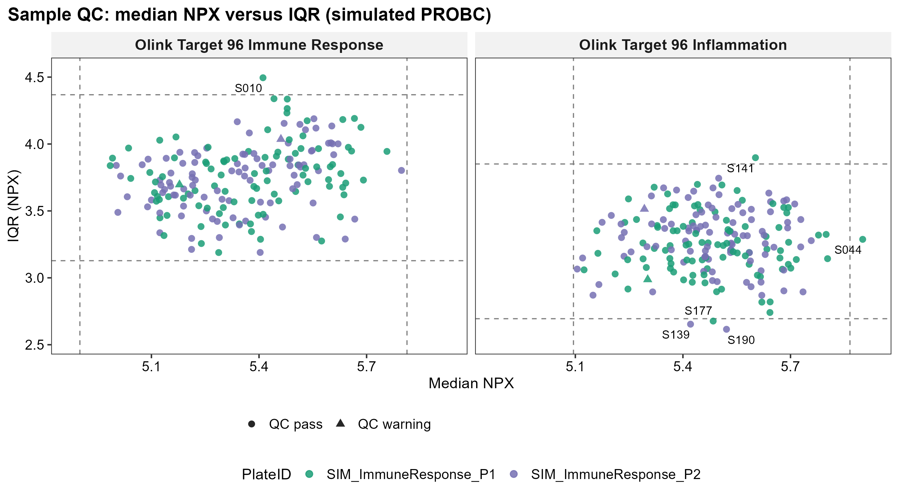](https://vanhungtran.github.io/OlinkViz/man/figures/fig_qc.png) | [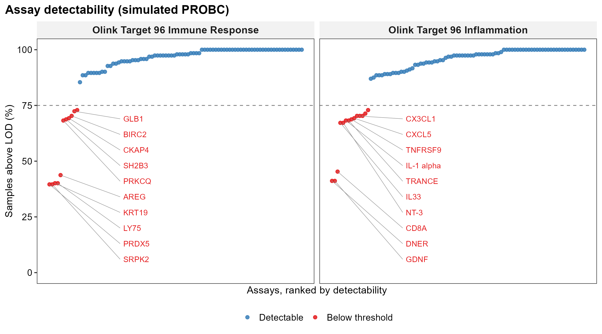](https://vanhungtran.github.io/OlinkViz/man/figures/fig_lod.png) |
| *[`plot_qc()`](https://vanhungtran.github.io/OlinkViz/reference/plot_qc.md): median vs IQR per sample, outliers beyond 2.5 SD labelled* | *[`plot_lod()`](https://vanhungtran.github.io/OlinkViz/reference/plot_lod.md): assays below 75 percent above LOD labelled* |

| Single-Protein ROC |
|:--:|
| [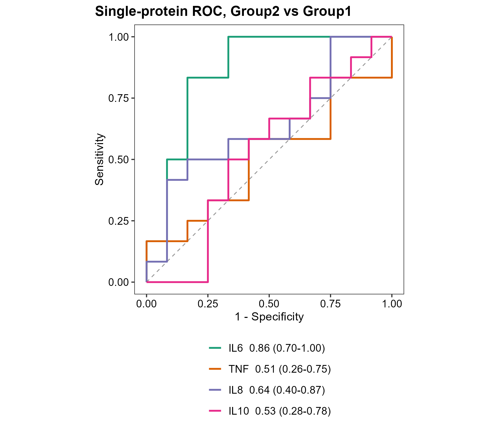](https://vanhungtran.github.io/OlinkViz/man/figures/fig_roc.png) |
| *[`plot_roc()`](https://vanhungtran.github.io/OlinkViz/reference/plot_roc.md): AUC and 95 percent CI in the legend* |

``` r
plot_qc(probc, color_by = "PlateID", sd_cutoff = 2.5)
plot_lod(probc, threshold = 75)
plot_roc(probc[probc$Timepoint == 1, ], assays = c("IL6", "TNF", "IL8"), group = "Project")
```

------------------------------------------------------------------------

## 🖨️ Journal-Size Figures

By default text and marks are sized for the screen (11 pt). A figure
drawn on a large canvas and shrunk to a journal column ends up with text
that is too small, or with labels that collide. Draw it at its final
size instead: one option sets the text size of every `plot_*()`
function, and
[`save_olinkviz()`](https://vanhungtran.github.io/OlinkViz/reference/save_olinkviz.md)
exports at the exact physical size. The figure below is 183 mm wide (a
double column), with 7 pt text and left and bottom axes only; it passes
a rendered text-size and collision audit.

[](https://vanhungtran.github.io/OlinkViz/man/figures/fig_journal_size.png)

*Four panels at 183 mm, 7 pt: PCA, a mean profile, a volcano plot of
per-subject means (FDR), and a boxplot — simulated `probc`*

``` r
old <- olinkviz_options(base_size = 7, axes = "l")   # 7 pt text, left + bottom axes
p <- plot_boxplot(probc, assay = "IL6", group = "Project")
save_olinkviz(p, "il6_boxplot", width = 89, height = 70)   # one column, PDF + PNG
options(old)                                               # back to the defaults
```

Combine panels with `patchwork` and save the whole figure with the same
call;
[`scripts/generate_figures_journal.R`](https://github.com/vanhungtran/OlinkViz/blob/main/scripts/generate_figures_journal.R)
builds the figure above. Tick labels are `base_size - 1`, the smallest
text in a plot, so use 7 for most journals and 9 where the minimum is 8
pt. Any base size below the 11 pt default is journal-size mode: long
titles wrap,
[`plot_corr_triangle()`](https://vanhungtran.github.io/OlinkViz/reference/plot_corr_triangle.md)
fits its circles to a single column, heatmaps with more than 30 samples
(at 7 pt) leave out the sample names, and `-log10` labels are plain text
(a typeset subscript is drawn at 70 percent size, which falls below the
5 to 6 pt minimum most journals ask for). At the default size none of
this applies.
[`plot_heatmap()`](https://vanhungtran.github.io/OlinkViz/reference/plot_heatmap.md)
and
[`plot_corr()`](https://vanhungtran.github.io/OlinkViz/reference/plot_corr.md)
draw with base graphics: open the device yourself (for example
[`grDevices::cairo_pdf()`](https://rdrr.io/r/grDevices/cairo.html)),
call the function, and close it.

------------------------------------------------------------------------

## 📖 Paper-Inspired Analyses

[](https://vanhungtran.github.io/OlinkViz/man/figures/fig_montage_paper.png)

*Recreating the visualization strategy of Al-Nesf et al. (Nat Commun
2022)*

The figures below recreate the visualization strategy of [*Al-Nesf et
al. (2022), “Prognostic tools and candidate drugs based on plasma
proteomics of patients with severe COVID-19 complications”, Nature
Communications
13:2406*](https://www.nature.com/articles/s41467-022-28639-4) — applied
to the datasets bundled with OlinkViz. The paper profiled 893 plasma
proteins with Olink panels and used ROC curves, unsupervised clustering,
PCA, correlation networks and feature selection to build a 12-protein
COVID-19 severity signature. Each figure maps one of those ideas onto
the bundled cohorts.

### Classification & Model Performance *(paper Fig. 1a, 5c)*

| Per-Panel DEP Counts & ROC | 12-Protein Signature ROC |
|:--:|:--:|
| [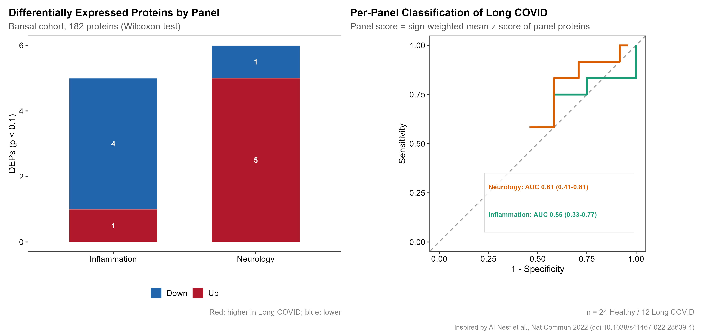](https://vanhungtran.github.io/OlinkViz/man/figures/fig_panel_roc.png) | [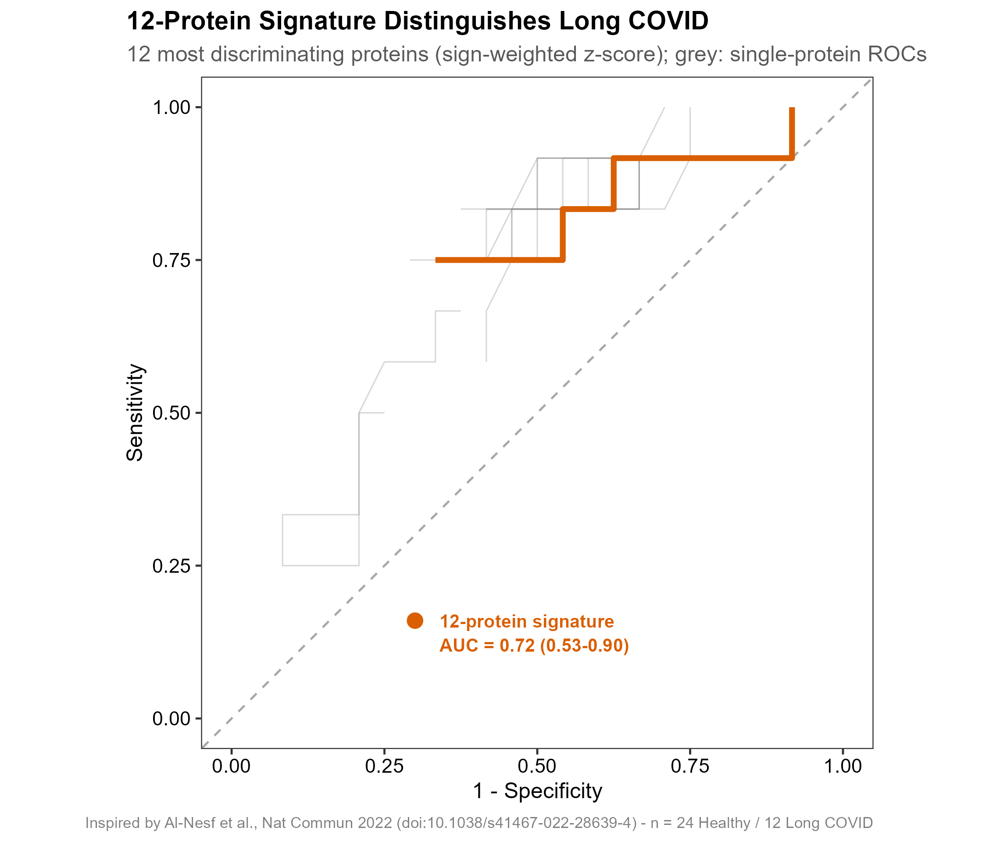](https://vanhungtran.github.io/OlinkViz/man/figures/fig_sig_roc.png) |
| *DEP counts per panel + per-panel ROC with AUC — Bansal* | *Sign-weighted 12-protein signature ROC vs Healthy — Bansal* |

### Unsupervised Structure *(paper Fig. 1b)*

| Clustering Heatmap | PCA by Group |
|:--:|:--:|
| [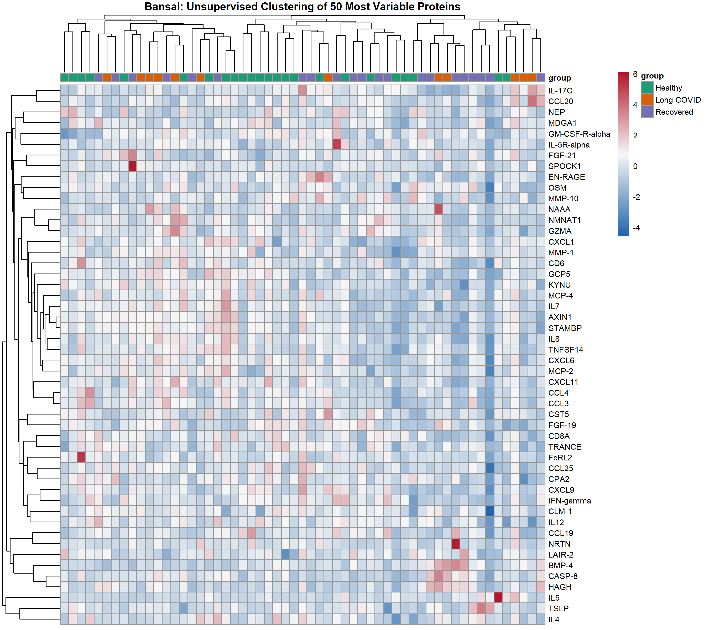](https://vanhungtran.github.io/OlinkViz/man/figures/fig_cluster_heatmap.png) | [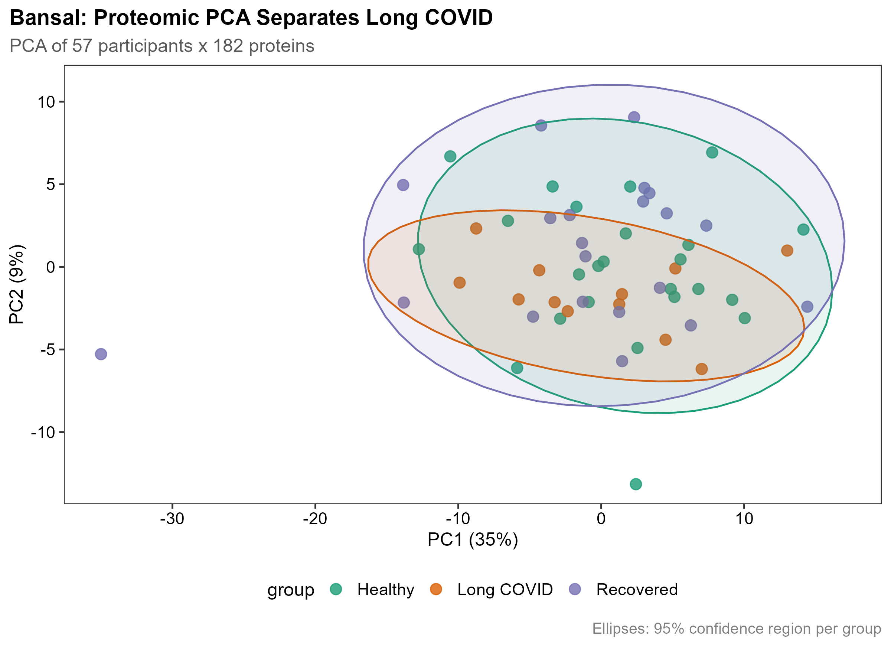](https://vanhungtran.github.io/OlinkViz/man/figures/fig_pca_groups.png) |
| *Z-score heatmap, correlation distance + average linkage* | *PCA separates Long COVID from Healthy / Recovered — Bansal* |

### Deregulation & Clinical Correlations *(paper Fig. 2, 3)*

| Deregulated Protein Bubble Plot | Protein × Clinical Marker Correlations |
|:--:|:--:|
| [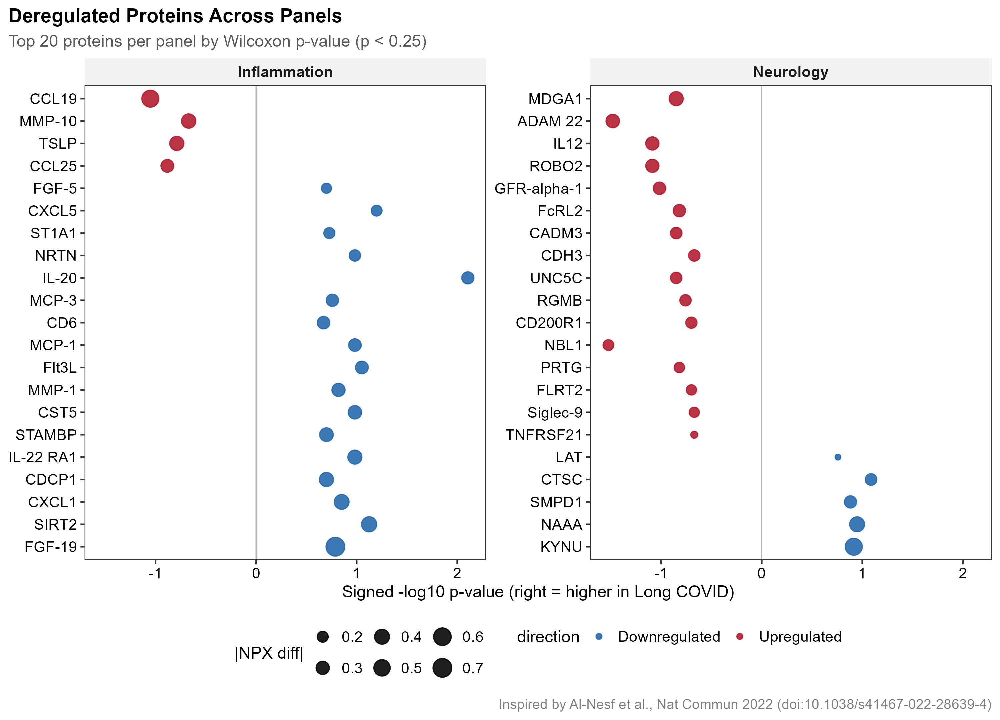](https://vanhungtran.github.io/OlinkViz/man/figures/fig_dereg_bubble.png) | [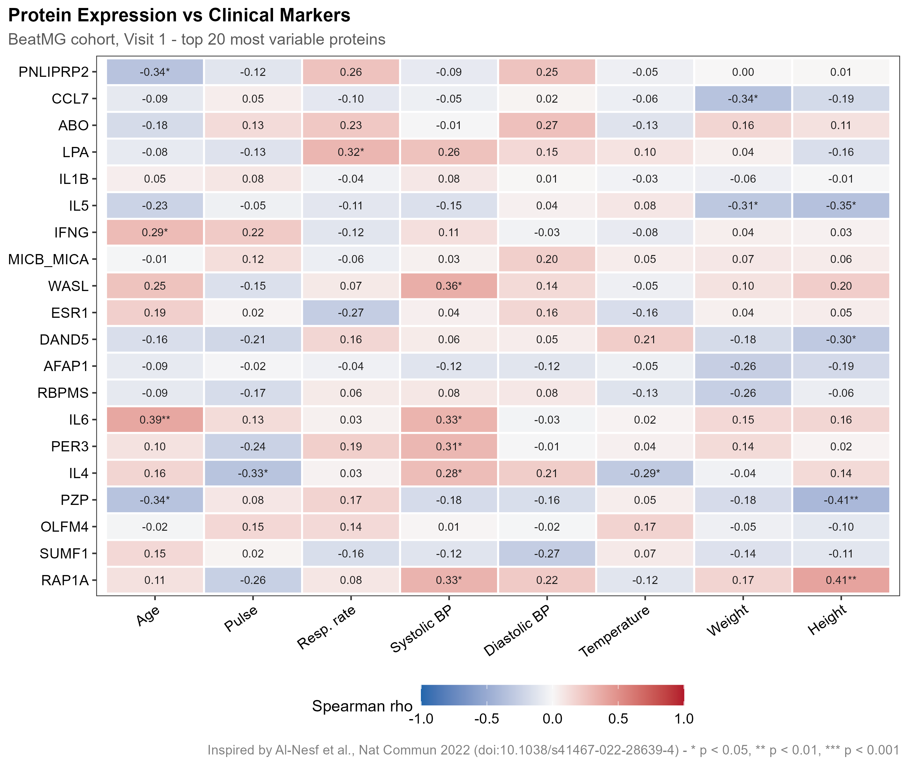](https://vanhungtran.github.io/OlinkViz/man/figures/fig_clinical_corr.png) |
| *Signed -log10 p bubble plot per panel — Bansal* | *Spearman rho of top proteins vs vital signs — BeatMG* |

### Networks & Dynamics *(paper Fig. 4/5b, 6b, 7a)*

| Protein Correlation Network | Mean ± SEM Time Curves | Group Boxplots |
|:--:|:--:|:--:|
| [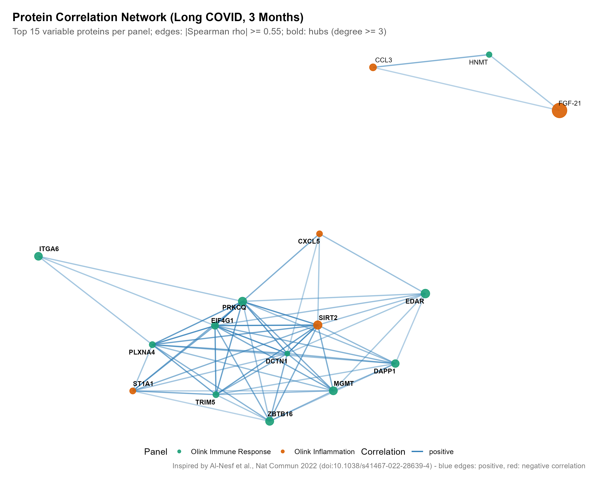](https://vanhungtran.github.io/OlinkViz/man/figures/fig_protein_network.png) | [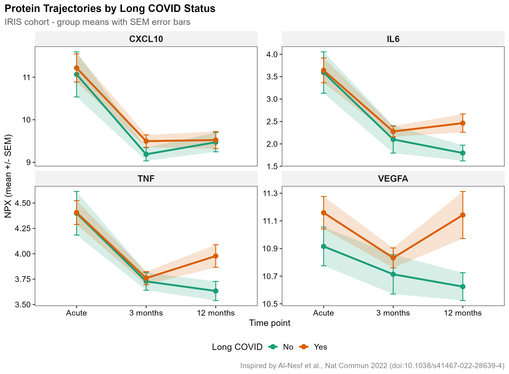](https://vanhungtran.github.io/OlinkViz/man/figures/fig_timecurve.png) | [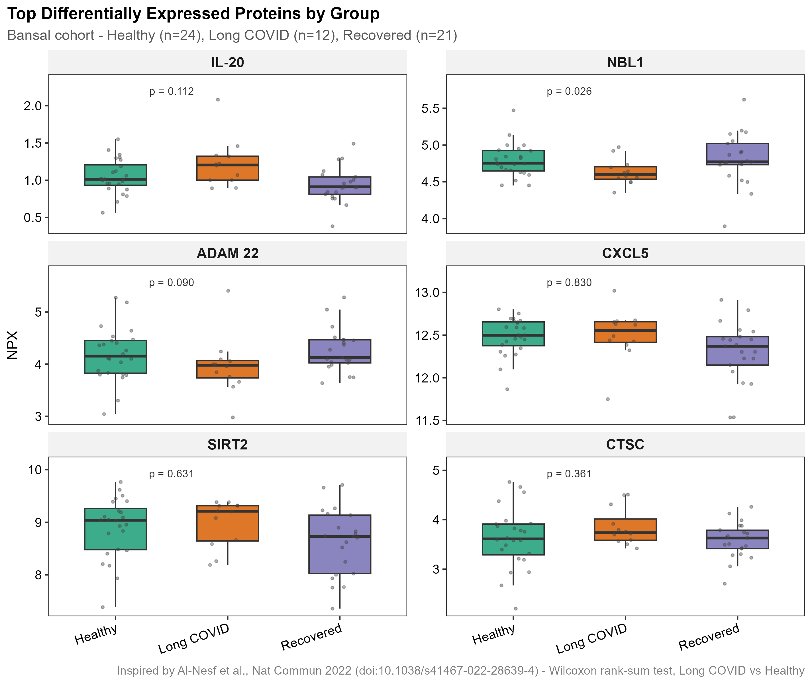](https://vanhungtran.github.io/OlinkViz/man/figures/fig_boxplots.png) |
| *Correlation network of top proteins — IRIS* | *Protein trajectories by Long COVID status — IRIS* | *Top DE proteins across groups — Bansal* |

Reproduce every figure with
[`scripts/generate_figures_paper.R`](https://github.com/vanhungtran/OlinkViz/blob/main/scripts/generate_figures_paper.R),
or step through the code in the
[vignette](https://vanhungtran.github.io/OlinkViz/articles/OlinkViz.html#recreating-a-nature-communications-analysis).

------------------------------------------------------------------------

## 🫀 Cardiometabolic Biomarker Analyses

The second template comes from [*Tan et al. (2025), “Identification of
Cardiometabolic Protein Biomarkers for Acute Myocardial Infarction Using
Olink Proteomics”, Journal of Inflammation
Research*](https://www.dovepress.com/identification-of-cardiometabolic-protein-biomarkers-for-acute-myocard-peer-reviewed-fulltext-article-JIR),
which profiled 92 cardiometabolic proteins in AMI patients versus
controls and combined differential expression with GO/KEGG enrichment,
STRING protein-protein interaction networks, correlation networks
linking proteins to clinical indicators, and combined ROC curves for
core biomarkers. The figures below reproduce those analyses on the
bundled cohorts — GO/KEGG enrichment and the PPI network use the live
gProfiler and STRING web APIs.

| Clinical Indicators by Group | Top DEP Heatmap |
|:--:|:--:|
| [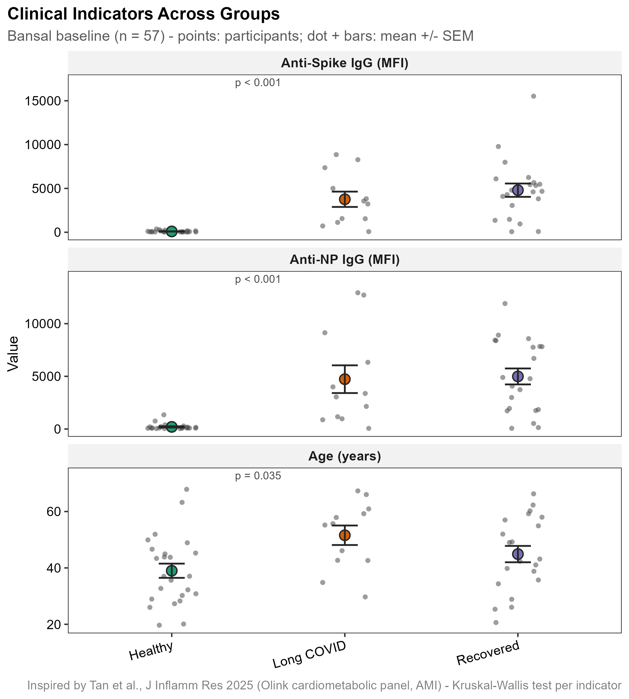](https://vanhungtran.github.io/OlinkViz/man/figures/fig_clinical_dash.png) | [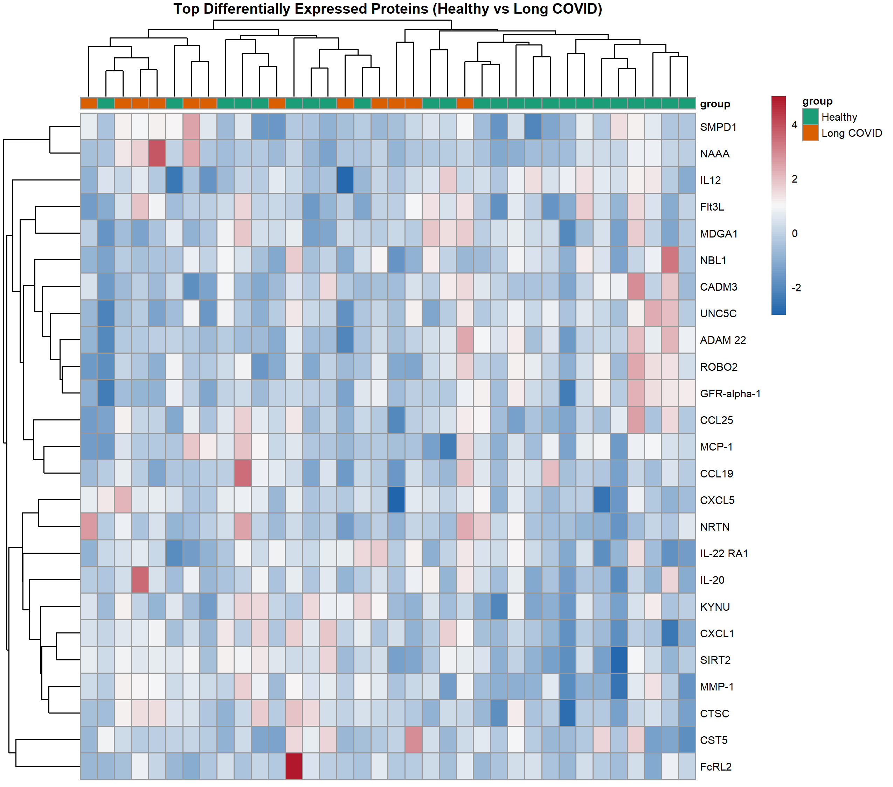](https://vanhungtran.github.io/OlinkViz/man/figures/fig_dep_heatmap.png) |
| *Age & antibody titers across groups, mean ± SEM — Bansal* | *Top 25 differentially expressed proteins — Bansal* |

| GO & KEGG Enrichment | STRING PPI Network |
|:--:|:--:|
| [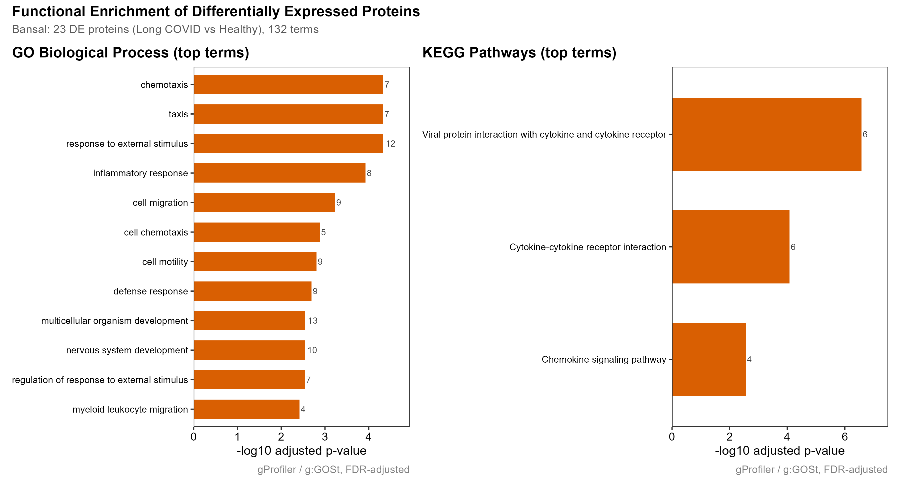](https://vanhungtran.github.io/OlinkViz/man/figures/fig_enrichment.png) | [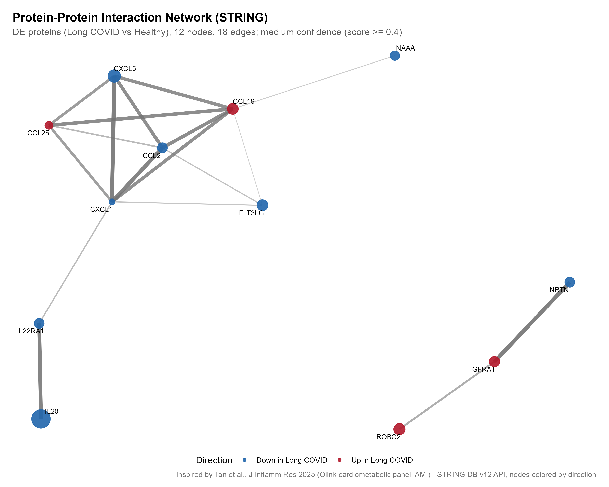](https://vanhungtran.github.io/OlinkViz/man/figures/fig_ppi_network.png) |
| *gProfiler <GO:BP> + KEGG of DE proteins* | *STRING medium-confidence interactions, colored by direction* |

| Protein–Clinical Correlation Network | Core-Protein ROC Curves |
|:--:|:--:|
| [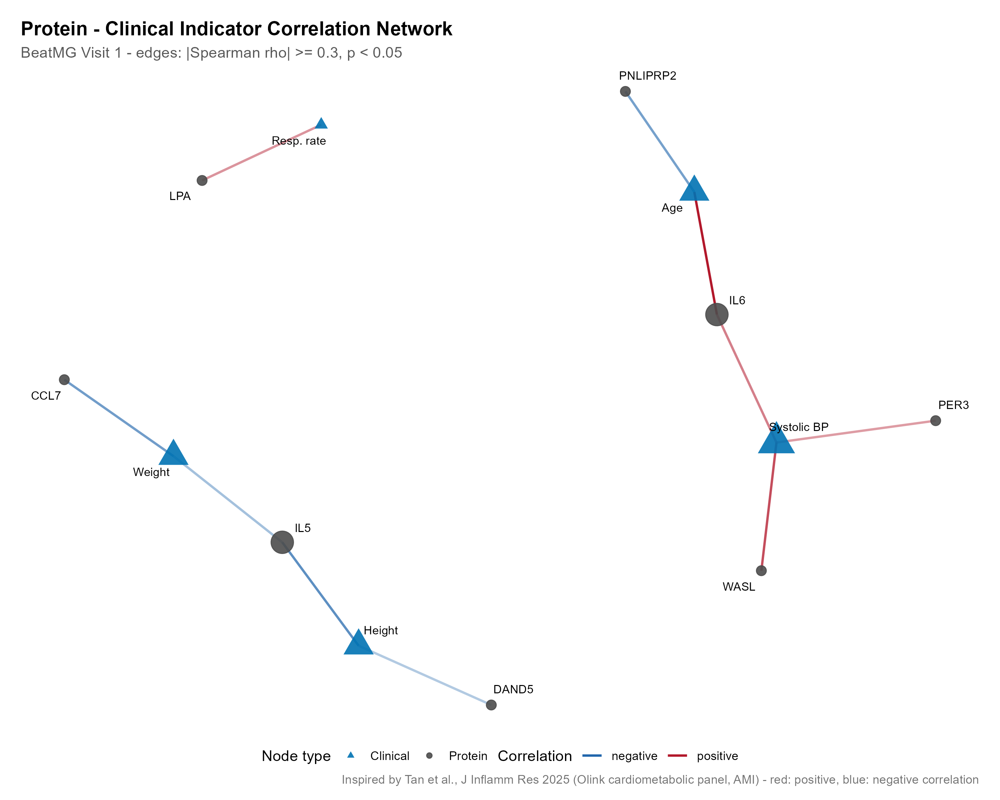](https://vanhungtran.github.io/OlinkViz/man/figures/fig_corr_network.png) | [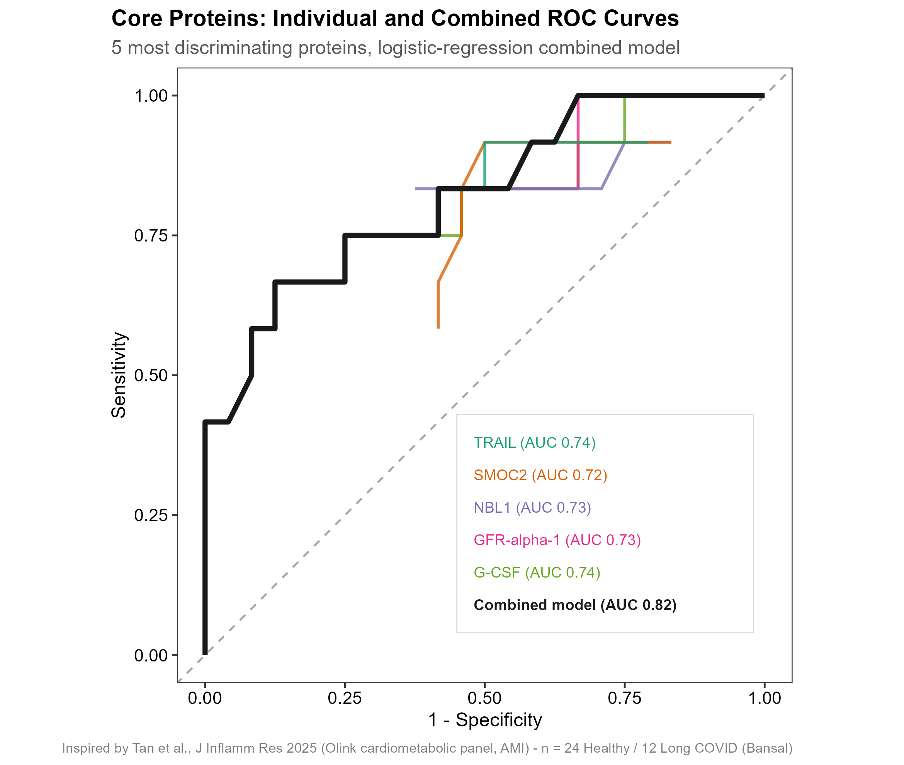](https://vanhungtran.github.io/OlinkViz/man/figures/fig_core_roc.png) |
| *Bipartite protein × vital-sign network — BeatMG* | *Individual + combined ROC for 5 core proteins — Bansal* |

Reproduce every figure with
[`scripts/generate_figures_jir.R`](https://github.com/vanhungtran/OlinkViz/blob/main/scripts/generate_figures_jir.R),
or step through the code in the
[vignette](https://vanhungtran.github.io/OlinkViz/articles/OlinkViz.html#cardiometabolic-biomarker-analyses).

------------------------------------------------------------------------

## 🧬 ALS Phenoconversion Biomarker Analyses

The third template comes from [*Ran X, Wuu J, Qin ZS, et al., Benatar M.
(2026), “Longitudinal plasma proteomics predict phenoconversion to
clinically manifest ALS”, Nature Medicine 32,
3417-3429*](https://doi.org/10.1038/s41591-026-04528-x), which used
longitudinal Olink Explore HT proteomics (516 samples, 137 participants)
from asymptomatic carriers of ALS-associated gene variants to find a
19-protein panel predicting “phenoconversion” — transition to clinically
manifest disease — up to 5 years ahead of symptom onset, via volcano
plots, direction-split pathway enrichment, a protein/functional-module
network, time-resolved heatmaps, Kaplan-Meier curves, ROC curves, an
UpSet plot of predictive proteins, and a cross-cohort replication
scatterplot. OlinkViz has no genetic-carrier ALS cohort, so the figures
below map the same ideas onto the one bundled dataset with a *real*
observed state transition over time: IRIS Long COVID participants who
are Long-COVID-positive at the 3-month visit sometimes resolve by 12
months (11 of 23 with follow-up, confirmed from the raw data). Same
underlying question — do early biomarkers anticipate a later change in
clinical state? — opposite direction (recovery, not onset).

| Disease-State Volcano | Pathway Enrichment by Direction |
|:--:|:--:|
| [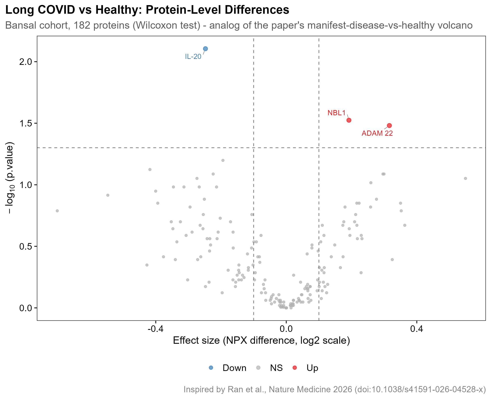](https://vanhungtran.github.io/OlinkViz/man/figures/fig_disease_volcano.png) | [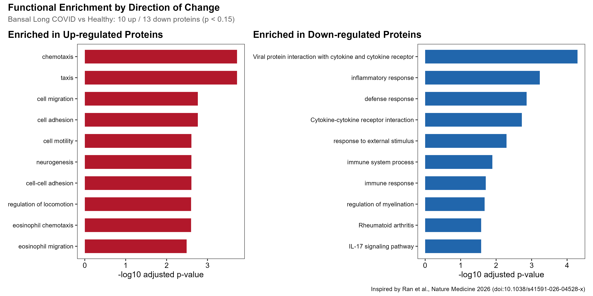](https://vanhungtran.github.io/OlinkViz/man/figures/fig_pathway_direction.png) |
| *Long COVID vs Healthy — Bansal* | *GO/KEGG terms enriched among up- vs down-regulated proteins* |

| Functional Module Network | Pre/Post Resolution Heatmap |
|:--:|:--:|
| [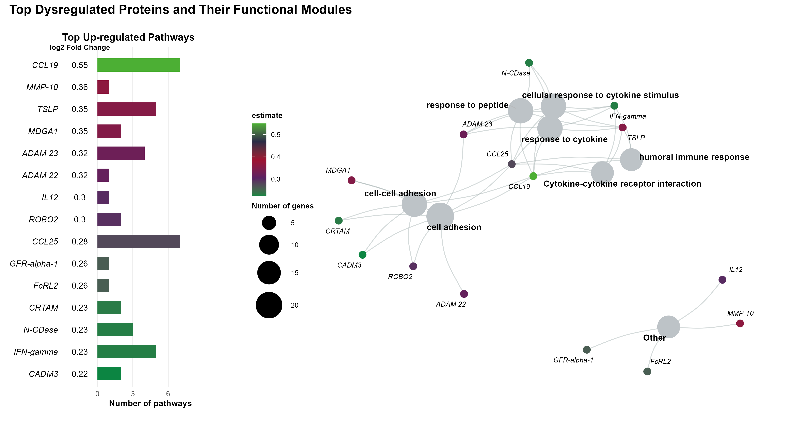](https://vanhungtran.github.io/OlinkViz/man/figures/fig_module_network.png) | [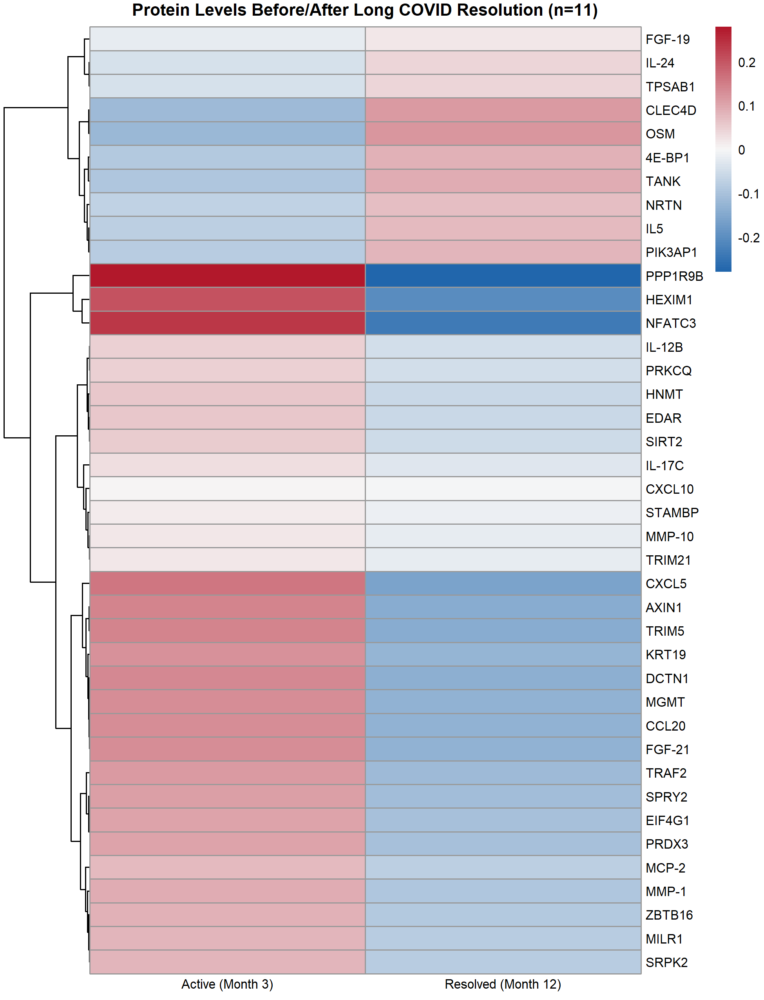](https://vanhungtran.github.io/OlinkViz/man/figures/fig_resolution_heatmap.png) |
| *Top dysregulated proteins by Olink panel — Bansal* | *Protein levels before/after Long COVID resolution — IRIS* |

| Protein Trajectories | Resolution Kaplan-Meier |
|:--:|:--:|
| [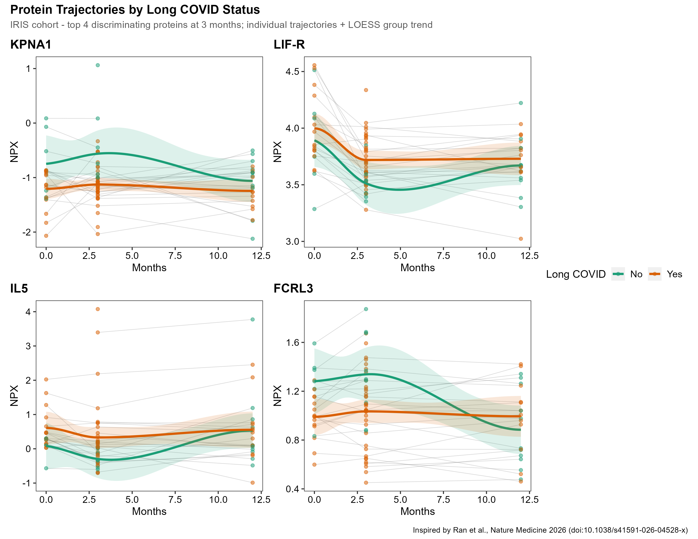](https://vanhungtran.github.io/OlinkViz/man/figures/fig_protein_trajectories.png) | [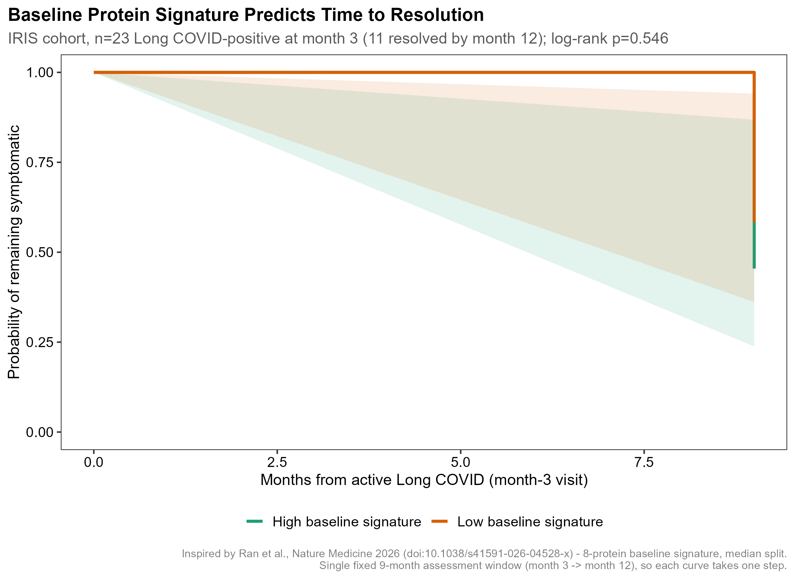](https://vanhungtran.github.io/OlinkViz/man/figures/fig_km_resolution.png) |
| *Top 4 discriminating proteins over time — IRIS* | *Baseline signature vs time to resolution — IRIS* |

| Resolution ROC + Protein Overlap | Cross-Cohort Replication |
|:--:|:--:|
| [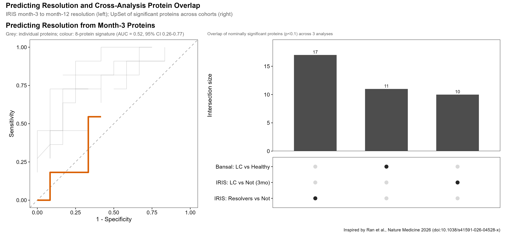](https://vanhungtran.github.io/OlinkViz/man/figures/fig_roc_upset.png) | [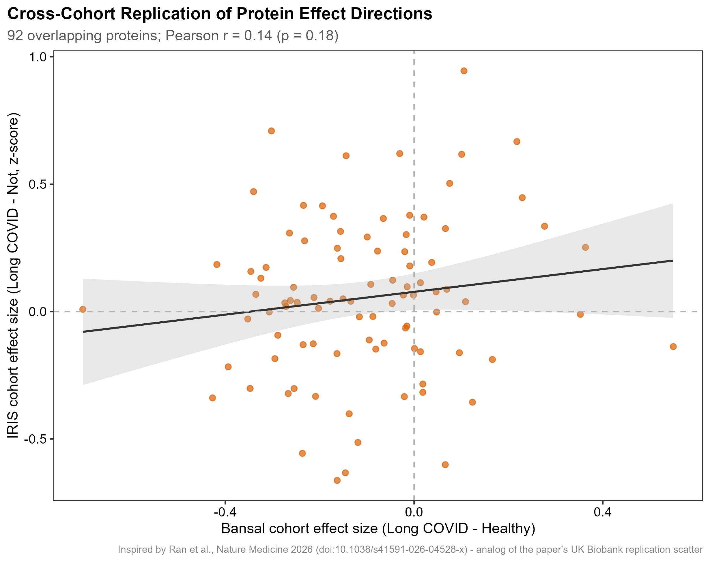](https://vanhungtran.github.io/OlinkViz/man/figures/fig_replication_scatter.png) |
| *8-protein ROC \| UpSet of significant proteins across 3 analyses — IRIS* | *IRIS vs Bansal per-protein effect-size correlation* |

Reproduce every figure with
[`scripts/generate_figures_natmed.R`](https://github.com/vanhungtran/OlinkViz/blob/main/scripts/generate_figures_natmed.R),
or step through the code in the
[vignette](https://vanhungtran.github.io/OlinkViz/articles/OlinkViz.html#als-phenoconversion-biomarker-analyses).

------------------------------------------------------------------------

## 🧪 Quick Reference

[TABLE]

------------------------------------------------------------------------

## 📦 Bundled Datasets

11 curated Olink datasets from published studies are bundled with the
package:

| Dataset | Study | Proteins | Samples | Description |
|----|----|:--:|:--:|----|
| `iris_longcovid` | IRIS — [10.5281/zenodo.13363117](https://doi.org/10.5281/zenodo.13363117) | 180 | ~2,300 | Long COVID (7 time points) |
| `bansal_baseline57` | Bansal — [10.1038/s43856-026-01541-6](https://doi.org/10.1038/s43856-026-01541-6) | 182 | 57 | Long COVID baseline |
| `bansal_longitudinal` | Bansal — [10.1038/s43856-026-01541-6](https://doi.org/10.1038/s43856-026-01541-6) | 182 | 34 | Long COVID paired longitudinal |
| `bansal_univariate` | Bansal — [10.1038/s43856-026-01541-6](https://doi.org/10.1038/s43856-026-01541-6) | 182 | — | Per-protein Wilcoxon results |
| `beatmg_npx` | BeatMG — [10.1212/WNL.0000000000013121](https://doi.org/10.1212/WNL.0000000000013121) | 738 | ~2,000 | Myasthenia Gravis NPX |
| `beatmg_npx_merged` | BeatMG — [10.1212/WNL.0000000000013121](https://doi.org/10.1212/WNL.0000000000013121) | 738 | ~2,000 | MG NPX + demographics |
| `beatmg_demo` | BeatMG — [10.1212/WNL.0000000000013121](https://doi.org/10.1212/WNL.0000000000013121) | — | 52 | MG clinical variables |
| `pcnsl_olink` | PCNSL — [10.5281/zenodo.20815686](https://doi.org/10.5281/zenodo.20815686) | 1,007 | 172 | Primary CNS lymphoma |
| `qinfeng_npx` | Song 2025 — [10.1007/s00011-025-02020-9](https://doi.org/10.1007/s00011-025-02020-9) | 92 | 66 | Tuberculosis biomarkers |
| `tofa_data` | TOFA — [10.7554/elife.99323](https://doi.org/10.7554/elife.99323) | Multiple | — | Down Syndrome NPX |
| `tofa_dictionary` | TOFA — [10.7554/elife.99323](https://doi.org/10.7554/elife.99323) | — | — | TOFA variable dictionary |
| `probc` | NUMAB project B (simulated) | 184 | 192 | Simulated 2-group longitudinal NPX |

``` r
data(package = "OlinkViz")   # list all datasets
?iris_longcovid               # dataset documentation
```

------------------------------------------------------------------------

## 🛠️ Data Utilities

| Function | What it does |
|----|----|
| [`validate_npx()`](https://vanhungtran.github.io/OlinkViz/reference/validate_npx.md) | Check data has required NPX columns (assay, value, sample) |
| [`to_wide()`](https://vanhungtran.github.io/OlinkViz/reference/to_wide.md) | Long → wide format with replicate averaging and metadata preservation |
| [`to_long()`](https://vanhungtran.github.io/OlinkViz/reference/to_long.md) | Wide → long format with auto-detection of protein columns |
| [`theme_olinkviz()`](https://vanhungtran.github.io/OlinkViz/reference/theme_olinkviz.md) | Clean, publication-ready ggplot2 theme (`base_size` and `axes` follow the options below) |
| [`olinkviz_options()`](https://vanhungtran.github.io/OlinkViz/reference/olinkviz_options.md) | Set the text size and axis style of every plot, e.g. `base_size = 7` for a journal column |
| [`save_olinkviz()`](https://vanhungtran.github.io/OlinkViz/reference/save_olinkviz.md) | Save a plot at an exact physical size (mm, cm or in) as PDF, PNG, SVG and/or TIFF |
| [`olinkviz_palette()`](https://vanhungtran.github.io/OlinkViz/reference/olinkviz_palette.md) | Colorblind-friendly categorical palette (Dark2 + interpolation) |
| [`run_shiny()`](https://vanhungtran.github.io/OlinkViz/reference/run_shiny.md) | Launch interactive Shiny dashboard |

``` r
# Validate your data
validate_npx(my_data)

# Convert between formats
wide <- to_wide(long_data)
long <- to_long(wide, id_cols = "SampleID")
```

------------------------------------------------------------------------

## 🖥️ Interactive Shiny App

``` r
OlinkViz::run_shiny()
```

- Browse all 11 built-in datasets with variable descriptions
- Upload your own CSV or Excel NPX files
- Select from 8 plot types with adjustable parameters
- Filter by assay, timepoint, and group
- Download publication-ready plots as PNG or PDF

------------------------------------------------------------------------

## 📖 Vignettes

| Vignette | What you’ll learn |
|----|----|
| [Getting Started](https://vanhungtran.github.io/OlinkViz/articles/OlinkViz.html) | Installation, first plots, data utilities, complete workflow |

------------------------------------------------------------------------

## 📖 Citation

If you use `OlinkViz` in your work, please cite:

``` bibtex
@software{tran2026olinkviz,
  author    = {{Lucas VHH TRAN}},
  title     = {OlinkViz: Visualization Toolkit for Olink Proteomics Data},
  year      = {2026},
  publisher = {Zenodo},
  version   = {0.1.0},
  doi       = {10.5281/zenodo.XXXXXXX}
}
```

------------------------------------------------------------------------

## 🤝 Contributing

Bug reports, feature requests, and pull requests are welcome. See
[CONTRIBUTING.md](https://vanhungtran.github.io/OlinkViz/CONTRIBUTING.md)
and the [Code of
Conduct](https://vanhungtran.github.io/OlinkViz/CODE_OF_CONDUCT.md).

------------------------------------------------------------------------

## 📜 License

MIT © 2025 Lucas VHH TRAN. See
[LICENSE.md](https://vanhungtran.github.io/OlinkViz/LICENSE.md).

------------------------------------------------------------------------

  
*Built with 🧬 and 📊 for the Olink proteomics community.*  
  
